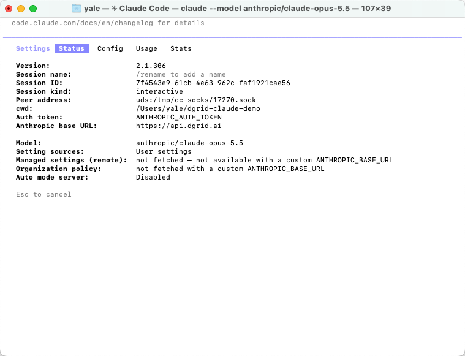
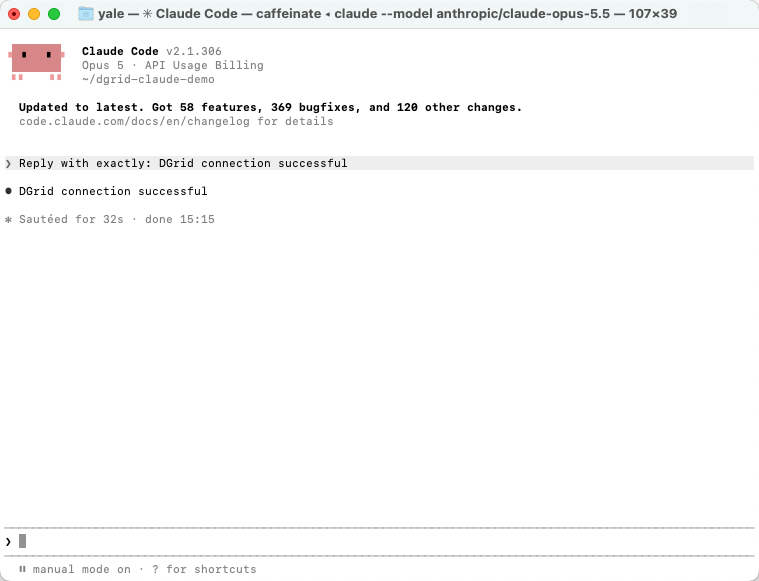
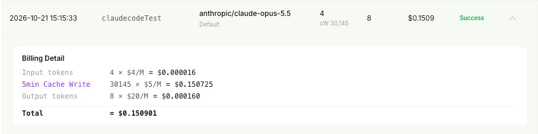
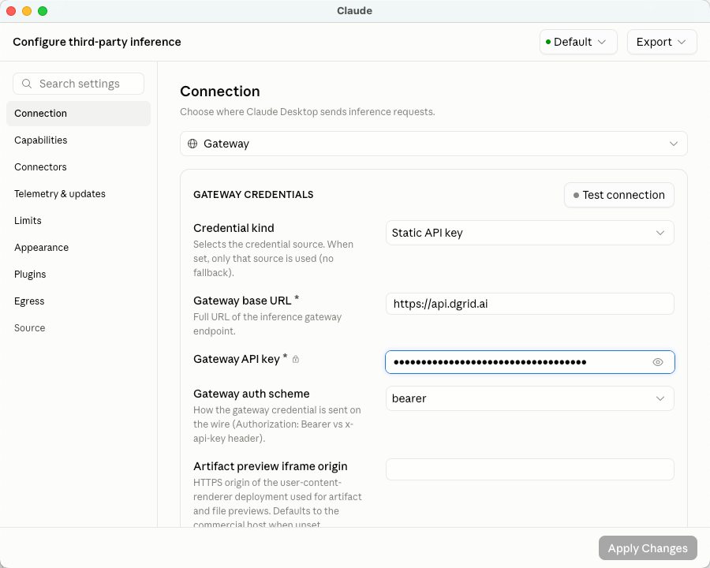
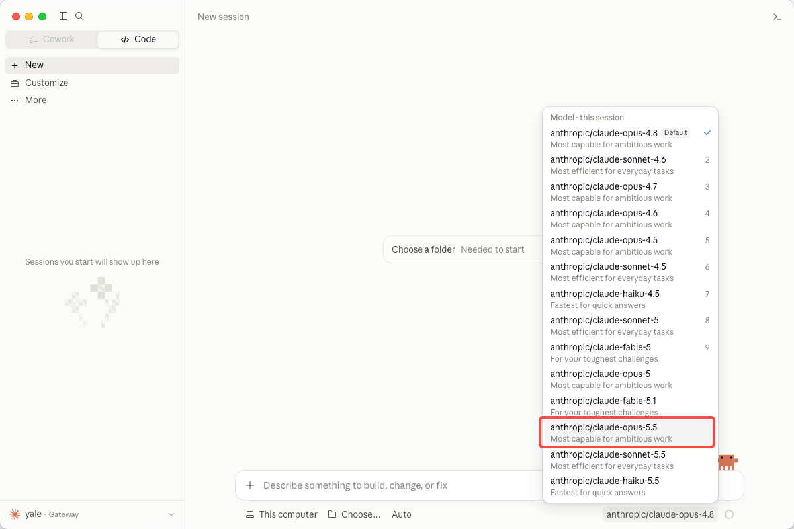
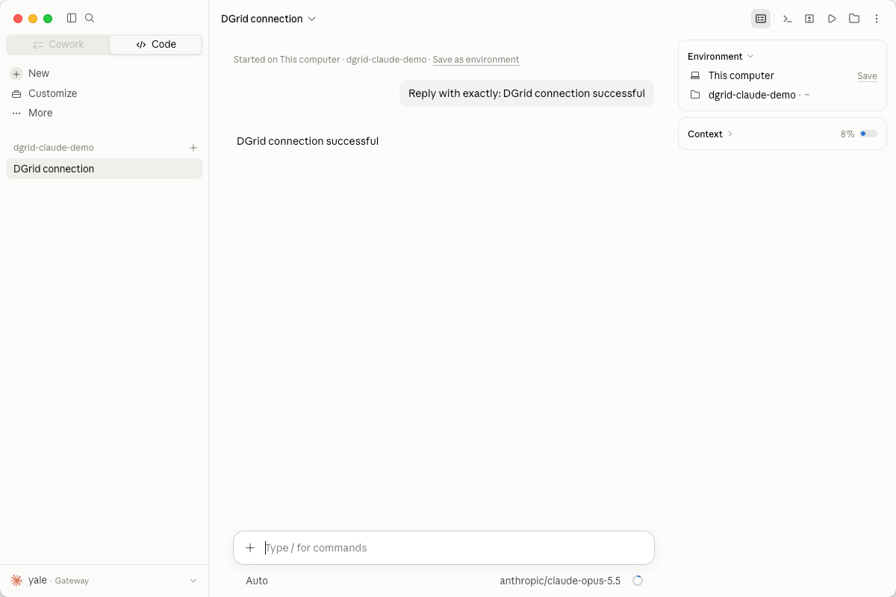

<Info>
Use a DGrid Model API Key for model requests. A Management API Key is an administrative credential and cannot be used for this tutorial. Check that your key has available credits and access to the selected model.
</Info>

Connect Claude Code to DGrid with your DGrid API key, the gateway URL, and a Claude model available to your key. This guide covers macOS Terminal first, followed by an alternative setup in the Claude desktop app's **Code** tab.

The example model is `anthropic/claude-opus-5.5`. Use its complete DGrid model ID, including `anthropic/`. You can substitute another available Claude model throughout the guide.

## Before you start

- A macOS computer with an internet connection. The Terminal commands below use Zsh, the default macOS shell.
- A [DGrid account](https://dgrid.ai/) with available credits and access to your chosen Claude model.
- For the npm installation method: **Node.js 22 or later and npm**. Installation instructions are included below.

The CLI screenshots show Claude Code `2.1.306`. Menus and model availability may differ in other versions. The desktop setup is independent: you can follow that section without completing the CLI installation.

## Step 1 Create a DGrid API key and select a model

1. Sign in to [DGrid](https://dgrid.ai/) and open [API Keys](https://dgrid.ai/api-keys).
2. Click **Create New Key**, name it, and create the key.
3. Copy the key for the configuration steps below. Keep the full key out of screenshots and shared files.
4. In DGrid's model list, find an available Claude model and copy its complete model ID. This guide uses `anthropic/claude-opus-5.5`.

The connection settings are:

| Setting | Value |
| --- | --- |
| Base URL | `https://api.dgrid.ai` |
| Credential | Your DGrid API key |
| Example model ID | `anthropic/claude-opus-5.5` |

**Do not add `/v1` or `/v1/messages` to the base URL.** Claude Code adds the Messages API path when sending requests.

<Tabs>
<Tab title="CLI">

### Step 2 Install Claude Code


If Claude Code is already installed, run `claude --version` and continue to Step 3 if it prints a version number.

#### Install with npm

First check whether Node.js and npm are available:

```zsh
node -v
npm -v
```

If either command is missing, or Node.js is older than 22, install the current **LTS** version from the [Node.js download page](https://nodejs.org/en/download). Choose the macOS installer, which includes npm. Open a new Terminal window after installation and run the two commands again.

Install Claude Code into your user directory:

```zsh
npm install -g @anthropic-ai/claude-code --prefix "$HOME/.local"
```

Add the installation directory to this terminal's PATH and check the version:

```zsh
export PATH="$HOME/.local/bin:$PATH"
claude --version
```

No `sudo` is needed for this user-directory installation. To make the PATH setting available in new terminals, add the same `export PATH` line to `~/.zshrc` with a text editor.

#### Alternative: native installer

You can instead use the [official native installer](https://code.claude.com/docs/en/setup#install-claude-code). This method does not require a separate Node.js installation:

```zsh
curl -fsSL https://claude.ai/install.sh | bash
```

After installation, open a new terminal and check `claude --version`. If the command is unavailable, add `~/.local/bin` to PATH using the command above. Choose one installation method. If the script URL returns HTML or fails to download, use the npm method after installing Node.js.

### Step 3 Configure DGrid in the current terminal

Run this block in Zsh. Its final command prompts for the key without displaying your input:

```zsh
export ANTHROPIC_BASE_URL="https://api.dgrid.ai"
unset ANTHROPIC_API_KEY
export ANTHROPIC_AUTH_TOKEN
read -rs "ANTHROPIC_AUTH_TOKEN?Paste your DGrid API key (hidden): "
```

At **Paste your DGrid API key (hidden):**, paste your DGrid API key and press Enter. The terminal returns to its prompt; the key remains hidden.

Continue in this same terminal so Claude Code inherits the variables. These settings apply to this terminal session. For a new terminal, repeat this step or use the optional project settings below.

If you previously configured another provider, its settings may still apply. An `unset` command removes a shell variable but does not remove an entry from a settings file. Check the effective connection in Step 5; see Troubleshooting if another credential is detected.

### Step 4 Start Claude Code

Create a separate folder for your first session, then start Claude Code with the complete DGrid model ID:

```zsh
mkdir -p "$HOME/dgrid-claude-demo"
cd "$HOME/dgrid-claude-demo"
claude --model "anthropic/claude-opus-5.5"
```

If Claude Code asks whether you trust this folder, check the path and select **Yes, I trust this folder** for the folder you just created. Complete any first-launch appearance prompts.

### Step 5 Check the active connection

Inside Claude Code, enter:

```text
/status
```

The **Status** tab should show:

| Status field | Expected value |
| --- | --- |
| Auth token | `ANTHROPIC_AUTH_TOKEN` |
| Anthropic base URL | `https://api.dgrid.ai` |
| Model | `anthropic/claude-opus-5.5` |

<Frame caption="Claude Code Status showing the DGrid URL, token source, and selected model">
  
</Frame>

If you chose another Claude model, check for that complete model ID instead. Press Esc to return to the conversation.

### Step 6 Send your first message

Enter:

```text
Reply with exactly: DGrid connection successful
```

Press Enter and wait for the reply:

```text
DGrid connection successful
```

<Frame caption="A successful reply in Claude Code Terminal">
  
</Frame>

You can now continue using Claude Code through DGrid. To view usage, open DGrid's request history and find the corresponding model and request time. A completed request is marked **Success**.

<Frame caption="A completed Claude model request in DGrid">
  
</Frame>

Token counts and charges depend on the request. The screenshot is one example, including its cache-write usage.

#### Optional: save settings for this project

To reuse the connection without entering shell variables each time, configure `.claude/settings.local.json` inside your project. Before creating it, add `.claude/settings.local.json` to the project's `.gitignore` so the credential stays out of version control.

Create or edit the local settings file, replacing the placeholder with your DGrid key:

```json
{
  "env": {
    "ANTHROPIC_BASE_URL": "https://api.dgrid.ai",
    "ANTHROPIC_AUTH_TOKEN": "<your-dgrid-api-key>",
    "ANTHROPIC_API_KEY": ""
  },
  "model": "anthropic/claude-opus-5.5"
}
```

Merge these fields with any existing local settings. This stores the key in a local file; keep that file private. In a new terminal, enter the project folder and run `claude`. Use `/status` to check the active settings again. See the [official gateway settings guidance](https://code.claude.com/docs/en/llm-gateway-connect#set-in-a-settings-file) for configuration scopes.

</Tab>
<Tab title="Desktop">

Claude Code is also available in the Claude desktop app's **Code** tab. Configure its gateway separately from the CLI. Terminal environment variables do not configure the desktop app's third-party inference connection.

### 1 Open third-party inference settings

1. Download and install the [Claude desktop app](https://claude.com/download) for macOS, then open it.
2. In the macOS menu bar, choose **Help → Troubleshooting → Enable Developer Mode**.
3. If prompted, allow the app to restart. Then choose **Developer → Configure Third-Party Inference…**.
4. If an existing gateway error offers **Open Setup**, that button also opens the configuration window.

If the Developer menu disappears after applying your first third-party configuration, enable Developer Mode again from Help. The [official in-app configuration guide](https://claude.com/docs/third-party/claude-desktop/in-app-configuration) describes this behavior and the local Apply Changes option.

### 2 Enter the DGrid connection details

Open **Connection** and use these values:

| Field | Enter or select |
| --- | --- |
| Inference provider | **Gateway** |
| Credential kind | **Static API key** |
| Gateway base URL | `https://api.dgrid.ai` |
| Gateway API key | Your DGrid API key |
| Gateway auth scheme | **bearer** |

Leave **Artifact preview iframe origin** at its default for this setup. Keep the key hidden using the eye icon before taking screenshots.

<Frame caption="DGrid gateway connection settings in the Claude desktop app">
  
</Frame>

Click **Apply Changes** to apply the configuration locally. The app restarts. You can also use **Test connection** in the settings window to inspect connectivity; if it fails, open the error details and check the reported model and response.

### 3 Select the model and start a local session

1. Open the **Code** tab and start a new session.
2. Select **This computer** as the environment if an environment selector is shown.
3. Open the model picker and select **`anthropic/claude-opus-5.5`**, or your chosen available Claude model.
4. Click **Choose a folder** or the project-folder control and select `dgrid-claude-demo`. If you skipped the CLI setup, create and select a new folder of your own.

<Frame caption="Select the complete DGrid Claude model ID in the desktop model picker">
  
</Frame>

Send:

```text
Reply with exactly: DGrid connection successful
```

Wait for the response. The model name below the input box should match your selection.

<Frame caption="A successful DGrid reply in the Claude desktop Code tab">
  
</Frame>

You can continue working in this desktop session using DGrid.

</Tab>
</Tabs>

## Troubleshooting

### The terminal says command not found or permission denied

Check which command the shell finds:

```zsh
type -a claude
```

For the user-directory installation above, make sure `~/.local/bin` is on PATH. You can check the installed launcher directly:

```zsh
"$HOME/.local/bin/claude" --version
```

If it is missing or cannot run, review the installer output and complete a successful installation before configuring the gateway. See [Claude Code installation troubleshooting](https://code.claude.com/docs/en/troubleshooting).

### Claude Code detects another API key or shows the wrong gateway

Existing user or project settings can contain provider variables. If a first-launch prompt offers an old `ANTHROPIC_API_KEY` you do not intend to use, choose **No** for that key, then run `/status` to confirm the DGrid URL, the `ANTHROPIC_AUTH_TOKEN` source, and your model.

If the status is wrong, review the `env` entries in `~/.claude/settings.json`, `.claude/settings.json`, and `.claude/settings.local.json`, along with any provider-switching tool you use. Settings-file values can override shell exports. Change the relevant provider fields or use the project-local configuration above, preserving unrelated settings. Restart the session and check `/status` again.

### A request fails with an authentication or model error

Check the DGrid key, available credits, and access to the selected Claude model. Use the complete DGrid model ID rather than assuming a built-in model alias matches DGrid's catalog. Re-enter the key if necessary without displaying it.

### The desktop app reports a gateway error

Open **Details** and inspect the request URL, HTTP status, response message, and `probedModel` if present. The connection check can use a model different from the one selected for your chat. Check that the key has access to the reported model.

An `HTTP 500` with `upstream_error` does not by itself establish whether the key, model route, or upstream service caused the failure. Confirm the saved connection settings and model access, then retry. If the error persists, provide DGrid support with the request time and error details, excluding the API key.

### The desktop app does not show the expected model

Reopen the third-party inference settings and confirm the DGrid gateway and key were applied. Check that the model is available to that key. Desktop model lists can come from gateway discovery or an explicit configured list; see the [official gateway model configuration](https://claude.com/docs/third-party/claude-desktop/gateway#models).

## Related resources

- [Integration tutorials overview](/ai-gateway/integrations)
- [AI Gateway quickstart](/ai-gateway/overview#quickstart)
- [Use Claude Code with DGrid](https://blog.dgrid.ai/posts/2026-03-12/)
