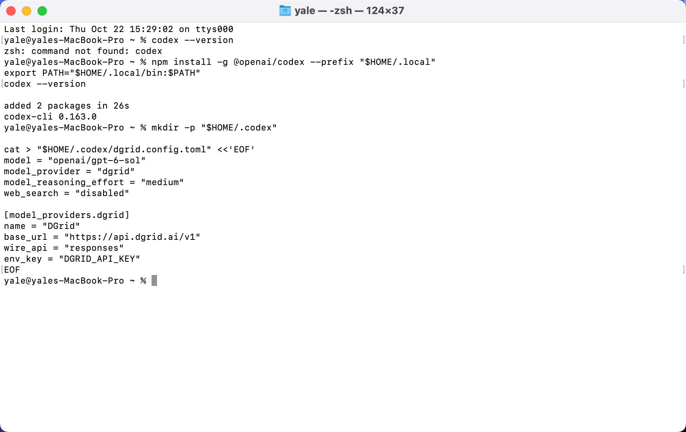
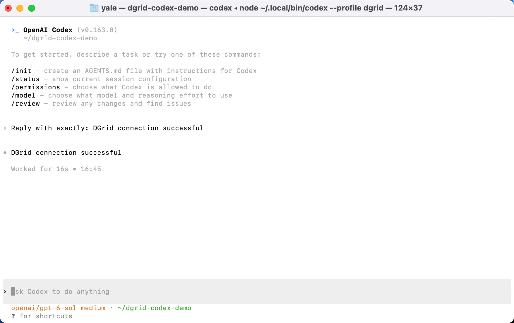
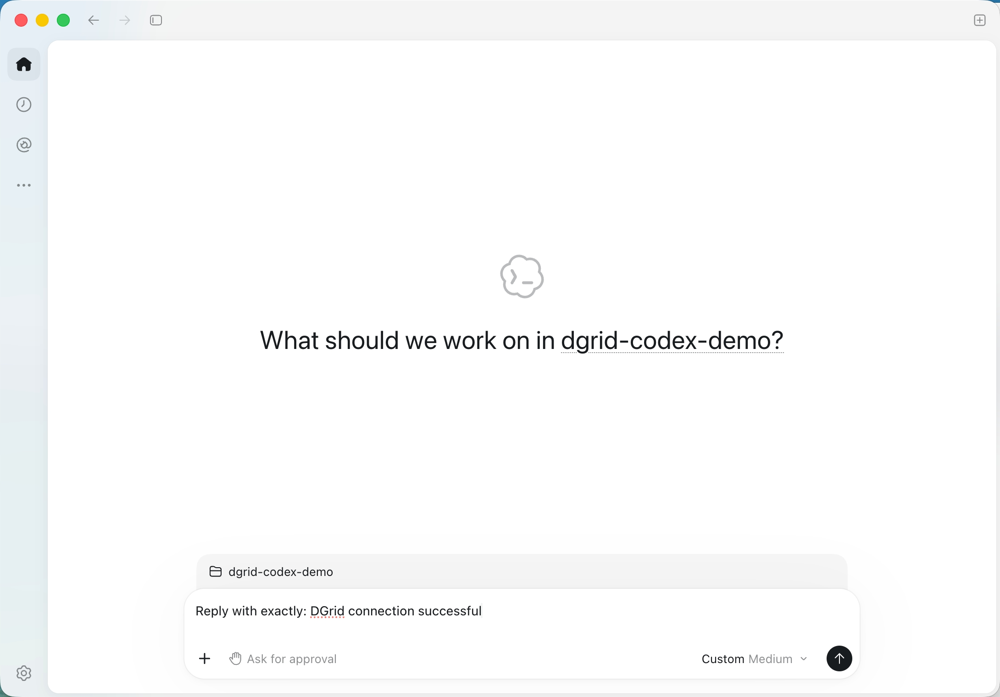
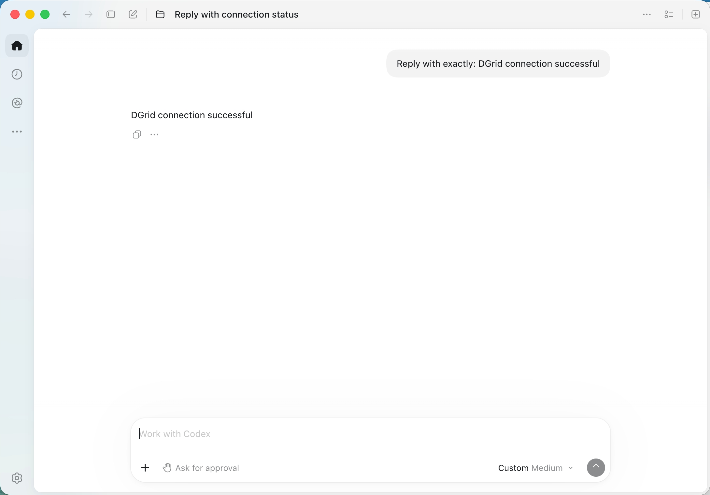
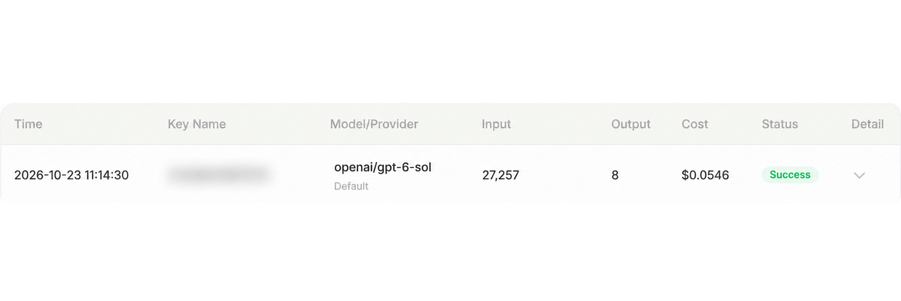

<Info>
Use a DGrid Model API Key for model requests. A Management API Key is an administrative credential and cannot be used for this tutorial. Check that your key has available credits and access to the selected model.
</Info>

Connect **Codex CLI** or **Codex in the desktop app** to DGrid using your API key, the Responses API base URL, and a complete model ID.

The current desktop download is the **ChatGPT desktop app, which includes Codex**. Existing installations may still use the Codex app name. Get the app from the [official download page](https://chatgpt.com/download/).

This guide uses `openai/gpt-6-sol`. Screenshots and the detailed desktop walkthrough use macOS; Windows installation and CLI instructions are also included.

## Before you start

- A [DGrid account](https://dgrid.ai/) with available credits and access to a model that supports the Responses API.
- A DGrid API key: sign in and create or copy a key from [API Keys](https://dgrid.ai/api-keys).
- For installation through npm, Node.js with npm. The desktop method can be used independently of the CLI.

Keep your full key out of screenshots and shared files. Preserve the complete model ID, including its `openai/` prefix.

<Note>
If Codex reports a model metadata or catalog error, ask DGrid for catalog settings that match your Codex version. Custom model aliases may need matching catalog metadata; do not guess a catalog URL. See the [official gateway setup guide](https://learn.chatgpt.com/docs/enterprise/connect-to-a-gateway).
</Note>

## Choose your setup

| Method | Configuration | Selection |
| --- | --- | --- |
| CLI | `~/.codex/dgrid.config.toml` | Run `codex --profile dgrid`. |
| Desktop on macOS | `~/.codex/config.toml` | The app reads its main configuration at startup. |

The CLI profile selects DGrid for runs started with that profile. Editing the desktop main file changes the default provider for clients that read that file. If you depend on your current desktop setup, use another computer for the desktop walkthrough.

Both methods use these connection settings:

| Setting | Value |
| --- | --- |
| Model | `openai/gpt-6-sol` |
| Base URL | `https://api.dgrid.ai/v1` |
| Wire API | `responses` |
| Credential environment variable | `DGRID_API_KEY` |

<Tabs>
<Tab title="CLI">

### 1. Install Node.js and Codex CLI

If needed, install the current LTS release from the [Node.js download page](https://nodejs.org/en/download). On macOS, run the macOS installer; on Windows, run the Windows installer. Standard installers include npm.

Open Terminal on macOS or PowerShell on Windows and check:

```shell
node -v
npm -v
```

Install using the [official Codex npm method](https://learn.chatgpt.com/docs/codex/cli).

**macOS:** install into your user directory.

```zsh
npm install -g @openai/codex --prefix "$HOME/.local"
export PATH="$HOME/.local/bin:$PATH"
codex --version
```

The PATH command applies to this terminal. Run it again in a new terminal, or add the directory to your shell's PATH configuration.

**Windows PowerShell:**

```powershell
npm install -g @openai/codex
codex --version
```

If PowerShell blocks `npm.ps1`, use `npm.cmd` instead of `npm`.

The CLI screenshots use `codex-cli 0.163.0`. The separate profile-file format below applies to Codex `0.134.0` and later; see [configuration profiles](https://learn.chatgpt.com/docs/config-file/config-advanced#profiles).

### 2. Create a DGrid profile

Create `~/.codex/dgrid.config.toml` on macOS, or `%USERPROFILE%\.codex\dgrid.config.toml` on Windows. Paste this content into that file:

```toml
model = "openai/gpt-6-sol"
model_provider = "dgrid"
model_reasoning_effort = "medium"
web_search = "disabled"

[model_providers.dgrid]
name = "DGrid"
base_url = "https://api.dgrid.ai/v1"
wire_api = "responses"
env_key = "DGRID_API_KEY"
```

On macOS, you can create and open the file using:

```zsh
mkdir -p "$HOME/.codex"
touch "$HOME/.codex/dgrid.config.toml"
open -t "$HOME/.codex/dgrid.config.toml"
```

If the profile already exists, edit its matching settings. Save as plain text with straight quotation marks. `env_key` is the variable's name: keep `DGRID_API_KEY` here.

<Frame caption="Codex CLI installed and a separate DGrid profile created in Terminal">
  
</Frame>

### 3. Enter the API key

Use the same terminal where you will launch Codex.

**macOS Terminal with Zsh:**

```zsh
export DGRID_API_KEY
read -rs "DGRID_API_KEY?Paste your DGrid API key (hidden): "
```

Paste your key at the prompt and press Enter. No characters appear as you enter it. Wait for the terminal prompt to return before running the next command.

**Windows PowerShell:** run the first line, enter the key at the masked prompt, then run the remaining lines.

```powershell
$dgridSecureKey = Read-Host "Paste your DGrid API key (hidden)" -AsSecureString
$env:DGRID_API_KEY = [System.Net.NetworkCredential]::new("", $dgridSecureKey).Password
Remove-Variable dgridSecureKey
```

This sets the key for the current terminal session. A new terminal requires entering it again.

### 4. Launch Codex and send a message

On macOS:

```zsh
mkdir -p "$HOME/dgrid-codex-demo"
cd "$HOME/dgrid-codex-demo"
codex --profile dgrid
```

On Windows PowerShell:

```powershell
New-Item -ItemType Directory -Force "$HOME/dgrid-codex-demo" | Out-Null
Set-Location "$HOME/dgrid-codex-demo"
codex --profile dgrid
```

If Codex asks whether you trust the folder, confirm for this demo folder you created. Check the selected model is `openai/gpt-6-sol`. You can also use `/status` to inspect the session.

Send:

```text
Reply with exactly: DGrid connection successful
```

The expected response is:

```text
DGrid connection successful
```

<Frame caption="Codex CLI displaying the response with the DGrid model selected">
  
</Frame>

If startup shows `Running without the shared background server: --profile requires embedded mode.`, it describes how this profile session runs. Use F2 to view the warning and Esc to close it, then continue. Some Mac keyboards use Fn + F2.

</Tab>
<Tab title="Desktop (macOS)">

### 1. Install the desktop app

Open the [official download page](https://chatgpt.com/download/) and choose your operating system.

- **macOS:** open the downloaded installer, drag the app into Applications, and open it.
- **Windows:** run the downloaded installer and follow the installation prompts.

Choose the current app that includes Codex. The walkthrough below uses macOS and the application path `/Applications/ChatGPT.app`.

For DGrid credentials, configure the provider and launch environment below. The initial `OpenAI API key` sign-in field does not itself set a DGrid base URL.

### 2. Configure DGrid in the main file

**Fully quit the desktop app with Command + Q.** Closing its window may leave it running.

In macOS Terminal, run:

```zsh
mkdir -p "$HOME/.codex"
touch "$HOME/.codex/config.toml"
open -t "$HOME/.codex/config.toml"
```

Use these settings in `config.toml`:

```toml
model = "openai/gpt-6-sol"
model_provider = "dgrid"
model_reasoning_effort = "medium"
web_search = "disabled"

[model_providers.dgrid]
name = "DGrid"
base_url = "https://api.dgrid.ai/v1"
wire_api = "responses"
env_key = "DGRID_API_KEY"
```

For an existing file, update matching top-level keys and place them **before the first table header** (`[section]`). Add the DGrid provider table at the end, or update it if present. Keep other settings and avoid duplicate keys or tables. Save as plain text with straight quotation marks.

The app reads this main file. A CLI profile file alone does not select DGrid in the desktop app. Windows uses `%USERPROFILE%\.codex\config.toml`. See the [official gateway setup guide](https://learn.chatgpt.com/docs/enterprise/connect-to-a-gateway).

### 3. Enter the key and launch the app

In macOS Terminal with Zsh:

```zsh
export DGRID_API_KEY
read -rs "DGRID_API_KEY?Paste your DGrid API key (hidden): "
```

Paste the DGrid key and press Enter. When the terminal prompt returns, run this **as a separate command in the same terminal**:

```zsh
open -a "/Applications/ChatGPT.app" --env "DGRID_API_KEY=$DGRID_API_KEY"
```

If your installation is named `Codex.app`, substitute its actual application path.

If Terminal reports that the application was already running and additional environment variables could not be set, fully quit with Command + Q and repeat the launch command.

The key is available to this launched app process. For a future launch from a new terminal, repeat the hidden key entry and launch command. Opening the app from the Dock does not supply a variable set only in this terminal.

### 4. Choose a project and send a message

Create a demo folder:

```zsh
mkdir -p "$HOME/dgrid-codex-demo"
```

In the desktop app:

1. Click **Choose project** and select `dgrid-codex-demo` in your home folder.
2. Enter the prompt below.
3. Click the send arrow.

```text
Reply with exactly: DGrid connection successful
```

<Frame caption="A project selected and the connection prompt ready to send in Codex">
  
</Frame>

The expected response is:

```text
DGrid connection successful
```

<Frame caption="Codex desktop app displaying the model response">
  
</Frame>

Some versions display a label such as **Custom Medium**. Check the complete model ID in your configuration and the corresponding DGrid request record to confirm the model and route used.

</Tab>
</Tabs>

## Confirm the request in DGrid

Open DGrid's request history and find the matching request time and complete model ID. A completed request appears with **Success** status.

<Frame caption="DGrid request history showing openai/gpt-6-sol and Success, with Key Name blurred">
  
</Frame>

The Key Name is blurred for privacy. Token counts and costs vary with the model and the context sent by Codex.

## Troubleshooting

| Symptom | What to check |
| --- | --- |
| `codex: command not found` | Confirm installation completed. On macOS, run `export PATH="$HOME/.local/bin:$PATH"` in the current terminal. |
| Missing API key | Set the key in the terminal that launches the client. `env_key` names a variable; it does not set its value. |
| App already running; environment variables could not be set | Fully quit with Command + Q, then repeat the desktop launch command. |
| Desktop sign-in or request fails after opening from the Dock | Quit the app, enter the key in Terminal, and launch with `--env`. |
| Authentication or model access error | Check the DGrid key, credits, Responses support, and complete model ID. |
| Provider settings ignored | Use the user-level files above. Project-level `.codex/config.toml` cannot select a custom provider. |
| Return to an earlier desktop provider | Restore its model, provider, and authentication settings, then fully quit and reopen the app. |

The [Codex configuration reference](https://learn.chatgpt.com/docs/config-file/config-reference) lists provider settings. This guide covers connecting and receiving a response; tools, web search, and longer agent tasks depend on the selected model and gateway support.

## Related resources

- [Integration tutorials overview](/ai-gateway/integrations)
- [AI Gateway quickstart](/ai-gateway/overview#quickstart)
- [Using Codex CLI with DGrid](https://blog.dgrid.ai/posts/2026-03-23/)
