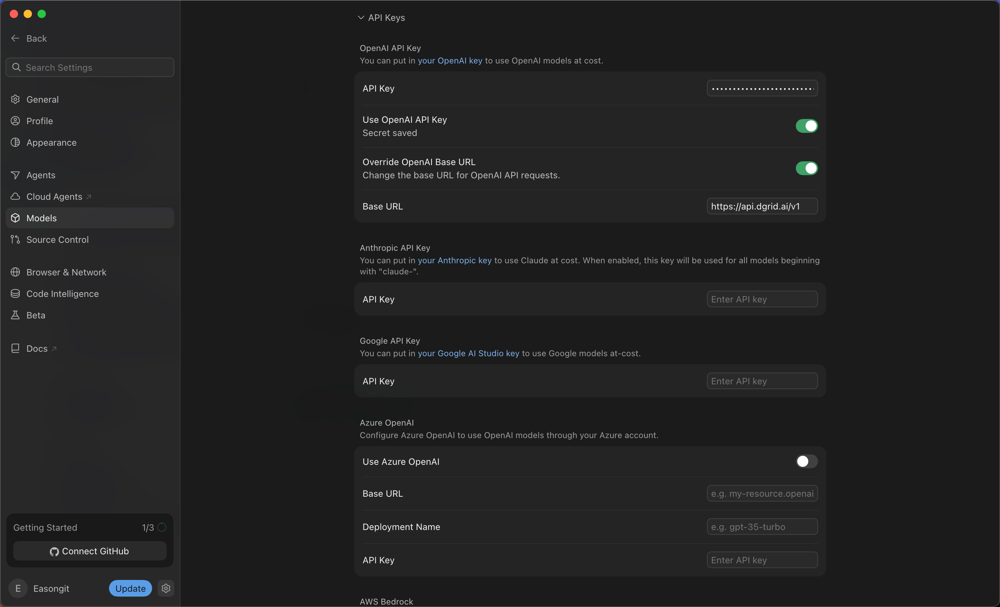
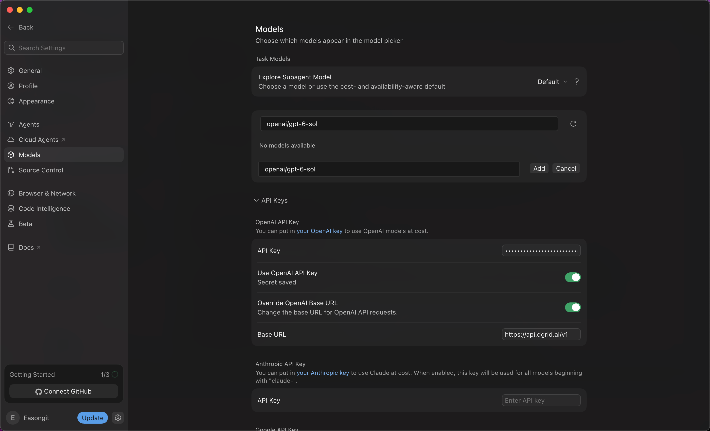
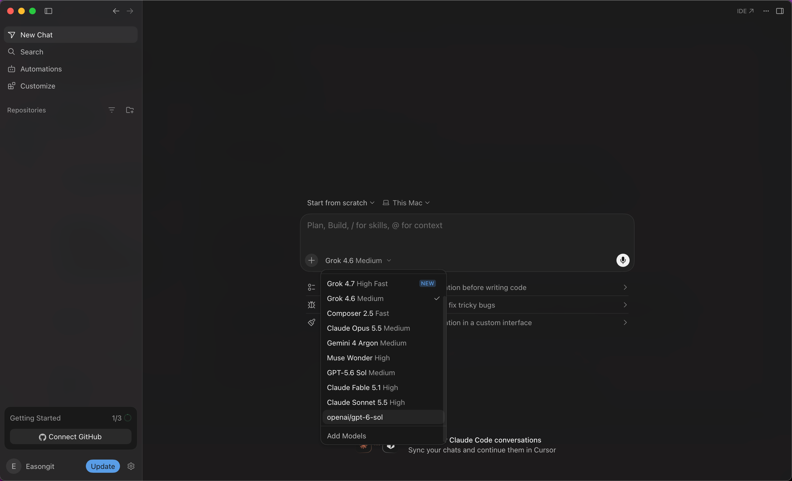
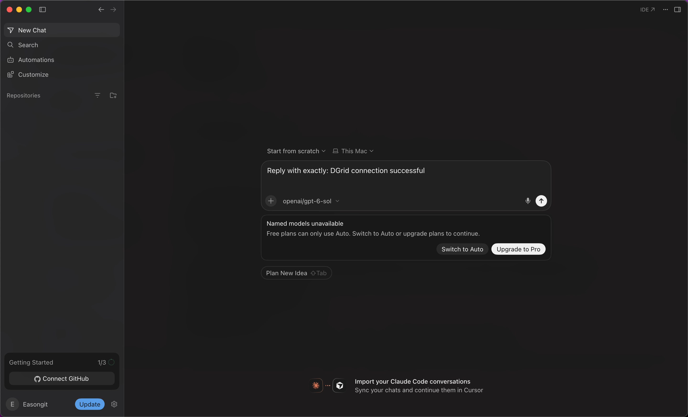

<Info>
Use a DGrid Model API Key for model requests. A Management API Key is an administrative credential and cannot be used for this tutorial. Check that your key has available credits and access to the selected model.
</Info>

Configure Cursor with a DGrid API key and an OpenAI-compatible base URL, then add and select a model using its complete DGrid model ID. This guide uses `openai/gpt-6-sol` as the example.

## Before you start

- A macOS or Windows computer with an internet connection.
- A Cursor account. Check that your plan supports bring your own key (BYOK) and the selected custom model. In the version shown here, the free account could save the settings but was blocked from sending a message with the selected model.
- A [DGrid account](https://dgrid.ai/) with available credits and access to your chosen model.

Cursor subscription charges and DGrid model usage are separate. The screenshots show a free-plan restriction; check your account and current Cursor documentation for feature availability. For background, see the [Cursor support explanation](https://forum.cursor.com/t/youve-hit-your-usage-limit-still-after-setting-my-key/150496/3).

Installation instructions below cover macOS and Windows. The subsequent configuration steps and screenshots use Cursor `3.24.18` on macOS as the example. Menu labels may differ in other versions.

## Step 1 Install and open Cursor

Open the [official Cursor download page](https://cursor.com/download) and choose the desktop installer for your operating system.

### macOS

1. Choose **Mac (ARM64)** for Apple Silicon or **Mac (x64)** for Intel. **Mac Universal** supports both.
2. Open the downloaded `.dmg` and drag **Cursor** into **Applications**.
3. Open Cursor from Applications, complete any initial setup, and sign in to your Cursor account.

### Windows

1. Choose **Windows (x64) (User)** for an Intel or AMD computer, or **Windows (ARM64) (User)** for a Windows on ARM computer. The User installer installs Cursor for your Windows account.
2. Run the downloaded `.exe` and follow the installation wizard.
3. Open Cursor from the Start menu or its desktop shortcut, complete any initial setup, and sign in to your Cursor account.

The rest of this guide illustrates the configuration on macOS.

## Step 2 Create a DGrid API key

1. Sign in to [DGrid](https://dgrid.ai/) and open [API Keys](https://dgrid.ai/api-keys).
2. Click **Create New Key**, give it a name such as `Cursor`, and create the key.
3. Copy the key for the next step. Keep the full key out of screenshots and shared files.
4. In DGrid's model list, confirm the model you want to use is available to this key. Copy its complete model ID; the example below is `openai/gpt-6-sol`.

## Step 3 Configure the API key and base URL

1. Click the **gear icon** beside your account name at the bottom left of Cursor.
2. Select **Models** in the settings sidebar.
3. Scroll down and expand **API Keys**.
4. Under **OpenAI API Key**, paste your **DGrid API key** into the **API Key** field. Save if a Save button appears. A saved credential is indicated by **Secret saved**.
5. Turn on **Override OpenAI Base URL** and enter:

```text
https://api.dgrid.ai/v1
```

6. Turn on **Use OpenAI API Key**. If Cursor opens the **Enable OpenAI API Key** confirmation, read the feature limitations and click **Enable OpenAI API Key** to continue.

Check that the settings match this table:

| Field | Value |
| --- | --- |
| API Key under OpenAI API Key | Your DGrid API key |
| Use OpenAI API Key | On |
| Override OpenAI Base URL | On |
| Base URL | `https://api.dgrid.ai/v1` |

Keep the `/v1` suffix. Leave the key masked when taking screenshots.

<Frame caption="Saved DGrid key, enabled API key and base URL switches, and DGrid base URL">
  
</Frame>

## Step 4 Add the complete DGrid model ID

1. Scroll up to the model list on the same **Models** settings page.
2. In **Add or search model**, enter:

```text
openai/gpt-6-sol
```

3. If the search shows **No models available**, click **Add Custom Model**.
4. In the new model field, enter the same complete ID, then click **Add**.

<Frame caption="Add the complete DGrid model ID as a custom model">
  
</Frame>

5. Confirm that **openai/gpt-6-sol** appears in the model list and its switch is on.

Keep the `openai/` prefix. If you use another model, substitute its exact DGrid ID in both the settings and chat selection.

## Step 5 Select the model in a new chat

1. Click **Back** at the top left to return to the chat screen. Start a new chat if needed.
2. Click the model name below the message input to open the model picker.
3. Select **`openai/gpt-6-sol`**, the custom entry you just added.
4. Confirm that the input area now shows **`openai/gpt-6-sol`** as the selected model.

<Frame caption="Choose the custom DGrid model in the chat model picker">
  
</Frame>

## Subscription requirement and first message

<Note>
The screenshot below illustrates a plan restriction, not a successful model request. Confirm the route by receiving a reply and finding the corresponding request in DGrid.
</Note>

If Cursor displays **Named models unavailable — Free plans can only use Auto**, the current account is blocked by Cursor's plan requirement. To use the selected custom model, sign in to an eligible paid account or choose whether to upgrade your Cursor subscription. Switching to Auto does not establish that the selected DGrid model is being used.

<Frame caption="Cursor's free-plan restriction when sending a message with the custom model">
  
</Frame>

With an eligible plan, you can send a short message such as:

```text
Reply with exactly: DGrid connection successful
```

After receiving a response, you can check DGrid's request history for the corresponding model, request time, and **Success** status.

## Notes and troubleshooting

- **Feature scope:** Custom API keys apply to supported chat models. Tab completion continues to use Cursor's built-in models. See [Cursor's API key documentation](https://cursor.com/help/models-and-usage/api-keys) for feature and billing details.
- **The key is saved but requests do not use it:** Check that both **Use OpenAI API Key** and **Override OpenAI Base URL** are on, and that the base URL is `https://api.dgrid.ai/v1`.
- **The model is missing from the picker:** Check that the complete custom model ID was added and enabled, then reopen the picker in a new chat.
- **A request fails after the subscription check:** Check your DGrid key, available credits, complete model ID, and model access. Adding a model to Cursor's list alone does not confirm that requests to it will succeed.
- **Returning to another provider:** Review the base URL override before using other OpenAI models, since it changes where those requests are sent.

## Related resources

- [Integration tutorials overview](/ai-gateway/integrations)
- [AI Gateway quickstart](/ai-gateway/overview#quickstart)
- [Configure DGrid AI Gateway in Cursor](https://blog.dgrid.ai/posts/2026-02-18/)
