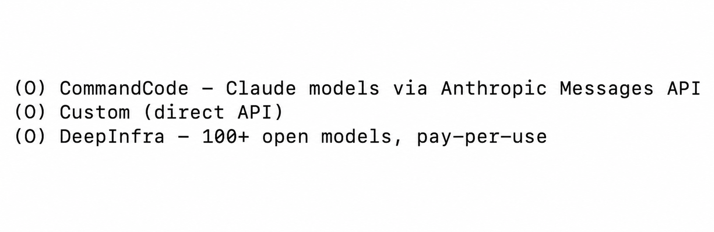
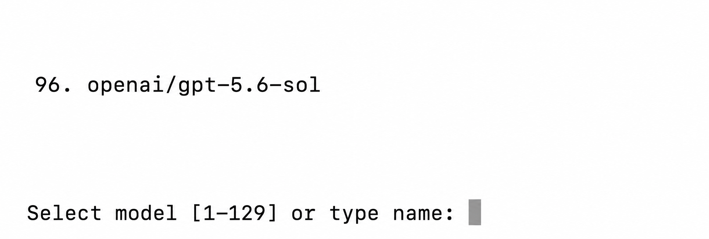
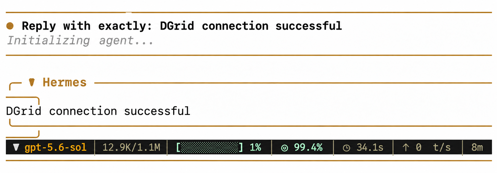
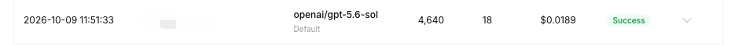

<Info>
Use a DGrid Model API Key for model requests. A Management API Key is an administrative credential and cannot be used for this tutorial. Check that your key has available credits and access to the selected model.
</Info>

To use DGrid models in Hermes Agent, add a custom API provider and enter your DGrid API key and endpoint. This guide follows the first-time setup wizard and uses `openai/gpt-5.6-sol` as the example model.

## Before you start

- A [DGrid account](https://dgrid.ai/) with available credits.
- A computer with terminal access. Installation commands for macOS, Linux, WSL2, and native Windows are below.

## Step 1: Create a DGrid API key

1. Sign in to the [DGrid Console](https://dgrid.ai/) and open **Credits → Keys**, or go to the [API Keys page](https://dgrid.ai/api-keys).
2. Select **Create New Key**, give it a name such as `Hermes`, and create it.
3. Copy the key. You will paste it into the Hermes **API key** prompt. Do not include it in screenshots or public documents.

## Step 2: Install Hermes and open setup

On macOS, Linux, or WSL2, run:

```bash
curl -fsSL https://hermes-agent.nousresearch.com/install.sh | bash
```

On native Windows, run in PowerShell:

```powershell
iex (irm https://hermes-agent.nousresearch.com/install.ps1)
```

If you see `prerequisites ok` or `Cloning ... hermes-agent.git`, installation is still running. Wait for the setup wizard.

At **How would you like to set up Hermes?**, use the arrow keys to move to **Full setup — configure every provider, tool & option yourself (bring your own keys)**, then press Enter or Space.

If installation finishes without opening the wizard, run `hermes model` in your terminal and continue at Step 3.

## Step 3: Choose a custom API provider

In **Select provider**, find **Custom (direct API)** near the bottom of the list and select it. If you entered through `hermes model`, choose **Custom endpoint (enter URL manually)**.

<Frame caption="Custom direct API entry in the Hermes provider menu">
  
</Frame>

## Step 4: Enter the DGrid endpoint and model

Follow the wizard prompts in this order:

| Wizard prompt | Enter or select |
| --- | --- |
| **API base URL** | `https://api.dgrid.ai/v1` |
| **API key** | Your DGrid API key from Step 1 |
| **Select API compatibility mode** | **Chat Completions**, option `2` in the current wizard |
| **Select model** | Full model ID `openai/gpt-5.6-sol` |
| **Context length in tokens** | Submit a blank value for automatic detection |
| **Display name** | `DGrid` |

The base URL stops at `/v1`; do not append `/chat/completions`. The `[optional]` text beside the generic **API key** prompt does not apply when connecting with a DGrid key.

After you enter the key, Hermes loads the models visible to it. Find `openai/gpt-5.6-sol` on **Select model** and enter that row's number, or type the full ID. The screenshot shows `96`, but your list number may differ. Use the complete ID to identify the model. If it is absent, choose another available DGrid model that supports Chat Completions.

<Frame caption="The example model and model-selection prompt in Hermes">
  
</Frame>

When Hermes reports that the model and custom provider were saved, configuration is complete.

## Step 5: Start Hermes and use the DGrid model

Run:

```bash
hermes
```

On first launch, **Help improve Hermes?** may ask for a usage-data preference. Choose your preference; **No thanks** also continues to chat. Enter a message, for example:

```text
Reply with exactly: DGrid connection successful
```

Once Hermes replies, you can keep chatting. To check that the request went through DGrid, open the DGrid request history around that time and look for the model ID with a **Success** status. The images below show an example reply and request record.

<Frame caption="Chatting with a DGrid model in Hermes">
  
</Frame>

<Frame caption="The model request in the DGrid Console">
  
</Frame>

## Common questions

- **The wizard did not open automatically:** run `hermes model`, select the custom endpoint, and enter the values from Step 4.
- **Enter inserts a literal `^M`:** press **Control+J** to submit the current text prompt.
- **You want to check or change the model:** run `hermes status` in the terminal to see the current Model and Provider; run `hermes model` to select a model again.
- **Chat replied, but `Auxiliary title generation failed: Request timed out` appeared:** this message concerns automatic conversation-title generation and does not undo the chat reply.

See the [Hermes installation guide](https://hermes-agent.nousresearch.com/docs/getting-started/installation/) and [provider documentation](https://hermes-agent.nousresearch.com/docs/integrations/providers/) for more details.

## Related resources

- [Integration tutorials overview](/ai-gateway/integrations)
- [AI Gateway quickstart](/ai-gateway/overview#quickstart)
