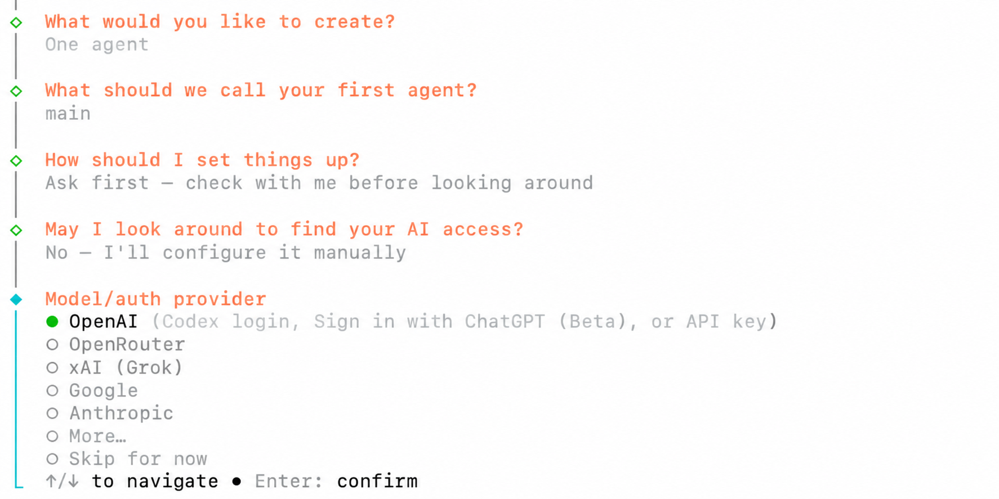
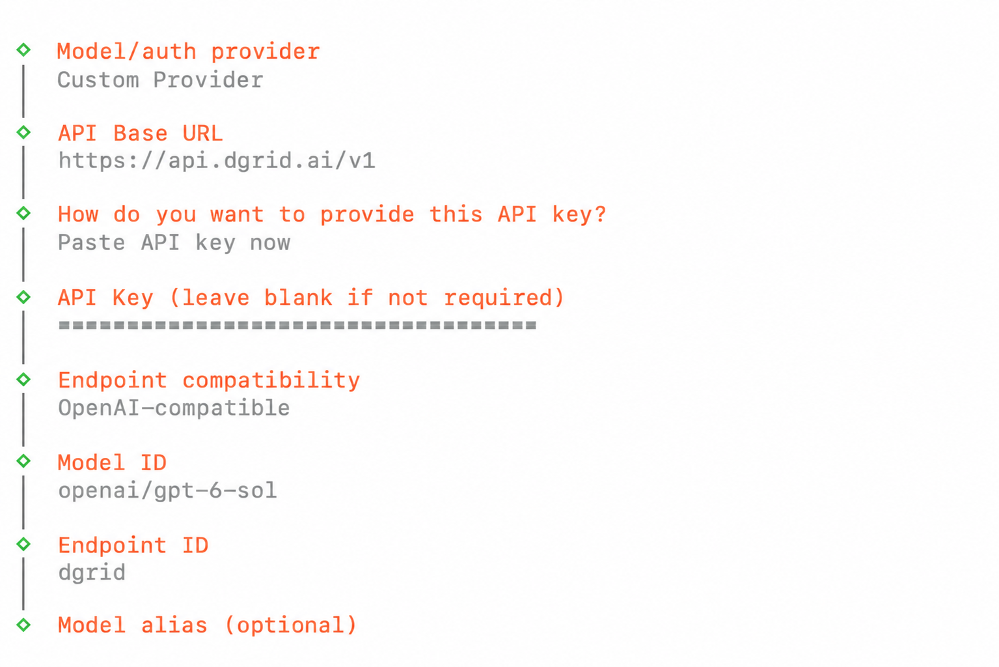
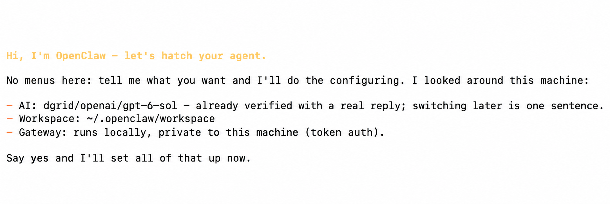
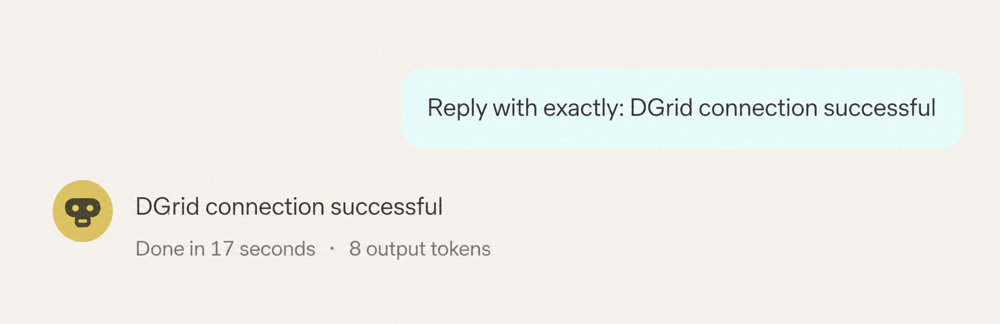
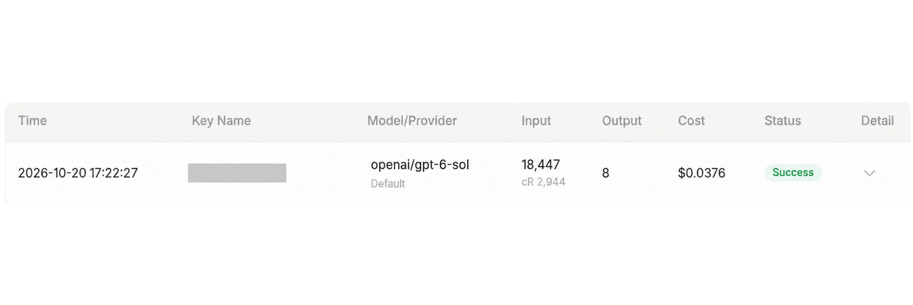

<Info>
Use a DGrid Model API Key for model requests. A Management API Key is an administrative credential and cannot be used for this tutorial. Check that your key has available credits and access to the selected model.
</Info>

<Note>
The OpenClaw Gateway is a local service on your computer that connects the OpenClaw dashboard. DGrid AI Gateway is the remote API service that receives model requests. Their access credentials are separate.
</Note>

Connect OpenClaw to DGrid by adding a Custom Provider, entering your DGrid API key and base URL, and selecting a model. This guide walks through installation and setup on macOS, then shows how to send your first message in the browser dashboard. The example model is `openai/gpt-6-sol`.

## Before you start

- A macOS computer with Terminal and an internet connection.
- A [DGrid account](https://dgrid.ai/) with available credits and access to the model you want to use.

The menu labels and screenshots below follow OpenClaw `2026.10.5`. Model availability depends on your DGrid account. You can replace the example with another available model that supports Chat Completions; enter its complete DGrid model ID.

## Step 1 Create a DGrid API key

1. Sign in to [DGrid](https://dgrid.ai/) and open the [API Keys page](https://dgrid.ai/api-keys).
2. Click **Create New Key**, give the key a name such as `OpenClaw`, and create it.
3. Copy the key. You will paste it into the OpenClaw setup wizard in Step 4. Keep the full key out of screenshots and shared documents.

## Step 2 Install OpenClaw

Open Terminal and run:

```bash
curl -fsSL https://openclaw.ai/install-cli.sh | bash
```

This official installer places OpenClaw and a supported Node.js runtime under `~/.openclaw`. Wait until it reports that OpenClaw is installed and the terminal prompt returns.

Start the setup wizard as a separate command:

```bash
"$HOME/.openclaw/bin/openclaw" onboard
```

Use the full command path shown throughout this guide so you can run OpenClaw immediately after this installation method.

## Step 3 Choose manual provider setup

If the opening menu offers **Quick start** and **Custom setup**, choose **Custom setup**. Read the safety notice and select **Yes** if you accept it. If a usage statistics prompt appears, choose your preference; **No thanks** also lets you continue.

Use the arrow keys and Enter to make these selections:

| Setup prompt | Choose or enter |
| --- | --- |
| What would you like to create? | **One agent** |
| What should we call your first agent? | Keep **main** |
| How should I set things up? | **Ask first - check with me before looking around** |
| May I look around to find your AI access? | **No - I'll configure it manually** |

At **Model/auth provider**, select **More...** to open the full provider list.

<Frame caption="Select manual setup, then open More in the provider menu">
  
</Frame>

Type `custom` in the provider search, select **Custom Provider**, and press Enter.

## Step 4 Enter the DGrid connection details

Fill in the prompts in this order. Press Enter after each text field, and use the arrow keys and Enter for menu selections.

| Setup prompt | Enter or select |
| --- | --- |
| API Base URL | `https://api.dgrid.ai/v1` |
| How do you want to provide this API key? | **Paste API key now** |
| API Key | Your DGrid API key from Step 1 |
| Endpoint compatibility | **OpenAI-compatible (Uses /chat/completions)** |
| Model ID | `openai/gpt-6-sol` |
| Endpoint ID | Replace the generated value with `dgrid` |
| Model alias (optional) | Leave blank and press Enter |

The base URL ends at `/v1`; do not append `/chat/completions`. Enter the DGrid key even though the generic API Key prompt says it can be left blank when not required.

Use `openai/gpt-6-sol` as the Model ID, including the `openai/` prefix. The Endpoint ID `dgrid` is OpenClaw's local name for this provider. Together, they form the OpenClaw model reference `dgrid/openai/gpt-6-sol`.

<Frame caption="DGrid base URL, masked API key, model ID, and endpoint ID">
  
</Frame>

After the alias prompt, OpenClaw checks the model connection. Wait for it to finish. If it reports a connection failure, check the URL, key, credits, and complete model ID before trying again.

## Step 5 Finish setup and start the Gateway

The setup assistant displays a summary of the selected model, workspace, and local Gateway. When it asks **Say yes and I'll set all of that up now**, enter:

```text
yes
```

Press Enter and wait for setup to finish applying the configuration.

<Frame caption="Review the setup summary and enter yes to apply it">
  
</Frame>

Open a second Terminal window and install the Gateway background service:

```bash
"$HOME/.openclaw/bin/openclaw" gateway install
```

Check that the Gateway is running and reachable:

```bash
"$HOME/.openclaw/bin/openclaw" gateway status
```

If the setup assistant reported **Gateway is not reachable yet**, complete these Gateway steps before opening the dashboard. If the status still shows **Runtime: stopped**, see the Gateway troubleshooting instructions below.

Open the browser dashboard:

```bash
"$HOME/.openclaw/bin/openclaw" dashboard
```

Use the link opened by this command to connect to your local Gateway.

## Step 6 Start chatting with the DGrid model

1. In the dashboard, open **Home** and the **main** session.
2. Check that the model selector below the message box shows **openai/gpt-6-sol (Custom Provider)**. If you used another model, select that model instead.
3. In **Message main**, enter:

```text
Reply with exactly: DGrid connection successful
```

4. Click the **up-arrow Send button** and wait for the reply.

<Frame caption="Send a message and receive a reply in OpenClaw">
  
</Frame>

You can now continue chatting with your DGrid model. To view the request in DGrid, open the request history and find the corresponding model and time. A completed request appears with a **Success** status.

<Frame caption="A successful DGrid model request">
  
</Frame>

To return to the browser dashboard later, run:

```bash
"$HOME/.openclaw/bin/openclaw" dashboard
```

## Troubleshooting

**The installer says onboarding requires an interactive TTY**

Run the setup wizard directly from Terminal after installation:

```bash
"$HOME/.openclaw/bin/openclaw" onboard
```

**The model connection check fails**

Check that the base URL is `https://api.dgrid.ai/v1`, the key has available credits and model access, the complete DGrid model ID is correct, and Endpoint compatibility is set to **OpenAI-compatible** for this Chat Completions configuration.

**The Gateway stays stopped after an upgrade**

If the Gateway startup log specifically reports **Legacy device identity exists**, stop the service and run the built-in migration and repair command:

```bash
"$HOME/.openclaw/bin/openclaw" gateway stop
"$HOME/.openclaw/bin/openclaw" doctor --fix
```

Follow any repair prompts. Doctor may restart and check the Gateway automatically. Run `"$HOME/.openclaw/bin/openclaw" gateway status` again; if the repaired service is still stopped, run:

```bash
"$HOME/.openclaw/bin/openclaw" gateway start
```

**The browser cannot connect to the Gateway**

Check the service with `"$HOME/.openclaw/bin/openclaw" gateway status`, then reopen the dashboard using the command in Step 5. The Gateway token used for dashboard access is separate from your DGrid API key.

For more details, see the [OpenClaw installer guide](https://docs.openclaw.ai/install/installer), [setup wizard documentation](https://docs.openclaw.ai/start/wizard), and [Gateway CLI reference](https://docs.openclaw.ai/cli/gateway).

## Related resources

- [Integration tutorials overview](/ai-gateway/integrations)
- [AI Gateway quickstart](/ai-gateway/overview#quickstart)
- [OpenClaw agent setup with DGrid](https://blog.dgrid.ai/posts/2026-02-02/)
- [OpenClaw installation and no-code setup](https://blog.dgrid.ai/posts/2026-02-27/)

An earlier video walkthrough is available below. Its interface may differ from the version covered in this guide.

<video controls preload="metadata" style={{ width: "100%", borderRadius: "12px", marginTop: "12px" }}>
  <source src="/images/dgrid-openclaw-demo.mp4" type="video/mp4" />
  Your browser does not support the video tag.
</video>
