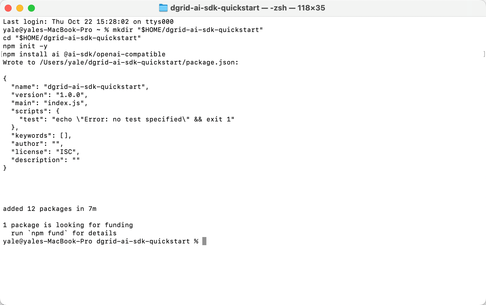
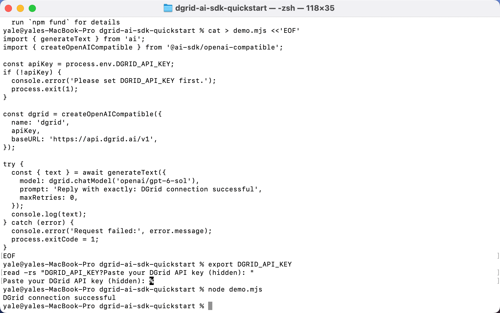

<Info>
Use a DGrid Model API Key for model requests. A Management API Key is an administrative credential and cannot be used for this tutorial. Check that your key has available credits and access to the selected model.
</Info>

Vercel publishes its **AI SDK Core as the npm package `ai`**. In this guide, you will install that package, import its `generateText()` function, and connect it to DGrid using the SDK's official OpenAI-compatible provider. See the [AI SDK by Vercel introduction](https://ai-sdk.dev/docs/introduction).

Configure your DGrid API key, the OpenAI-compatible base URL, and a complete model ID, then run a single Node.js script to print the response generated through Vercel AI SDK.

This guide uses `openai/gpt-6-sol`. The application runs locally and sends its model request to DGrid through the AI SDK's OpenAI-compatible provider.

## How Vercel AI SDK connects to DGrid

The SDK appears in both the installation command and the JavaScript code:

| Package or function | Role in this example |
| --- | --- |
| `ai` | Vercel AI SDK Core, installed with npm. |
| `generateText` imported from `ai` | The Vercel AI SDK function that runs text generation and returns the result. |
| `@ai-sdk/openai-compatible` | The AI SDK provider package that supports OpenAI-compatible services. |
| `createOpenAICompatible(...)` | Creates the SDK provider configured with your DGrid key and base URL. |
| `dgrid.chatModel(...)` | Supplies a DGrid model to the SDK's `generateText()` call. |

The request flow is:

**Your script → Vercel AI SDK `generateText()` → OpenAI-compatible provider → DGrid → model response**

Node.js runs the program, Vercel AI SDK provides the model-calling interface, and DGrid handles the model request. The [official compatible-provider example](https://ai-sdk.dev/providers/openai-compatible-providers#example) uses this same combination of `generateText()` and `createOpenAICompatible()`.

## Before you start

- A macOS or Windows computer with internet access.
- **Node.js 22 or later**, with npm.
- A [DGrid account](https://dgrid.ai/) with available credits and access to the model you want to use.

The example environment uses Node.js `22.14.0`, npm `10.9.2`, `ai` `7.0.148`, and `@ai-sdk/openai-compatible` `3.0.75`. The installation commands below select AI SDK 7 and compatible-provider 3. Screenshots use macOS; Windows-specific instructions are included where the shell commands differ.

## Step 1 Install Node.js and check your environment

If Node.js is not installed, download the current **LTS** release from the [official Node.js download page](https://nodejs.org/en/download).

- **macOS:** choose the macOS installer, run the downloaded `.pkg`, and follow the installation steps.
- **Windows:** choose the Windows installer for your computer's architecture, run the downloaded `.msi`, and follow the installation steps.

The standard installers include npm. Open a new **Terminal** window on macOS or **PowerShell** window on Windows, then run:

```shell
node -v
npm -v
```

Both commands should print version numbers. If Node.js is older than 22, update it before continuing.

## Step 2 Create a DGrid API key

1. Sign in to [DGrid](https://dgrid.ai/) and open [API Keys](https://dgrid.ai/api-keys).
2. Click **Create New Key**, give the key a name, and create it.
3. Copy the key for Step 5. Keep the full key out of screenshots and shared files.
4. In DGrid's model list, confirm that your key can access `openai/gpt-6-sol`, or copy the complete ID of another model that supports Chat Completions.

Use the complete model ID, including the provider prefix. For this example, that is `openai/gpt-6-sol`.

## Step 3 Create the project and install Vercel AI SDK

Run the following commands in macOS Terminal or Windows PowerShell:

```shell
mkdir "$HOME/dgrid-ai-sdk-quickstart"
cd "$HOME/dgrid-ai-sdk-quickstart"
npm init -y
npm install ai@7 @ai-sdk/openai-compatible@3
```

This command installs **Vercel AI SDK Core** (`ai@7`) and its **OpenAI-compatible provider** (`@ai-sdk/openai-compatible@3`). The next step imports code from both packages to make the DGrid request.

Wait until npm reports that the packages were added and your terminal prompt returns. Installation time depends on your connection.

<Frame caption="The example project and SDK dependencies installed in Terminal">
  
</Frame>

## Step 4 Call DGrid with Vercel AI SDK

Using a code editor, create a file named **`demo.mjs`** in `dgrid-ai-sdk-quickstart`, beside `package.json`. Paste the code below and save it as plain text. Make sure the filename is `demo.mjs`, not `demo.mjs.txt`.

The `.mjs` extension lets Node.js use the `import` statements in this example.

```javascript
// Vercel AI SDK Core: the text-generation API.
import { generateText } from 'ai';
// AI SDK provider: connects to OpenAI-compatible services such as DGrid.
import { createOpenAICompatible } from '@ai-sdk/openai-compatible';

const apiKey = process.env.DGRID_API_KEY;
if (!apiKey) {
  console.error('Please set DGRID_API_KEY first.');
  process.exit(1);
}

// Configure the AI SDK provider with the DGrid key and endpoint.
const dgrid = createOpenAICompatible({
  name: 'dgrid',
  apiKey,
  baseURL: 'https://api.dgrid.ai/v1',
});

try {
  // Run the DGrid model request through Vercel AI SDK Core.
  const { text } = await generateText({
    model: dgrid.chatModel('openai/gpt-6-sol'),
    prompt: 'Reply with exactly: DGrid connection successful',
    maxRetries: 0,
  });
  console.log(text);
} catch (error) {
  console.error('Request failed:', error.message);
  process.exitCode = 1;
}
```

The main connection settings are:

| Code | Purpose |
| --- | --- |
| `process.env.DGRID_API_KEY` | Reads the key from your terminal environment. |
| `baseURL: 'https://api.dgrid.ai/v1'` | Sends model requests to DGrid. Keep the `/v1` suffix. |
| `dgrid.chatModel('openai/gpt-6-sol')` | Selects the complete DGrid model ID through the Chat Completions adapter. |
| `generateText(...)` | Vercel AI SDK Core sends the prompt through the configured provider and returns the generated text. |

If you selected another model in Step 2, replace `openai/gpt-6-sol` with its complete ID. The provider's `name: 'dgrid'` is a local SDK label.

## Step 5 Enter your DGrid API key

Use the instructions for your shell. Enter the key in the same terminal where you will run the script.

### macOS Terminal with Zsh

Run:

```zsh
export DGRID_API_KEY
read -rs "DGRID_API_KEY?Paste your DGrid API key (hidden): "
```

At **Paste your DGrid API key (hidden):**, paste your DGrid key and press Enter. The key will not appear on screen.

### Windows PowerShell

Run the first command, enter your key at the masked prompt, and press Enter. Then run the remaining commands to make it available to Node.js:

```powershell
$dgridSecureKey = Read-Host "Paste your DGrid API key (hidden)" -AsSecureString
$env:DGRID_API_KEY = [System.Net.NetworkCredential]::new("", $dgridSecureKey).Password
Remove-Variable dgridSecureKey
```

These settings last for the current terminal session. Opening a new terminal requires setting the key again. Keep the key out of `demo.mjs` and version control.

## Step 6 Run the example

From the project directory, in the same terminal where you entered the key, run:

```shell
node demo.mjs
```

Wait for the model response. For the prompt in this example, the expected text is:

```text
DGrid connection successful
```

<Frame caption="Run the script and receive the model response through DGrid">
  
</Frame>

To ask another question, edit the `prompt` string in `demo.mjs`, save the file, and run `node demo.mjs` again. Each run makes a new request.

## Step 7 View the request in DGrid

Open DGrid's request history and locate the matching model and request time. The completed request appears with **Success** status.

<Frame caption="DGrid request history showing the selected model and Success, with Key Name blurred">
  
</Frame>

The screenshot's Key Name is blurred for privacy. Token counts, cache usage, and charges vary by request.

## Troubleshooting

| Message or symptom | What to check |
| --- | --- |
| `Please set DGRID_API_KEY first.` | Repeat Step 5 in the same terminal, then run the script again. |
| `Cannot find module` or `ERR_MODULE_NOT_FOUND` | Confirm you are in `dgrid-ai-sdk-quickstart` and the dependency installation completed there. |
| The terminal cannot find `demo.mjs` | Check the current directory and filename, including a possible extra `.txt` extension. |
| Authentication error | Re-enter the DGrid key and confirm it is valid. |
| Model or access error | Check the complete model ID, access permissions, and available DGrid credits. |
| Network error | Check that your computer can reach the DGrid API, then retry. |
| PowerShell blocks `npm.ps1` | Use `npm.cmd` in place of `npm` for the initialization and installation commands. |

For more details, see the [AI SDK Node.js guide](https://ai-sdk.dev/docs/getting-started/nodejs) and [OpenAI-compatible provider documentation](https://ai-sdk.dev/providers/openai-compatible-providers).

## Related resources

- [Integration tutorials overview](/ai-gateway/integrations)
- [AI Gateway quickstart](/ai-gateway/overview#quickstart)
- [Use DGrid with Vercel AI SDK](https://blog.dgrid.ai/posts/2026-03-26/)
