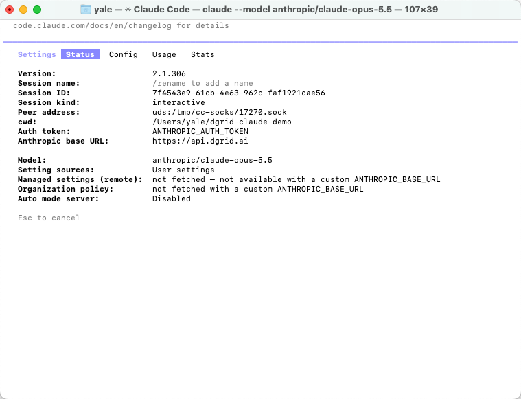
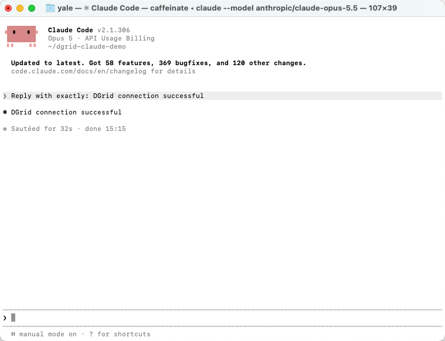
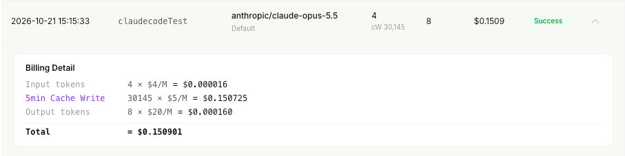
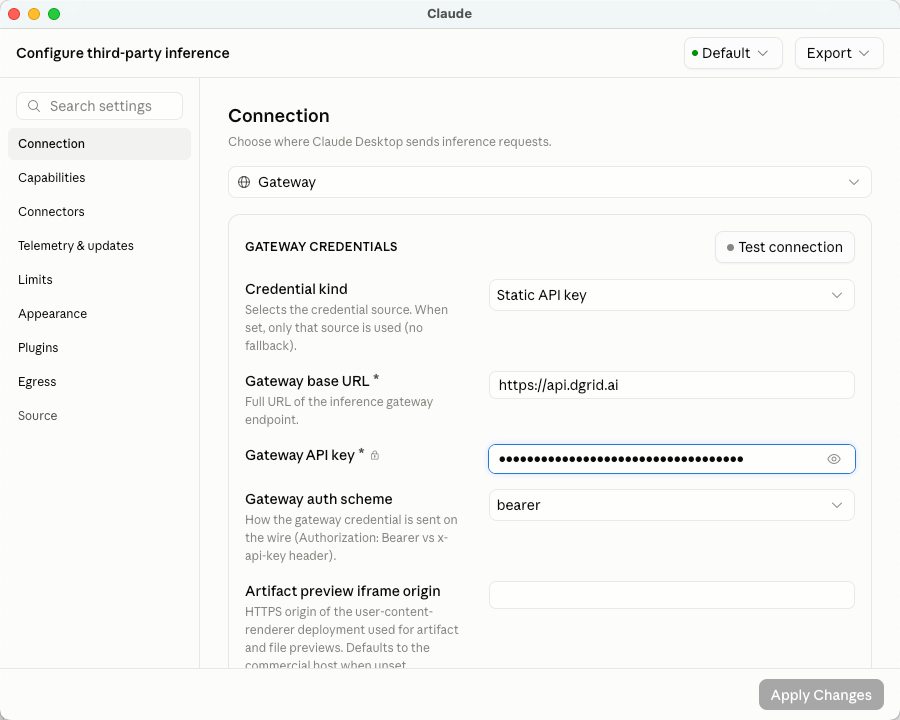
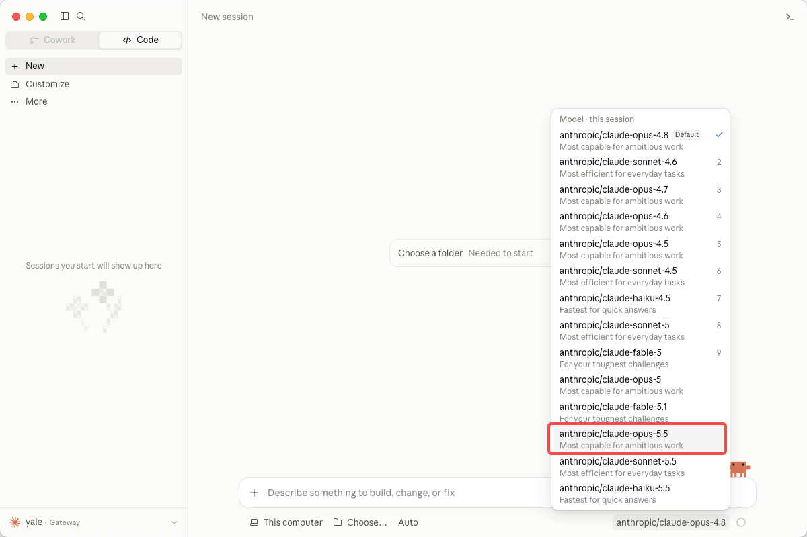
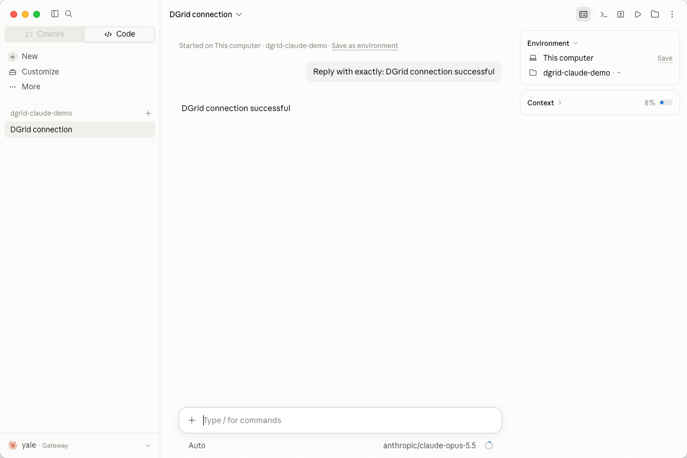

<Info>
Use una DGrid Model API Key para las solicitudes a los modelos. Una Management API Key es una credencial administrativa y no sirve para este tutorial. Compruebe que la clave tenga saldo disponible y acceso al modelo seleccionado.
</Info>

Conecte Claude Code con DGrid usando su clave API de DGrid, la URL de la pasarela y un modelo Claude accesible con esa clave. Esta guía explica primero la configuración en Terminal de macOS y después la alternativa en la pestaña **Code** de la aplicación Claude.

El modelo del ejemplo es `anthropic/claude-opus-5.5`. Use el ID completo de DGrid, incluido el prefijo `anthropic/`. Puede sustituirlo en toda la guía por otro modelo Claude disponible.

## Antes de empezar

- Un equipo macOS con conexión a Internet. Los comandos usan Zsh, el intérprete predeterminado de macOS.
- Una [cuenta de DGrid](https://dgrid.ai/) con saldo disponible y acceso al modelo Claude elegido.
- Para instalar con npm: **Node.js 22 o posterior y npm**. Las instrucciones se incluyen a continuación.

Las capturas de la CLI usan Claude Code `2.1.306`. Los menús y los modelos disponibles pueden variar según la versión. La configuración de escritorio es independiente y no requiere instalar antes la CLI.

## Paso 1: crear una clave API de DGrid y elegir un modelo

1. Inicie sesión en [DGrid](https://dgrid.ai/) y abra [API Keys](https://dgrid.ai/api-keys).
2. Haga clic en **Create New Key**, asigne un nombre y cree la clave.
3. Copie la clave para los siguientes pasos. No muestre la clave completa en capturas ni archivos compartidos.
4. Busque un modelo Claude disponible en la lista de DGrid y copie su ID completo. Esta guía usa `anthropic/claude-opus-5.5`.

Los parámetros de conexión son los siguientes:

| Parámetro | Valor |
| --- | --- |
| Base URL | `https://api.dgrid.ai` |
| Credencial | Su clave API de DGrid |
| ID del modelo de ejemplo | `anthropic/claude-opus-5.5` |

**No añada `/v1` ni `/v1/messages` a la URL base.** Claude Code añade la ruta de la API Messages al enviar las solicitudes.

<Tabs>
<Tab title="CLI">

### Paso 2: instalar Claude Code


Si Claude Code ya está instalado, ejecute `claude --version`. Si aparece un número de versión, continúe con el paso 3.

#### Instalar con npm

Primero compruebe si Node.js y npm están disponibles:

```zsh
node -v
npm -v
```

Si falta algún comando o Node.js es anterior a 22, instale la versión **LTS** actual desde la [página de Node.js](https://nodejs.org/en/download). Elija el instalador de macOS, que incluye npm. Después abra un nuevo terminal y repita ambos comandos.

Instale Claude Code en su directorio de usuario:

```zsh
npm install -g @anthropic-ai/claude-code --prefix "$HOME/.local"
```

Añada el directorio de instalación al PATH del terminal y compruebe la versión:

```zsh
export PATH="$HOME/.local/bin:$PATH"
claude --version
```

Esta instalación de usuario no requiere `sudo`. Para conservar el PATH en nuevos terminales, añada la misma línea `export PATH` a `~/.zshrc` con un editor de texto.

#### Alternativa: instalador nativo

También puede usar el [instalador nativo oficial](https://code.claude.com/docs/en/setup#install-claude-code), sin instalar Node.js por separado:

```zsh
curl -fsSL https://claude.ai/install.sh | bash
```

Tras la instalación, abra un terminal y compruebe `claude --version`. Si no encuentra el comando, añada `~/.local/bin` al PATH como se indicó. Elija un solo método. Si la URL devuelve HTML o falla la descarga, instale Node.js y use npm.

### Paso 3: configurar DGrid en el terminal actual

Ejecute este bloque en Zsh. El último comando solicita la clave sin mostrar lo que escribe:

```zsh
export ANTHROPIC_BASE_URL="https://api.dgrid.ai"
unset ANTHROPIC_API_KEY
export ANTHROPIC_AUTH_TOKEN
read -rs "ANTHROPIC_AUTH_TOKEN?Paste your DGrid API key (hidden): "
```

Cuando aparezca **Paste your DGrid API key (hidden):**, pegue su clave de DGrid y pulse Intro. El terminal vuelve al indicador sin mostrar la clave.

Continúe en el mismo terminal para que Claude Code herede las variables. Los ajustes solo se aplican a esta sesión. En un nuevo terminal, repita este paso o use la configuración de proyecto opcional que se explica más adelante.

Es posible que siga activa la configuración de otro proveedor. `unset` elimina una variable del intérprete, pero no las entradas de los archivos. Compruebe la conexión en el paso 5; si detecta otra clave, consulte la solución de problemas.

### Paso 4: iniciar Claude Code

Cree una carpeta para la primera sesión e inicie Claude Code con el ID completo de DGrid:

```zsh
mkdir -p "$HOME/dgrid-claude-demo"
cd "$HOME/dgrid-claude-demo"
claude --model "anthropic/claude-opus-5.5"
```

Si Claude Code pregunta si confía en la carpeta, compruebe la ruta y seleccione **Yes, I trust this folder** para la carpeta creada. Complete los ajustes de apariencia del primer inicio.

### Paso 5: comprobar la conexión activa

En Claude Code, escriba:

```text
/status
```

La pestaña **Status** debe mostrar:

| Campo de estado | Valor esperado |
| --- | --- |
| Auth token | `ANTHROPIC_AUTH_TOKEN` |
| Anthropic base URL | `https://api.dgrid.ai` |
| Model | `anthropic/claude-opus-5.5` |

<Frame caption="Estado de Claude Code: URL de DGrid, origen del token y modelo seleccionado">
  
</Frame>

Si eligió otro modelo Claude, compruebe su ID completo. Pulse Esc para volver a la conversación.

### Paso 6: enviar el primer mensaje

Escriba:

```text
Reply with exactly: DGrid connection successful
```

Pulse Intro y espere la respuesta:

```text
DGrid connection successful
```

<Frame caption="Respuesta correcta en Terminal de Claude Code">
  
</Frame>

Ya puede seguir usando Claude Code mediante DGrid. Para consultar el uso, busque el modelo y la hora en el historial de solicitudes de DGrid. Una solicitud completada muestra **Success**.

<Frame caption="Solicitud del modelo Claude completada en DGrid">
  
</Frame>

Los tokens y los cargos varían según la solicitud. La captura es un ejemplo que incluye uso de escritura en caché.

#### Opcional: guardar los ajustes del proyecto

Para no introducir las variables cada vez, configure `.claude/settings.local.json` en el proyecto. Antes de crearlo, añada `.claude/settings.local.json` al `.gitignore` del proyecto para excluir la clave del control de versiones.

Cree o edite el archivo local y sustituya el marcador por su clave de DGrid:

```json
{
  "env": {
    "ANTHROPIC_BASE_URL": "https://api.dgrid.ai",
    "ANTHROPIC_AUTH_TOKEN": "<your-dgrid-api-key>",
    "ANTHROPIC_API_KEY": ""
  },
  "model": "anthropic/claude-opus-5.5"
}
```

Combine estos campos con los ajustes existentes. La clave se guarda en un archivo local: manténgalo privado. En un nuevo terminal, entre en el proyecto, ejecute `claude` y compruebe `/status`. Consulte los ámbitos en la [guía oficial de pasarelas](https://code.claude.com/docs/en/llm-gateway-connect#set-in-a-settings-file).

</Tab>
<Tab title="Aplicación de escritorio">

Claude Code también está disponible en la pestaña **Code** de la aplicación Claude. Configure su pasarela por separado de la CLI. Las variables del terminal no configuran la conexión de inferencia de terceros de la aplicación.

### 1 Abrir los ajustes de inferencia de terceros

1. Descargue e instale la [aplicación Claude](https://claude.com/download) para macOS y ábrala.
2. En la barra de menús de macOS, elija **Help → Troubleshooting → Enable Developer Mode**.
3. Si se le solicita, reinicie la aplicación. Después elija **Developer → Configure Third-Party Inference…**.
4. Si un error de pasarela ofrece **Open Setup**, ese botón también abre la configuración.

Si desaparece el menú Developer tras aplicar la primera configuración de terceros, reactive Developer Mode desde Help. La [guía oficial de configuración en la aplicación](https://claude.com/docs/third-party/claude-desktop/in-app-configuration) explica este comportamiento y la opción local Apply Changes.

### 2 Introducir los datos de conexión de DGrid

Abra **Connection** y use estos valores:

| Campo | Valor que debe introducir o seleccionar |
| --- | --- |
| Inference provider | **Gateway** |
| Credential kind | **Static API key** |
| Gateway base URL | `https://api.dgrid.ai` |
| Gateway API key | Su clave API de DGrid |
| Gateway auth scheme | **bearer** |

Deje **Artifact preview iframe origin** con su valor predeterminado. Oculte la clave con el icono del ojo antes de hacer capturas.

<Frame caption="Configuración de conexión a la pasarela de DGrid en Claude">
  
</Frame>

Haga clic en **Apply Changes** para aplicar la configuración local; la aplicación se reiniciará. También puede usar **Test connection**. Si falla, abra los detalles y compruebe el modelo utilizado y la respuesta.

### 3 Elegir el modelo e iniciar una sesión local

1. Abra la pestaña **Code** e inicie una sesión nueva.
2. Si aparece un selector de entorno, elija **This computer**.
3. En el selector de modelos, elija **`anthropic/claude-opus-5.5`** u otro modelo Claude disponible.
4. Haga clic en **Choose a folder** o en el control de carpeta del proyecto y seleccione `dgrid-claude-demo`. Si omitió la CLI, cree y seleccione una carpeta nueva.

<Frame caption="Selección del ID completo del modelo Claude de DGrid en la aplicación">
  
</Frame>

Envíe:

```text
Reply with exactly: DGrid connection successful
```

Espere la respuesta. El nombre del modelo bajo el cuadro de entrada debe coincidir con su selección.

<Frame caption="Respuesta correcta de DGrid en la pestaña Code de Claude">
  
</Frame>

Puede seguir trabajando con DGrid en esta sesión de escritorio.

</Tab>
</Tabs>

## Solución de problemas

### El terminal muestra command not found o permission denied

Compruebe qué comando encuentra el intérprete:

```zsh
type -a claude
```

Si usó la instalación de usuario anterior, compruebe que `~/.local/bin` esté en el PATH. También puede comprobar directamente el ejecutable instalado:

```zsh
"$HOME/.local/bin/claude" --version
```

Si falta el archivo o no se ejecuta, revise la salida del instalador y complete la instalación antes de configurar la pasarela. Consulte la [solución de problemas de instalación de Claude Code](https://code.claude.com/docs/en/troubleshooting).

### Claude Code detecta otra clave API o una pasarela incorrecta

Los ajustes de usuario o proyecto pueden contener variables de proveedor. Si el primer inicio ofrece una `ANTHROPIC_API_KEY` antigua que no desea usar, elija **No**. Después verifique con `/status` la URL de DGrid, el origen `ANTHROPIC_AUTH_TOKEN` y el modelo.

Si el estado es incorrecto, revise `env` en `~/.claude/settings.json`, `.claude/settings.json`, `.claude/settings.local.json` y sus herramientas de cambio de proveedor. Los archivos pueden sobrescribir las variables del intérprete. Modifique los campos pertinentes o use la configuración local anterior sin alterar el resto. Reinicie la sesión y revise `/status`.

### La solicitud falla por un error de autenticación o de modelo

Compruebe la clave, el saldo y el acceso al modelo Claude. Use el ID completo de DGrid sin suponer que un alias integrado coincide con su catálogo. Si es necesario, vuelva a introducir la clave sin mostrarla.

### La aplicación de escritorio indica un error de pasarela

Abra **Details** y revise la URL, el estado HTTP, el mensaje y, si aparece, `probedModel`. La prueba puede usar un modelo distinto al del chat. Compruebe que la clave tenga acceso al modelo indicado.

Un `HTTP 500` con `upstream_error` no permite determinar por sí solo si la causa es la clave, la ruta del modelo o el servicio ascendente. Compruebe los ajustes guardados y el acceso al modelo y reintente. Si persiste, facilite a soporte de DGrid la hora y los detalles del error, sin la clave API.

### El modelo esperado no aparece en la aplicación

Vuelva a abrir los ajustes de inferencia de terceros y compruebe que se aplicaron la pasarela DGrid y la clave, y que esta accede al modelo. La lista puede proceder del descubrimiento de la pasarela o de una configuración explícita. Consulte la [configuración oficial de modelos de pasarela](https://claude.com/docs/third-party/claude-desktop/gateway#models).

## Recursos relacionados

- [Descripción general de los tutoriales de integración](/es/ai-gateway/integrations)
- [Inicio rápido de AI Gateway](/es/ai-gateway/overview#inicio-rápido)
- [Usar Claude Code con DGrid](https://blog.dgrid.ai/posts/2026-03-12/)
