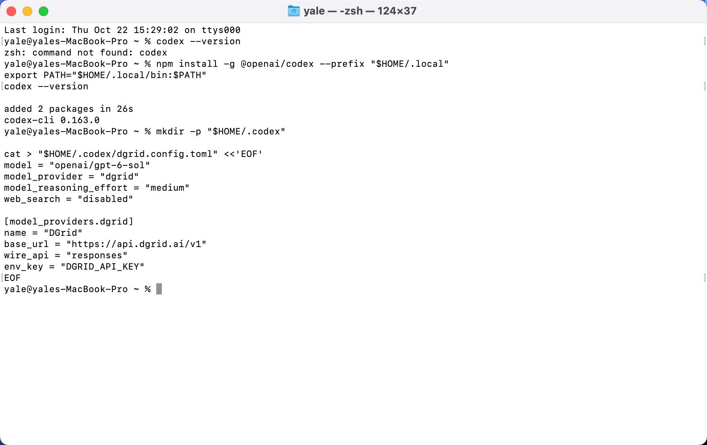
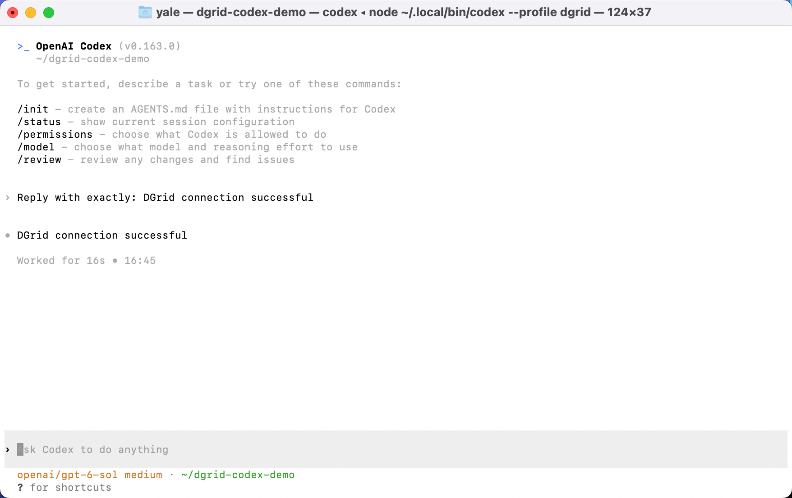
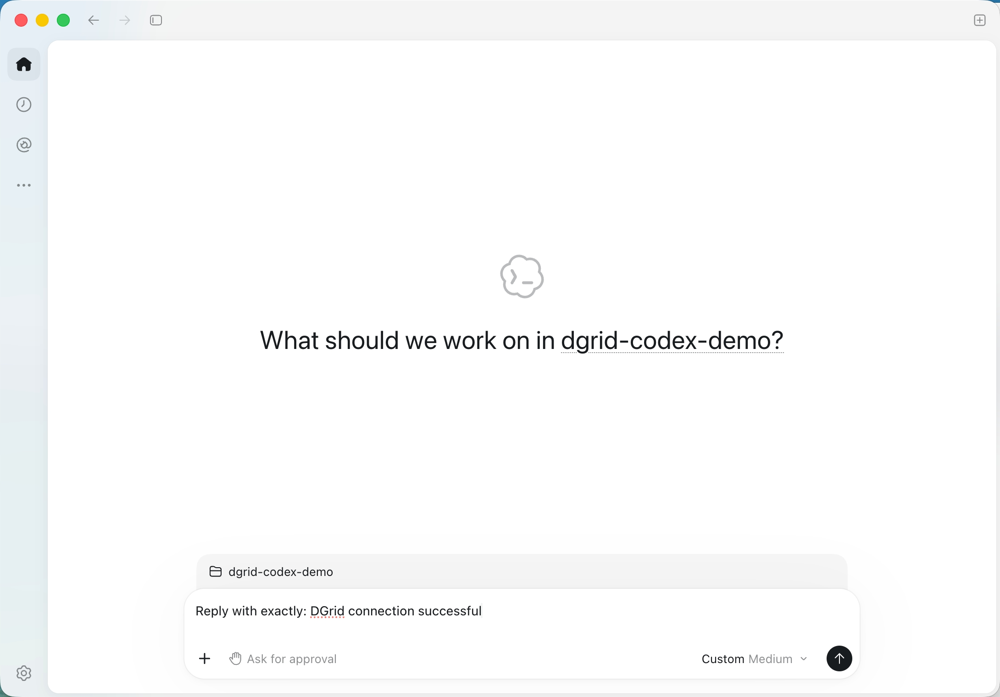
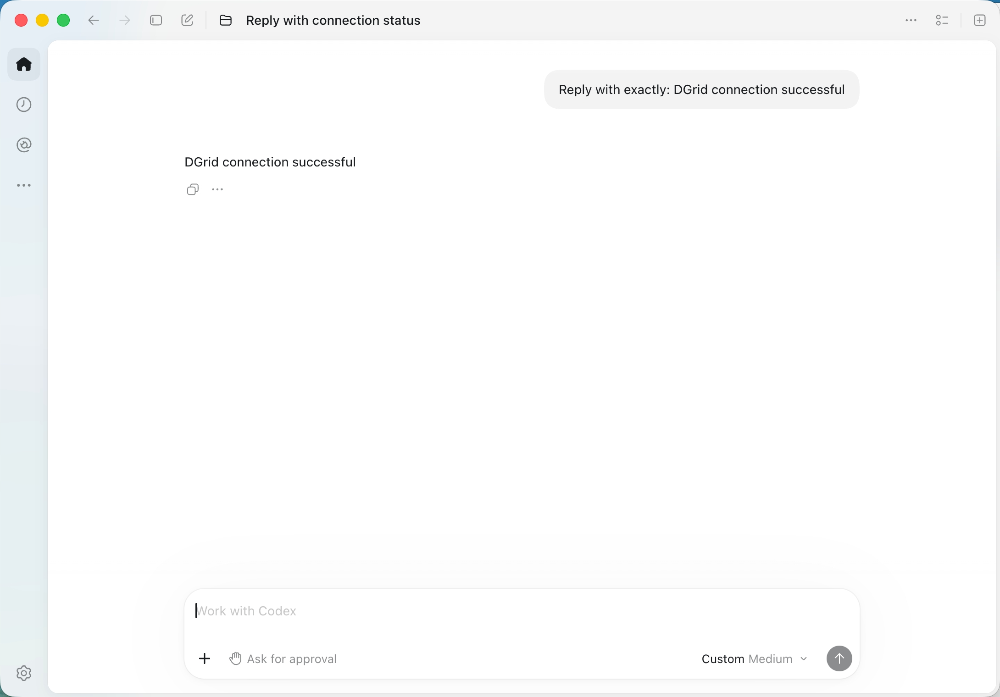
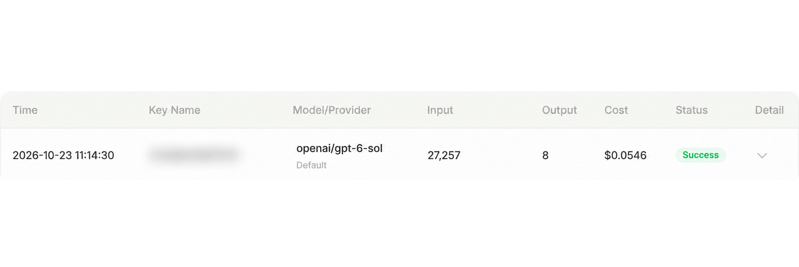

<Info>
Use una DGrid Model API Key para las solicitudes a los modelos. Una Management API Key es una credencial administrativa y no sirve para este tutorial. Compruebe que la clave tenga saldo disponible y acceso al modelo seleccionado.
</Info>

Conecte **Codex CLI** o **Codex en la aplicación de escritorio** con DGrid mediante su clave API, la URL base de Responses y el ID completo del modelo.

La descarga actual es la **aplicación ChatGPT que incluye Codex**. Algunas instalaciones conservan el nombre Codex. Obtenga la aplicación en la [página oficial](https://chatgpt.com/download/).

Esta guía usa `openai/gpt-6-sol`. Las capturas y el procedimiento de escritorio corresponden a macOS; también se incluyen instrucciones de instalación y CLI para Windows.

## Antes de empezar

- Una [cuenta de DGrid](https://dgrid.ai/) con saldo y acceso a un modelo compatible con la API Responses.
- Una clave API de DGrid: inicie sesión y cree o copie una clave desde [API Keys](https://dgrid.ai/api-keys).
- Para instalar con npm necesita Node.js y npm. El método de escritorio es independiente de la CLI.

No muestre la clave completa en capturas ni archivos compartidos. Conserve el ID completo, incluido el prefijo `openai/`.

<Note>
Si Codex indica un error de metadatos o catálogo, solicite a DGrid los ajustes adecuados para su versión. Los alias personalizados pueden necesitar metadatos correspondientes. No suponga una URL de catálogo. Consulte la [guía oficial de configuración de pasarelas](https://learn.chatgpt.com/docs/enterprise/connect-to-a-gateway).
</Note>

## Elegir el método de configuración

| Método | Configuración | Activación |
| --- | --- | --- |
| CLI | `~/.codex/dgrid.config.toml` | Ejecute `codex --profile dgrid`. |
| Aplicación de escritorio en macOS | `~/.codex/config.toml` | La aplicación lee su configuración principal al iniciarse. |

El perfil de CLI selecciona DGrid para las ejecuciones iniciadas con ese perfil. Editar el archivo principal cambia el proveedor predeterminado de los clientes que lo leen. Si depende de su entorno de escritorio actual, siga el procedimiento en otro equipo.

Ambos métodos usan estos parámetros de conexión:

| Parámetro | Valor |
| --- | --- |
| Model | `openai/gpt-6-sol` |
| Base URL | `https://api.dgrid.ai/v1` |
| Formato de la API | `responses` |
| Variable de entorno de la credencial | `DGRID_API_KEY` |

<Tabs>
<Tab title="CLI">

### 1. Instalar Node.js y Codex CLI

Si es necesario, instale la versión LTS actual desde la [página de Node.js](https://nodejs.org/en/download). Ejecute el instalador de macOS o Windows; los instaladores estándar incluyen npm.

Abra Terminal en macOS o PowerShell en Windows y compruebe:

```shell
node -v
npm -v
```

Siga el [método oficial de instalación de Codex con npm](https://learn.chatgpt.com/docs/codex/cli).

**macOS:** instale en su directorio de usuario.

```zsh
npm install -g @openai/codex --prefix "$HOME/.local"
export PATH="$HOME/.local/bin:$PATH"
codex --version
```

El comando PATH solo se aplica al terminal actual. Repítalo en nuevos terminales o añada el directorio a la configuración PATH del intérprete.

**Windows PowerShell:**

```powershell
npm install -g @openai/codex
codex --version
```

Si PowerShell bloquea `npm.ps1`, use `npm.cmd` en lugar de `npm`.

Las capturas usan `codex-cli 0.163.0`. El formato de perfil separado se aplica a Codex `0.134.0` y posteriores; consulte los [perfiles de configuración](https://learn.chatgpt.com/docs/config-file/config-advanced#profiles).

### 2. Crear un perfil de DGrid

Cree `~/.codex/dgrid.config.toml` en macOS o `%USERPROFILE%\.codex\dgrid.config.toml` en Windows. Pegue este contenido:

```toml
model = "openai/gpt-6-sol"
model_provider = "dgrid"
model_reasoning_effort = "medium"
web_search = "disabled"

[model_providers.dgrid]
name = "DGrid"
base_url = "https://api.dgrid.ai/v1"
wire_api = "responses"
env_key = "DGRID_API_KEY"
```

En macOS puede crear y abrir el archivo así:

```zsh
mkdir -p "$HOME/.codex"
touch "$HOME/.codex/dgrid.config.toml"
open -t "$HOME/.codex/dgrid.config.toml"
```

Si el perfil existe, modifique los ajustes correspondientes. Guarde como texto sin formato y use comillas rectas. `env_key` es el nombre de la variable: conserve `DGRID_API_KEY`.

<Frame caption="Instalación de Codex CLI y creación de un perfil de DGrid separado en Terminal">
  
</Frame>

### 3. Introducir la clave API

Use el mismo terminal desde el que iniciará Codex.

**Terminal de macOS con Zsh:**

```zsh
export DGRID_API_KEY
read -rs "DGRID_API_KEY?Paste your DGrid API key (hidden): "
```

Pegue la clave y pulse Intro. No se mostrará ningún carácter. Espere a que vuelva el indicador antes del siguiente comando.

**Windows PowerShell:** ejecute la primera línea, introduzca la clave en el indicador oculto y ejecute las líneas restantes.

```powershell
$dgridSecureKey = Read-Host "Paste your DGrid API key (hidden)" -AsSecureString
$env:DGRID_API_KEY = [System.Net.NetworkCredential]::new("", $dgridSecureKey).Password
Remove-Variable dgridSecureKey
```

La clave queda definida para esta sesión del terminal. Debe volver a introducirla en un terminal nuevo.

### 4. Iniciar Codex y enviar un mensaje

En macOS:

```zsh
mkdir -p "$HOME/dgrid-codex-demo"
cd "$HOME/dgrid-codex-demo"
codex --profile dgrid
```

En Windows PowerShell:

```powershell
New-Item -ItemType Directory -Force "$HOME/dgrid-codex-demo" | Out-Null
Set-Location "$HOME/dgrid-codex-demo"
codex --profile dgrid
```

Si Codex pregunta si confía en la carpeta, confirme para la carpeta de demostración creada. Compruebe el modelo `openai/gpt-6-sol`. También puede revisar la sesión con `/status`.

Envíe:

```text
Reply with exactly: DGrid connection successful
```

La respuesta esperada es:

```text
DGrid connection successful
```

<Frame caption="Respuesta en Codex CLI con el modelo de DGrid seleccionado">
  
</Frame>

El mensaje `Running without the shared background server: --profile requires embedded mode.` describe el modo de ejecución del perfil. Pulse F2 para verlo y Esc para cerrarlo; después continúe. Algunos teclados Mac usan Fn + F2.

</Tab>
<Tab title="Aplicación de escritorio (macOS)">

### 1. Instalar la aplicación de escritorio

Abra la [página oficial de descarga](https://chatgpt.com/download/) y elija su sistema operativo.

- **macOS:** abra el instalador descargado, arrastre la aplicación a Applications y ábrala.
- **Windows:** ejecute el instalador descargado y siga las instrucciones.

Elija la aplicación actual que incluye Codex. El procedimiento siguiente usa macOS y la ruta `/Applications/ChatGPT.app`.

Para usar las credenciales de DGrid, configure el proveedor y el entorno de inicio siguientes. El campo inicial `OpenAI API key` no define la URL base de DGrid.

### 2. Configurar DGrid en el archivo principal

**Cierre por completo la aplicación con Command + Q.** Cerrar solo la ventana puede dejarla en ejecución.

En Terminal de macOS, ejecute:

```zsh
mkdir -p "$HOME/.codex"
touch "$HOME/.codex/config.toml"
open -t "$HOME/.codex/config.toml"
```

Use estos ajustes en `config.toml`:

```toml
model = "openai/gpt-6-sol"
model_provider = "dgrid"
model_reasoning_effort = "medium"
web_search = "disabled"

[model_providers.dgrid]
name = "DGrid"
base_url = "https://api.dgrid.ai/v1"
wire_api = "responses"
env_key = "DGRID_API_KEY"
```

En un archivo existente, modifique las claves de nivel superior y colóquelas **antes del primer encabezado de tabla** (`[section]`). Añada la tabla de DGrid al final o modifique la existente. Conserve los demás ajustes sin duplicar claves ni tablas. Use texto sin formato y comillas rectas.

La aplicación lee este archivo principal. Un perfil de CLI por sí solo no selecciona DGrid en la aplicación. En Windows use `%USERPROFILE%\.codex\config.toml`. Consulte la [guía oficial de configuración de pasarelas](https://learn.chatgpt.com/docs/enterprise/connect-to-a-gateway).

### 3. Introducir la clave e iniciar la aplicación

En Terminal de macOS con Zsh:

```zsh
export DGRID_API_KEY
read -rs "DGRID_API_KEY?Paste your DGrid API key (hidden): "
```

Pegue la clave y pulse Intro. Cuando vuelva el indicador, ejecute lo siguiente **como un comando separado en el mismo terminal**:

```zsh
open -a "/Applications/ChatGPT.app" --env "DGRID_API_KEY=$DGRID_API_KEY"
```

Si la aplicación se llama `Codex.app`, use su ruta real.

Si Terminal indica que la aplicación ya está en ejecución y no puede definir las variables, ciérrela con Command + Q y repita el comando de inicio.

La clave se transmite al proceso iniciado. Para abrirlo desde otro terminal, repita la entrada oculta y el comando de inicio. Abrir desde el Dock no transmite una variable definida solo en este terminal.

### 4. Elegir un proyecto y enviar un mensaje

Cree una carpeta de demostración:

```zsh
mkdir -p "$HOME/dgrid-codex-demo"
```

En la aplicación de escritorio:

1. Haga clic en **Choose project** y seleccione `dgrid-codex-demo` en su carpeta de usuario.
2. Introduzca el prompt siguiente.
3. Haga clic en la flecha de envío.

```text
Reply with exactly: DGrid connection successful
```

<Frame caption="Proyecto seleccionado y prompt de conexión listo para enviar en Codex">
  
</Frame>

La respuesta esperada es:

```text
DGrid connection successful
```

<Frame caption="Respuesta del modelo en la aplicación Codex">
  
</Frame>

Algunas versiones muestran una etiqueta como **Custom Medium**. Compruebe el ID completo en la configuración y el registro correspondiente de DGrid para confirmar el modelo y la ruta.

</Tab>
</Tabs>

## Verificar la solicitud en DGrid

Busque la hora y el ID completo del modelo en el historial de DGrid. Una solicitud completada muestra **Success**.

<Frame caption="Historial de DGrid con openai/gpt-6-sol y Success; Key Name está difuminado">
  
</Frame>

Key Name está difuminado por privacidad. Los tokens y los costes varían según el modelo y el contexto enviado por Codex.

## Solución de problemas

| Síntoma | Qué comprobar |
| --- | --- |
| `codex: command not found` | Compruebe la instalación. En macOS, ejecute `export PATH="$HOME/.local/bin:$PATH"` en el terminal actual. |
| Falta la clave API | Defina la clave en el terminal que inicia el cliente. `env_key` nombra una variable, pero no define su valor. |
| La aplicación ya está en ejecución y no se pueden definir las variables | Cierre por completo con Command + Q y repita el comando de inicio. |
| Falla el inicio de sesión o la solicitud al abrir desde el Dock | Cierre la aplicación, introduzca la clave en Terminal e inicie con `--env`. |
| Error de autenticación o de acceso al modelo | Compruebe la clave de DGrid, el saldo, la compatibilidad con Responses y el ID completo del modelo. |
| Se ignora la configuración del proveedor | Use los archivos de usuario indicados. El archivo `.codex/config.toml` del proyecto no permite seleccionar un proveedor personalizado. |
| Volver al proveedor de escritorio anterior | Restaure el modelo, el proveedor y la autenticación anteriores; después cierre por completo y vuelva a abrir la aplicación. |

La [referencia de configuración de Codex](https://learn.chatgpt.com/docs/config-file/config-reference) describe los ajustes de proveedores. Esta guía cubre la conexión y la recepción de una respuesta. Las herramientas, la búsqueda web y las tareas largas dependen del modelo y de la pasarela.

## Recursos relacionados

- [Descripción general de los tutoriales de integración](/es/ai-gateway/integrations)
- [Inicio rápido de AI Gateway](/es/ai-gateway/overview#inicio-rápido)
- [Usar Codex CLI con DGrid](https://blog.dgrid.ai/posts/2026-03-23/)
