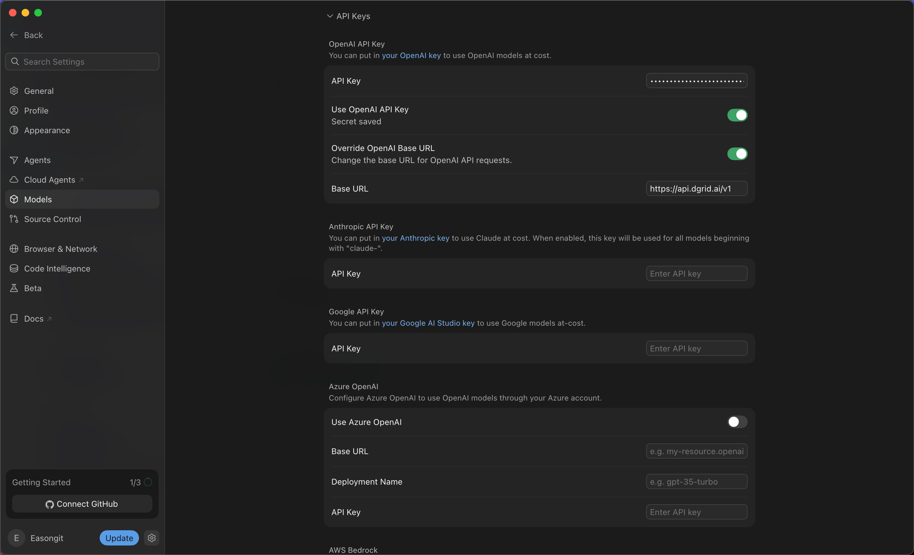
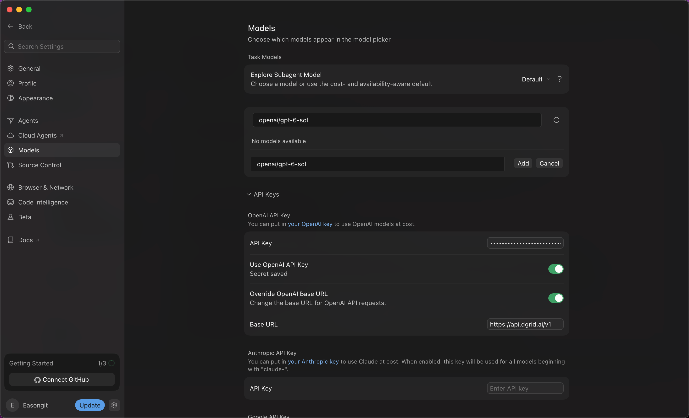
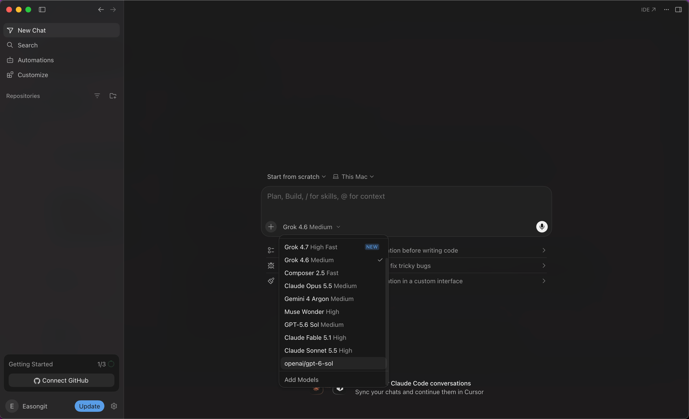
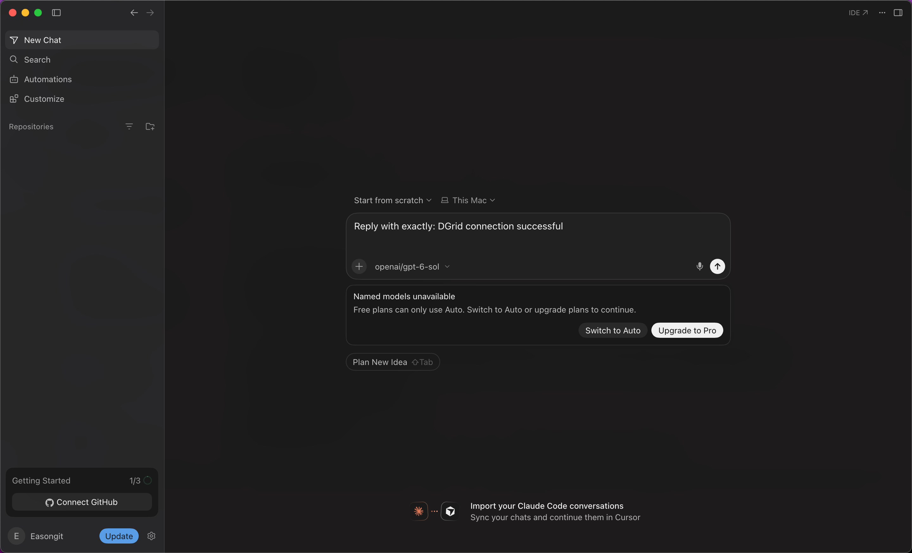

<Info>
Use una DGrid Model API Key para las solicitudes a los modelos. Una Management API Key es una credencial administrativa y no sirve para este tutorial. Compruebe que la clave tenga saldo disponible y acceso al modelo seleccionado.
</Info>

Configure Cursor con su clave de DGrid y una URL base compatible con OpenAI; después añada y seleccione el modelo con su ID completo de DGrid. El ejemplo usa `openai/gpt-6-sol`.

## Antes de empezar

- Un equipo macOS o Windows con conexión a Internet.
- Una cuenta de Cursor. Compruebe que su plan permita usar su propia clave (BYOK) y el modelo personalizado elegido. En la versión mostrada, la cuenta gratuita guardaba los ajustes, pero no podía enviar mensajes al modelo seleccionado.
- Una [cuenta de DGrid](https://dgrid.ai/) con saldo disponible y acceso al modelo elegido.

La suscripción de Cursor y el uso de modelos de DGrid se cobran por separado. Las capturas muestran una limitación del plan gratuito; consulte su cuenta y la documentación actual para conocer las funciones disponibles. Véase la [explicación de soporte de Cursor](https://forum.cursor.com/t/youve-hit-your-usage-limit-still-after-setting-my-key/150496/3).

La instalación cubre macOS y Windows. La configuración y las capturas usan Cursor `3.24.18` en macOS. Los menús pueden variar según la versión.

## Paso 1: instalar y abrir Cursor

En la [página oficial de Cursor](https://cursor.com/download), elija el instalador de escritorio de su sistema operativo.

### macOS

1. Elija **Mac (ARM64)** para Apple Silicon o **Mac (x64)** para Intel. **Mac Universal** admite ambos.
2. Abra el `.dmg` descargado y arrastre **Cursor** a **Applications**.
3. Abra Cursor desde Applications, complete la configuración inicial e inicie sesión en su cuenta.

### Windows

1. Elija **Windows (x64) (User)** para Intel o AMD, o **Windows (ARM64) (User)** para Windows en ARM. El instalador User instala Cursor para su cuenta de Windows.
2. Ejecute el `.exe` descargado y siga el asistente de instalación.
3. Abra Cursor desde el menú Inicio o su acceso directo, complete la configuración inicial e inicie sesión.

El resto de la configuración se ilustra en macOS.

## Paso 2: crear una clave API de DGrid

1. Inicie sesión en [DGrid](https://dgrid.ai/) y abra [API Keys](https://dgrid.ai/api-keys).
2. Haga clic en **Create New Key**, asigne un nombre como `Cursor` y cree la clave.
3. Copie la clave para el paso siguiente. No muestre la clave completa en capturas ni archivos compartidos.
4. En la lista de DGrid, compruebe que su clave acceda al modelo deseado y copie su ID completo. El ejemplo usa `openai/gpt-6-sol`.

## Paso 3: configurar la clave API y la URL base

1. Haga clic en el **icono de engranaje** junto a su nombre de cuenta, abajo a la izquierda de Cursor.
2. Seleccione **Models** en la barra lateral de ajustes.
3. Desplácese hacia abajo y expanda **API Keys**.
4. En **OpenAI API Key**, pegue su **clave API de DGrid** en **API Key**. Pulse Save si aparece. **Secret saved** confirma que se guardó.
5. Active **Override OpenAI Base URL** e introduzca:

```text
https://api.dgrid.ai/v1
```

6. Active **Use OpenAI API Key**. Si aparece la confirmación **Enable OpenAI API Key**, lea las limitaciones y haga clic en **Enable OpenAI API Key**.

Compruebe que los ajustes coincidan con esta tabla:

| Campo | Valor |
| --- | --- |
| API Key en OpenAI API Key | Su clave API de DGrid |
| Use OpenAI API Key | Activado |
| Override OpenAI Base URL | Activado |
| Base URL | `https://api.dgrid.ai/v1` |

Conserve el sufijo `/v1`. Oculte la clave en las capturas.

<Frame caption="Clave de DGrid guardada y opciones de clave API y URL base activadas">
  
</Frame>

## Paso 4: añadir el ID completo del modelo de DGrid

1. Desplácese hacia arriba hasta la lista de modelos de la misma página **Models**.
2. En **Add or search model**, introduzca:

```text
openai/gpt-6-sol
```

3. Si aparece **No models available**, haga clic en **Add Custom Model**.
4. En el nuevo campo, escriba el mismo ID completo y haga clic en **Add**.

<Frame caption="Adición del ID completo de DGrid como modelo personalizado">
  
</Frame>

5. Compruebe que **openai/gpt-6-sol** aparezca en la lista y esté activado.

Conserve el prefijo `openai/`. Si usa otro modelo, indique su ID exacto de DGrid tanto en los ajustes como en el chat.

## Paso 5: elegir el modelo en un chat nuevo

1. Haga clic en **Back**, arriba a la izquierda, para volver al chat. Cree uno nuevo si es necesario.
2. Haga clic en el nombre del modelo bajo el cuadro de entrada para abrir el selector.
3. Seleccione **`openai/gpt-6-sol`**, la entrada personalizada que acaba de añadir.
4. Compruebe que el área de entrada muestre **`openai/gpt-6-sol`** como modelo seleccionado.

<Frame caption="Selección del modelo personalizado de DGrid en el chat">
  
</Frame>

## Requisitos de suscripción y primer mensaje

<Note>
La captura siguiente muestra una limitación del plan, no una solicitud correcta. Confirme la ruta recibiendo una respuesta y encontrando la solicitud correspondiente en DGrid.
</Note>

Si Cursor muestra **Named models unavailable — Free plans can only use Auto**, el plan de la cuenta bloquea el modelo. Inicie sesión con una cuenta de pago compatible o decida si desea ampliar su suscripción. Cambiar a Auto no demuestra que se use el modelo DGrid seleccionado.

<Frame caption="Limitación del plan gratuito de Cursor al enviar al modelo personalizado">
  
</Frame>

Con un plan compatible, puede enviar un mensaje breve, por ejemplo:

```text
Reply with exactly: DGrid connection successful
```

Tras recibir la respuesta, compruebe el modelo, la hora y el estado **Success** en el historial de DGrid.

## Notas y solución de problemas

- **Alcance:** las claves personalizadas se aplican a los modelos de chat compatibles. El autocompletado Tab usa los modelos integrados de Cursor. Consulte la [documentación de claves API de Cursor](https://cursor.com/help/models-and-usage/api-keys) para funciones y facturación.
- **La clave se guarda, pero no se usa:** compruebe que **Use OpenAI API Key** y **Override OpenAI Base URL** estén activados y que la URL sea `https://api.dgrid.ai/v1`.
- **El modelo no aparece en el selector:** compruebe que añadió y activó el ID completo y vuelva a abrir el selector en un chat nuevo.
- **La solicitud falla tras comprobar la suscripción:** revise la clave, el saldo, el ID completo y los permisos. Añadir el modelo a Cursor no garantiza que las solicitudes funcionen.
- **Volver a otro proveedor:** revise la URL base sobrescrita antes de usar otros modelos OpenAI, ya que este ajuste cambia el destino de las solicitudes.

## Recursos relacionados

- [Descripción general de los tutoriales de integración](/es/ai-gateway/integrations)
- [Inicio rápido de AI Gateway](/es/ai-gateway/overview#inicio-rápido)
- [Configurar DGrid AI Gateway en Cursor](https://blog.dgrid.ai/posts/2026-02-18/)
