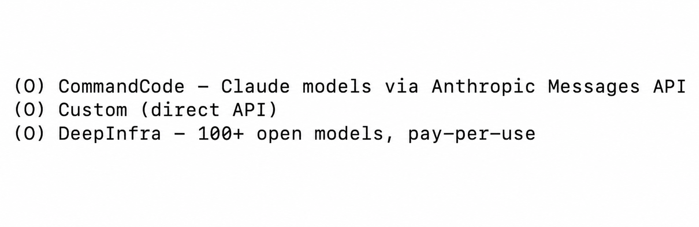
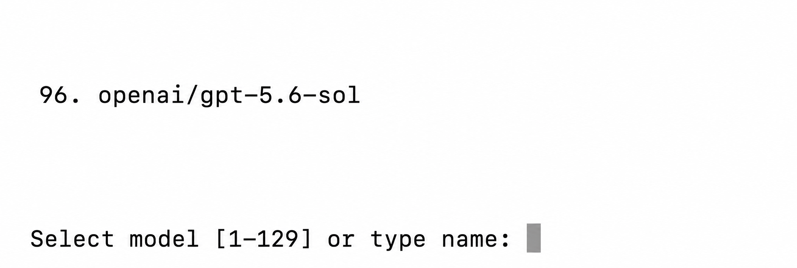
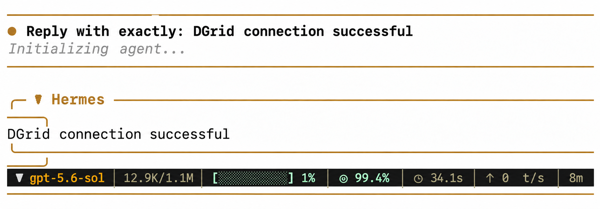
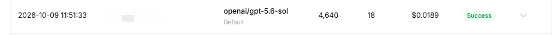

<Info>
Use una DGrid Model API Key para las solicitudes a los modelos. Una Management API Key es una credencial administrativa y no sirve para este tutorial. Compruebe que la clave tenga saldo disponible y acceso al modelo seleccionado.
</Info>

Para usar modelos de DGrid en Hermes Agent, añada un proveedor API personalizado e introduzca su clave y el endpoint de DGrid. Esta guía sigue el asistente inicial con el modelo `openai/gpt-5.6-sol`.

## Antes de empezar

- Una [cuenta de DGrid](https://dgrid.ai/) con saldo disponible.
- Un equipo con acceso a un terminal. Se incluyen comandos para macOS, Linux, WSL2 y Windows nativo.

## Paso 1: crear una clave API de DGrid

1. Inicie sesión en la [consola de DGrid](https://dgrid.ai/) y abra **Credits → Keys**, o vaya a [API Keys](https://dgrid.ai/api-keys).
2. Seleccione **Create New Key**, asigne un nombre como `Hermes` y cree la clave.
3. Copie la clave para pegarla en el campo **API key** de Hermes. No la incluya en capturas ni documentos públicos.

## Paso 2: instalar Hermes y abrir la configuración

En macOS, Linux o WSL2, ejecute:

```bash
curl -fsSL https://hermes-agent.nousresearch.com/install.sh | bash
```

En Windows nativo, ejecute en PowerShell:

```powershell
iex (irm https://hermes-agent.nousresearch.com/install.ps1)
```

Si aparece `prerequisites ok` o `Cloning ... hermes-agent.git`, la instalación sigue en curso. Espere al asistente de configuración.

En **How would you like to set up Hermes?**, seleccione **Full setup — configure every provider, tool & option yourself (bring your own keys)** con las flechas y pulse Intro o Espacio.

Si la instalación termina sin abrir el asistente, ejecute `hermes model` y continúe con el paso 3.

## Paso 3: elegir un proveedor API personalizado

En **Select provider**, elija **Custom (direct API)** cerca del final de la lista. Si entró mediante `hermes model`, elija **Custom endpoint (enter URL manually)**.

<Frame caption="Opción Custom direct API en el menú de proveedores de Hermes">
  
</Frame>

## Paso 4: introducir el endpoint y el modelo de DGrid

Siga las indicaciones del asistente en este orden:

| Indicación del asistente | Valor que debe introducir o seleccionar |
| --- | --- |
| **API base URL** | `https://api.dgrid.ai/v1` |
| **API key** | Su clave API de DGrid del paso 1 |
| **Select API compatibility mode** | **Chat Completions**, opción `2` del asistente actual |
| **Select model** | ID completo del modelo `openai/gpt-5.6-sol` |
| **Context length in tokens** | Déjelo vacío para la detección automática |
| **Display name** | `DGrid` |

La URL base termina en `/v1`; no añada `/chat/completions`. El texto genérico `[optional]` junto a **API key** no se aplica a la conexión con DGrid.

Tras introducir la clave, Hermes carga los modelos accesibles. En **Select model**, busque `openai/gpt-5.6-sol` e introduzca su número o el ID completo. La captura muestra `96`, pero puede variar: identifique el modelo por su ID. Si no aparece, elija otro modelo DGrid disponible compatible con Chat Completions.

<Frame caption="Modelo de ejemplo e indicación de selección en Hermes">
  
</Frame>

La configuración termina cuando Hermes confirma que guardó el modelo y el proveedor personalizado.

## Paso 5: iniciar Hermes y usar el modelo de DGrid

Ejecute:

```bash
hermes
```

En el primer inicio, **Help improve Hermes?** puede preguntar si desea compartir datos de uso. Elija su preferencia; **No thanks** también permite continuar. Introduzca un mensaje, por ejemplo:

```text
Reply with exactly: DGrid connection successful
```

Cuando Hermes responda, puede seguir conversando. Para confirmar que pasó por DGrid, busque el ID del modelo y el estado **Success** en el historial a esa hora. Las imágenes muestran un ejemplo de respuesta y registro.

<Frame caption="Conversación con un modelo de DGrid en Hermes">
  
</Frame>

<Frame caption="Solicitud al modelo en la consola de DGrid">
  
</Frame>

## Preguntas frecuentes

- **El asistente no se abre:** ejecute `hermes model`, elija el endpoint personalizado e introduzca los valores del paso 4.
- **Intro inserta `^M`:** pulse **Control+J** para enviar el texto actual.
- **Comprobar o cambiar el modelo:** ejecute `hermes status` para ver Model y Provider, y `hermes model` para volver a elegir un modelo.
- **Hay respuesta, pero aparece `Auxiliary title generation failed: Request timed out`:** el mensaje se refiere al título automático de la conversación y no anula la respuesta recibida.

Consulte la [guía de instalación de Hermes](https://hermes-agent.nousresearch.com/docs/getting-started/installation/) y la [documentación de proveedores](https://hermes-agent.nousresearch.com/docs/integrations/providers/).

## Recursos relacionados

- [Descripción general de los tutoriales de integración](/es/ai-gateway/integrations)
- [Inicio rápido de AI Gateway](/es/ai-gateway/overview#inicio-rápido)
