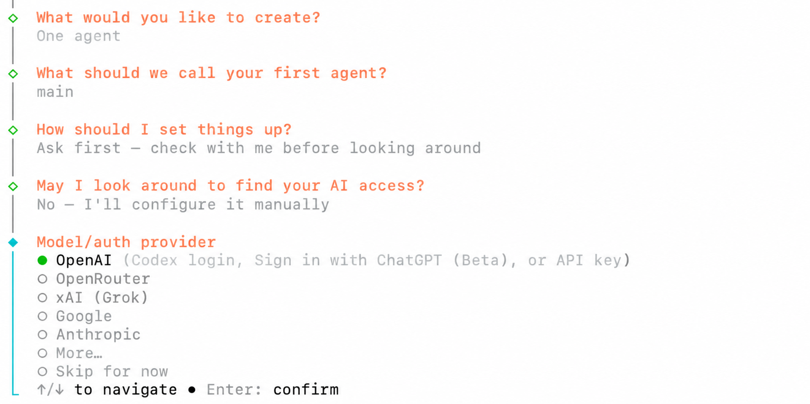
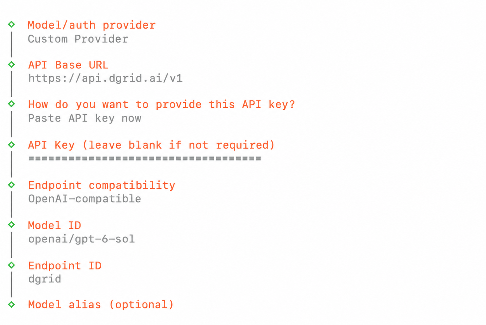
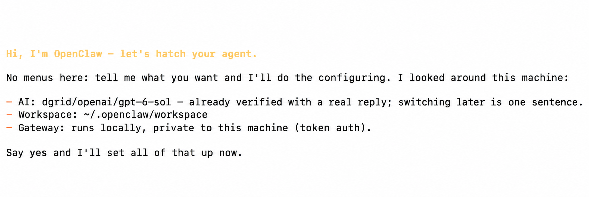
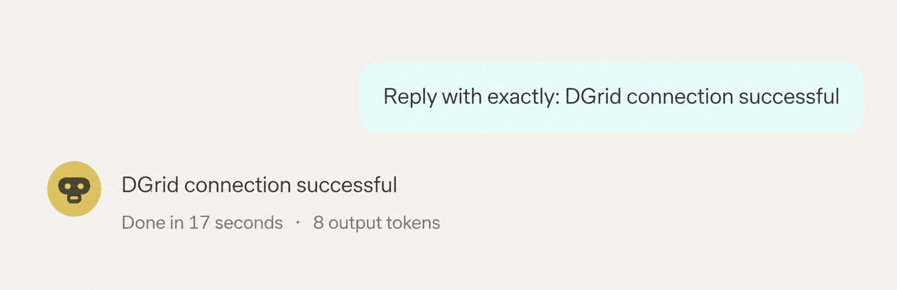
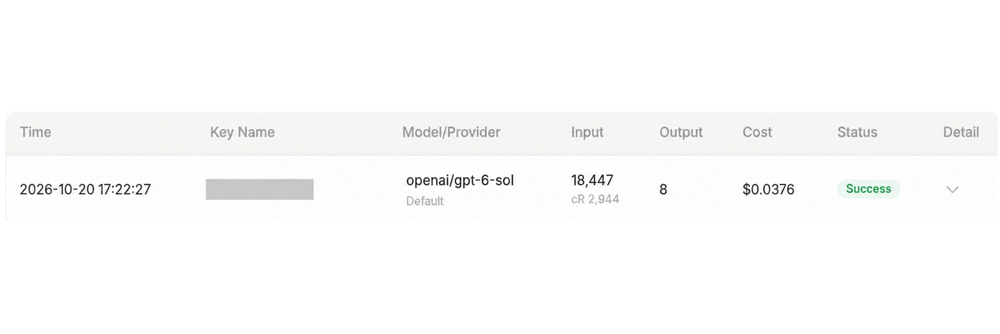

<Info>
Use una DGrid Model API Key para las solicitudes a los modelos. Una Management API Key es una credencial administrativa y no sirve para este tutorial. Compruebe que la clave tenga saldo disponible y acceso al modelo seleccionado.
</Info>

<Note>
OpenClaw Gateway es un servicio local que conecta el panel de OpenClaw en su equipo. DGrid AI Gateway es la API remota que recibe las solicitudes a los modelos. Sus credenciales de acceso son distintas.
</Note>

Conecte OpenClaw con DGrid añadiendo un Custom Provider con su clave, la URL base y un modelo. Esta guía cubre la instalación en macOS, la configuración y el primer mensaje en el panel web. El ejemplo usa `openai/gpt-6-sol`.

## Antes de empezar

- Un equipo macOS con Terminal y conexión a Internet.
- Una [cuenta de DGrid](https://dgrid.ai/) con saldo y acceso al modelo que desea usar.

Los menús y las capturas corresponden a OpenClaw `2026.10.5`. Los modelos disponibles dependen de su cuenta de DGrid. Puede elegir otro modelo accesible compatible con Chat Completions; introduzca su ID completo de DGrid.

## Paso 1: crear una clave API de DGrid

1. Inicie sesión en [DGrid](https://dgrid.ai/) y abra [API Keys](https://dgrid.ai/api-keys).
2. Haga clic en **Create New Key**, asigne un nombre como `OpenClaw` y cree la clave.
3. Copie la clave para pegarla en el asistente de OpenClaw en el paso 4. No muestre la clave completa en capturas ni documentos compartidos.

## Paso 2: instalar OpenClaw

Abra Terminal y ejecute:

```bash
curl -fsSL https://openclaw.ai/install-cli.sh | bash
```

El instalador oficial coloca OpenClaw y un entorno Node.js compatible en `~/.openclaw`. Espere a que confirme la instalación y vuelva el indicador del terminal.

Inicie el asistente con un comando separado:

```bash
"$HOME/.openclaw/bin/openclaw" onboard
```

Esta guía usa la ruta completa del comando para que pueda ejecutar OpenClaw inmediatamente después de instalarlo así.

## Paso 3: elegir la configuración manual del proveedor

Si el menú ofrece **Quick start** y **Custom setup**, elija **Custom setup**. Lea el aviso de seguridad y seleccione **Yes** si lo acepta. Elija su preferencia de estadísticas de uso; **No thanks** también permite continuar.

Use las flechas e Intro para estas selecciones:

| Indicación de configuración | Valor que debe elegir o introducir |
| --- | --- |
| What would you like to create? | **One agent** |
| What should we call your first agent? | Conserve **main** |
| How should I set things up? | **Ask first - check with me before looking around** |
| May I look around to find your AI access? | **No - I'll configure it manually** |

En **Model/auth provider**, elija **More...** para abrir la lista completa de proveedores.

<Frame caption="Selección manual y apertura de More en el menú de proveedores">
  
</Frame>

Busque `custom`, seleccione **Custom Provider** y pulse Intro.

## Paso 4: introducir los datos de conexión de DGrid

Rellene los campos en este orden. Pulse Intro tras cada campo y use las flechas e Intro en los menús.

| Indicación de configuración | Valor que debe introducir o seleccionar |
| --- | --- |
| API Base URL | `https://api.dgrid.ai/v1` |
| How do you want to provide this API key? | **Paste API key now** |
| API Key | Su clave API de DGrid del paso 1 |
| Endpoint compatibility | **OpenAI-compatible (Uses /chat/completions)** |
| Model ID | `openai/gpt-6-sol` |
| Endpoint ID | Sustituya el valor generado por `dgrid` |
| Model alias (optional) | Déjelo vacío y pulse Intro |

La URL base termina en `/v1`; no añada `/chat/completions`. Introduzca la clave de DGrid aunque la indicación genérica permita dejarla vacía cuando no sea necesaria.

Use `openai/gpt-6-sol` como Model ID, incluido el prefijo `openai/`. El Endpoint ID `dgrid` es el nombre local del proveedor en OpenClaw. Juntos forman la referencia `dgrid/openai/gpt-6-sol`.

<Frame caption="URL base de DGrid, clave oculta e ID del modelo y del endpoint">
  
</Frame>

Después del alias, OpenClaw comprueba la conexión al modelo. Espere a que termine. Si falla, revise la URL, la clave, el saldo y el ID completo antes de reintentar.

## Paso 5: terminar la configuración e iniciar el Gateway

El asistente resume el modelo, el espacio de trabajo y el Gateway local. Cuando indique **Say yes and I'll set all of that up now**, introduzca:

```text
yes
```

Pulse Intro y espere a que termine de aplicar la configuración.

<Frame caption="Revisión del resumen y entrada de yes para aplicar la configuración">
  
</Frame>

En una segunda ventana de terminal, instale el servicio Gateway en segundo plano:

```bash
"$HOME/.openclaw/bin/openclaw" gateway install
```

Compruebe que el Gateway esté activo y accesible:

```bash
"$HOME/.openclaw/bin/openclaw" gateway status
```

Si el asistente indica **Gateway is not reachable yet**, complete estos pasos antes de abrir el panel. Si sigue mostrando **Runtime: stopped**, consulte la solución de problemas siguiente.

Abra el panel web:

```bash
"$HOME/.openclaw/bin/openclaw" dashboard
```

Use el enlace abierto por el comando para conectarse al Gateway local.

## Paso 6: conversar con el modelo de DGrid

1. En el panel, abra **Home** y la sesión **main**.
2. Compruebe que el selector bajo el cuadro de entrada muestre **openai/gpt-6-sol (Custom Provider)**. Si usó otro modelo, selecciónelo.
3. En **Message main**, introduzca:

```text
Reply with exactly: DGrid connection successful
```

4. Haga clic en el **botón Send con forma de flecha hacia arriba** y espere la respuesta.

<Frame caption="Envío de un mensaje y recepción de respuesta en OpenClaw">
  
</Frame>

Ya puede seguir conversando con el modelo de DGrid. Busque el modelo y la hora en el historial de DGrid. Una solicitud completada muestra **Success**.

<Frame caption="Solicitud correcta al modelo de DGrid">
  
</Frame>

Para volver a abrir el panel más adelante, ejecute:

```bash
"$HOME/.openclaw/bin/openclaw" dashboard
```

## Solución de problemas

**El instalador indica que se necesita un TTY interactivo**

Tras la instalación, ejecute el asistente directamente desde Terminal:

```bash
"$HOME/.openclaw/bin/openclaw" onboard
```

**Falla la prueba de conexión al modelo**

Compruebe la URL `https://api.dgrid.ai/v1`, el saldo y los permisos de la clave, y el ID completo. Para esta configuración Chat Completions, Endpoint compatibility debe ser **OpenAI-compatible**.

**El Gateway sigue detenido después de actualizar**

Si el registro de inicio indica específicamente **Legacy device identity exists**, detenga el servicio y ejecute la migración y reparación integradas:

```bash
"$HOME/.openclaw/bin/openclaw" gateway stop
"$HOME/.openclaw/bin/openclaw" doctor --fix
```

Siga las indicaciones de reparación. Doctor puede reiniciar y comprobar el Gateway automáticamente. Vuelva a ejecutar `"$HOME/.openclaw/bin/openclaw" gateway status`; si sigue detenido, ejecute:

```bash
"$HOME/.openclaw/bin/openclaw" gateway start
```

**El navegador no se conecta al Gateway**

Compruebe el servicio con `"$HOME/.openclaw/bin/openclaw" gateway status` y vuelva a abrir el panel con el comando del paso 5. El token Gateway del panel es distinto de la clave API de DGrid.

Consulte la [guía de instalación de OpenClaw](https://docs.openclaw.ai/install/installer), la [documentación del asistente](https://docs.openclaw.ai/start/wizard) y la [referencia de Gateway CLI](https://docs.openclaw.ai/cli/gateway).

## Recursos relacionados

- [Descripción general de los tutoriales de integración](/es/ai-gateway/integrations)
- [Inicio rápido de AI Gateway](/es/ai-gateway/overview#inicio-rápido)
- [Configurar un agente OpenClaw con DGrid](https://blog.dgrid.ai/posts/2026-02-02/)
- [Instalación y configuración sin código de OpenClaw](https://blog.dgrid.ai/posts/2026-02-27/)

A continuación se conserva un vídeo anterior. Su interfaz puede diferir de la versión de esta guía.

<video controls preload="metadata" style={{ width: "100%", borderRadius: "12px", marginTop: "12px" }}>
  <source src="/images/dgrid-openclaw-demo.mp4" type="video/mp4" />
  Su navegador no admite la etiqueta video.
</video>
