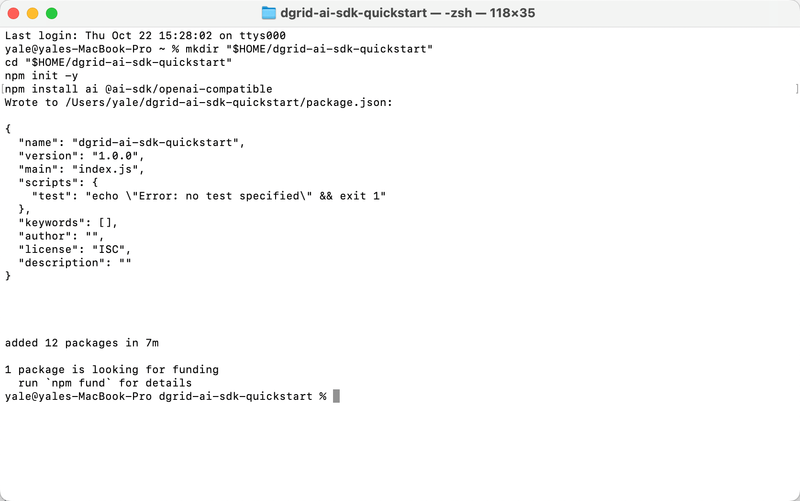
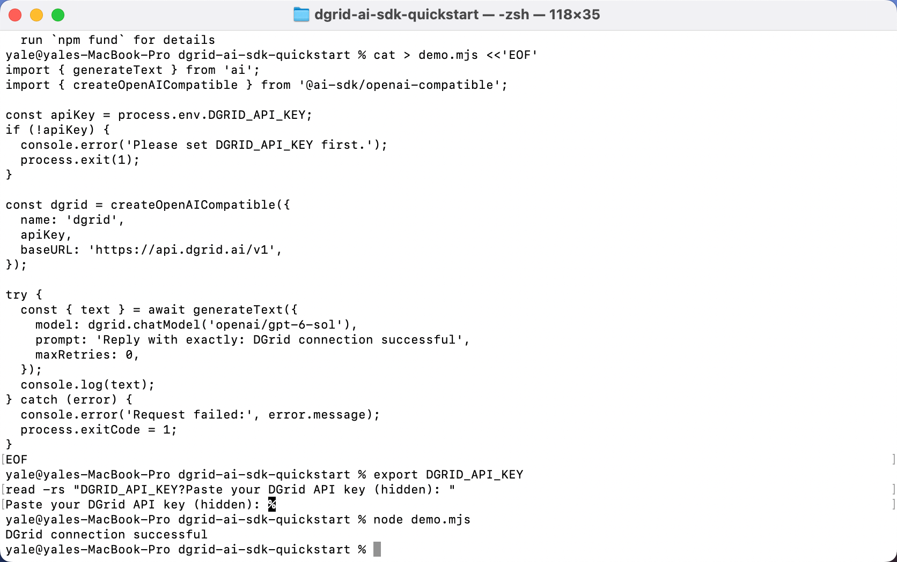

<Info>
Use una DGrid Model API Key para las solicitudes a los modelos. Una Management API Key es una credencial administrativa y no sirve para este tutorial. Compruebe que la clave tenga saldo disponible y acceso al modelo seleccionado.
</Info>

Vercel publica **AI SDK Core como el paquete npm `ai`**. Instalará el paquete, importará `generateText()` y conectará DGrid mediante el proveedor oficial compatible con OpenAI. Consulte la [introducción a Vercel AI SDK](https://ai-sdk.dev/docs/introduction).

Configure su clave de DGrid, la URL base compatible con OpenAI y el ID completo del modelo; después ejecute un script de Node.js para mostrar la respuesta obtenida mediante Vercel AI SDK.

Esta guía usa `openai/gpt-6-sol`. La aplicación se ejecuta localmente y envía la solicitud a DGrid mediante el proveedor compatible con OpenAI de AI SDK.

## Cómo se conecta Vercel AI SDK con DGrid

El SDK aparece tanto en la instalación como en el código JavaScript:

| Paquete o función | Función en este ejemplo |
| --- | --- |
| `ai` | Vercel AI SDK Core, instalado con npm. |
| `generateText` importado desde `ai` | Función de Vercel AI SDK que genera texto y devuelve el resultado. |
| `@ai-sdk/openai-compatible` | Paquete proveedor de AI SDK para servicios compatibles con OpenAI. |
| `createOpenAICompatible(...)` | Crea el proveedor del SDK con su clave de DGrid y la URL base. |
| `dgrid.chatModel(...)` | Proporciona un modelo de DGrid a la llamada `generateText()` del SDK. |

La solicitud sigue este flujo:

**Su script → Vercel AI SDK `generateText()` → proveedor compatible con OpenAI → DGrid → respuesta del modelo**

Node.js ejecuta el programa, Vercel AI SDK proporciona la interfaz de llamada y DGrid procesa la solicitud. El [ejemplo oficial del proveedor compatible](https://ai-sdk.dev/providers/openai-compatible-providers#example) también combina `generateText()` y `createOpenAICompatible()`.

## Antes de empezar

- Un equipo macOS o Windows con acceso a Internet.
- **Node.js 22 o posterior**, con npm.
- Una [cuenta de DGrid](https://dgrid.ai/) con saldo y acceso al modelo que desea usar.

El entorno del ejemplo usa Node.js `22.14.0`, npm `10.9.2`, `ai` `7.0.148` y `@ai-sdk/openai-compatible` `3.0.75`. Los comandos instalan AI SDK 7 y el proveedor compatible 3. Las capturas son de macOS; se indican las diferencias de comandos para Windows.

## Paso 1: instalar Node.js y comprobar el entorno

Si Node.js no está instalado, descargue la versión **LTS** actual desde la [página oficial](https://nodejs.org/en/download).

- **macOS:** elija el instalador de macOS, ejecute el `.pkg` descargado y siga los pasos.
- **Windows:** elija el instalador de la arquitectura de su equipo, ejecute el `.msi` descargado y siga los pasos.

Los instaladores estándar incluyen npm. Después abra una nueva ventana de **Terminal** en macOS o **PowerShell** en Windows y ejecute:

```shell
node -v
npm -v
```

Ambos comandos deben mostrar una versión. Si Node.js es anterior a 22, actualícelo antes de continuar.

## Paso 2: crear una clave API de DGrid

1. Inicie sesión en [DGrid](https://dgrid.ai/) y abra [API Keys](https://dgrid.ai/api-keys).
2. Haga clic en **Create New Key**, asigne un nombre y cree la clave.
3. Copie la clave para el paso 5. No muestre la clave completa en capturas ni archivos compartidos.
4. En la lista de DGrid, compruebe el acceso a `openai/gpt-6-sol` o copie el ID completo de otro modelo compatible con Chat Completions.

Use el ID completo con el prefijo del proveedor; en este ejemplo, `openai/gpt-6-sol`.

## Paso 3: crear el proyecto e instalar Vercel AI SDK

Ejecute estos comandos en Terminal de macOS o PowerShell de Windows:

```shell
mkdir "$HOME/dgrid-ai-sdk-quickstart"
cd "$HOME/dgrid-ai-sdk-quickstart"
npm init -y
npm install ai@7 @ai-sdk/openai-compatible@3
```

Este comando instala **Vercel AI SDK Core** (`ai@7`) y su **proveedor compatible con OpenAI** (`@ai-sdk/openai-compatible@3`). El siguiente paso importa ambos paquetes para llamar a DGrid.

Espere a que npm confirme la instalación y vuelva el indicador del terminal. El tiempo depende de su conexión.

<Frame caption="Proyecto de ejemplo y dependencias del SDK instalados en Terminal">
  
</Frame>

## Paso 4: llamar a DGrid con Vercel AI SDK

En un editor, cree **`demo.mjs`** en `dgrid-ai-sdk-quickstart`, junto a `package.json`. Pegue el código y guarde como texto sin formato. Compruebe que se llame `demo.mjs`, no `demo.mjs.txt`.

La extensión `.mjs` permite a Node.js usar las instrucciones `import` del ejemplo.

```javascript
// Vercel AI SDK Core: the text-generation API.
import { generateText } from 'ai';
// AI SDK provider: connects to OpenAI-compatible services such as DGrid.
import { createOpenAICompatible } from '@ai-sdk/openai-compatible';

const apiKey = process.env.DGRID_API_KEY;
if (!apiKey) {
  console.error('Please set DGRID_API_KEY first.');
  process.exit(1);
}

// Configure the AI SDK provider with the DGrid key and endpoint.
const dgrid = createOpenAICompatible({
  name: 'dgrid',
  apiKey,
  baseURL: 'https://api.dgrid.ai/v1',
});

try {
  // Run the DGrid model request through Vercel AI SDK Core.
  const { text } = await generateText({
    model: dgrid.chatModel('openai/gpt-6-sol'),
    prompt: 'Reply with exactly: DGrid connection successful',
    maxRetries: 0,
  });
  console.log(text);
} catch (error) {
  console.error('Request failed:', error.message);
  process.exitCode = 1;
}
```

Estos son los principales ajustes de conexión:

| Código | Finalidad |
| --- | --- |
| `process.env.DGRID_API_KEY` | Lee la clave del entorno del terminal. |
| `baseURL: 'https://api.dgrid.ai/v1'` | Envía las solicitudes a DGrid. Conserve el sufijo `/v1`. |
| `dgrid.chatModel('openai/gpt-6-sol')` | Selecciona el ID completo de DGrid mediante el adaptador Chat Completions. |
| `generateText(...)` | Vercel AI SDK Core envía el prompt mediante el proveedor configurado y devuelve el texto generado. |

Si eligió otro modelo en el paso 2, sustituya `openai/gpt-6-sol` por su ID completo. `name: 'dgrid'` es una etiqueta local del SDK.

## Paso 5: introducir su clave API de DGrid

Siga las instrucciones de su intérprete. Introduzca la clave en el mismo terminal donde ejecutará el script.

### Terminal de macOS con Zsh

Ejecute:

```zsh
export DGRID_API_KEY
read -rs "DGRID_API_KEY?Paste your DGrid API key (hidden): "
```

En **Paste your DGrid API key (hidden):**, pegue su clave y pulse Intro. No se mostrará en pantalla.

### Windows PowerShell

Ejecute el primer comando, introduzca la clave en el indicador oculto y pulse Intro. Después ejecute los demás comandos para proporcionársela a Node.js:

```powershell
$dgridSecureKey = Read-Host "Paste your DGrid API key (hidden)" -AsSecureString
$env:DGRID_API_KEY = [System.Net.NetworkCredential]::new("", $dgridSecureKey).Password
Remove-Variable dgridSecureKey
```

Los ajustes solo duran durante esta sesión. Defina la clave de nuevo en otro terminal. No la incluya en `demo.mjs` ni en el control de versiones.

## Paso 6: ejecutar el ejemplo

Desde el directorio del proyecto y en el terminal donde introdujo la clave, ejecute:

```shell
node demo.mjs
```

Espere la respuesta del modelo. Para el prompt del ejemplo, el texto esperado es:

```text
DGrid connection successful
```

<Frame caption="Ejecución del script y recepción de la respuesta mediante DGrid">
  
</Frame>

Para hacer otra pregunta, modifique `prompt` en `demo.mjs`, guarde y ejecute de nuevo `node demo.mjs`. Cada ejecución crea una solicitud.

## Paso 7: consultar la solicitud en DGrid

Busque el modelo y la hora en el historial de DGrid. Una solicitud completada muestra **Success**.

<Frame caption="Historial de DGrid con el modelo elegido y Success; Key Name está difuminado">
  
</Frame>

Key Name está difuminado por privacidad. Los tokens, el uso de caché y los cargos varían según la solicitud.

## Solución de problemas

| Mensaje o síntoma | Qué comprobar |
| --- | --- |
| `Please set DGRID_API_KEY first.` | Repita el paso 5 en el mismo terminal y vuelva a ejecutar el script. |
| `Cannot find module` o `ERR_MODULE_NOT_FOUND` | Compruebe que está en `dgrid-ai-sdk-quickstart` y que instaló allí las dependencias. |
| El terminal no encuentra `demo.mjs` | Compruebe el directorio y el nombre del archivo, incluida una posible extensión `.txt` adicional. |
| Error de autenticación | Vuelva a introducir la clave de DGrid y compruebe que sea válida. |
| Error de modelo o de acceso | Compruebe el ID completo, los permisos y el saldo disponible de DGrid. |
| Error de red | Compruebe que su equipo pueda acceder a la API de DGrid y vuelva a intentarlo. |
| PowerShell bloquea `npm.ps1` | Use `npm.cmd` en lugar de `npm` para inicializar e instalar. |

Consulte la [guía de AI SDK para Node.js](https://ai-sdk.dev/docs/getting-started/nodejs) y la [documentación del proveedor compatible con OpenAI](https://ai-sdk.dev/providers/openai-compatible-providers).

## Recursos relacionados

- [Descripción general de los tutoriales de integración](/es/ai-gateway/integrations)
- [Inicio rápido de AI Gateway](/es/ai-gateway/overview#inicio-rápido)
- [Usar DGrid con Vercel AI SDK](https://blog.dgrid.ai/posts/2026-03-26/)
