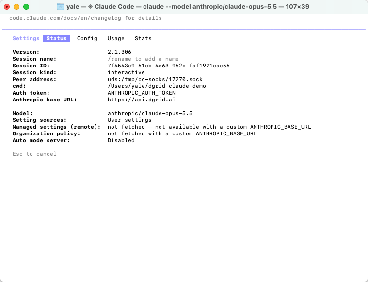
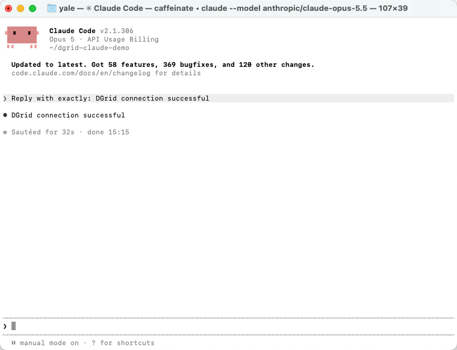
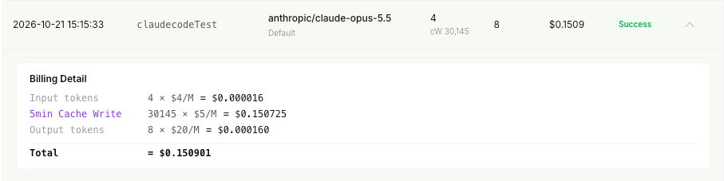
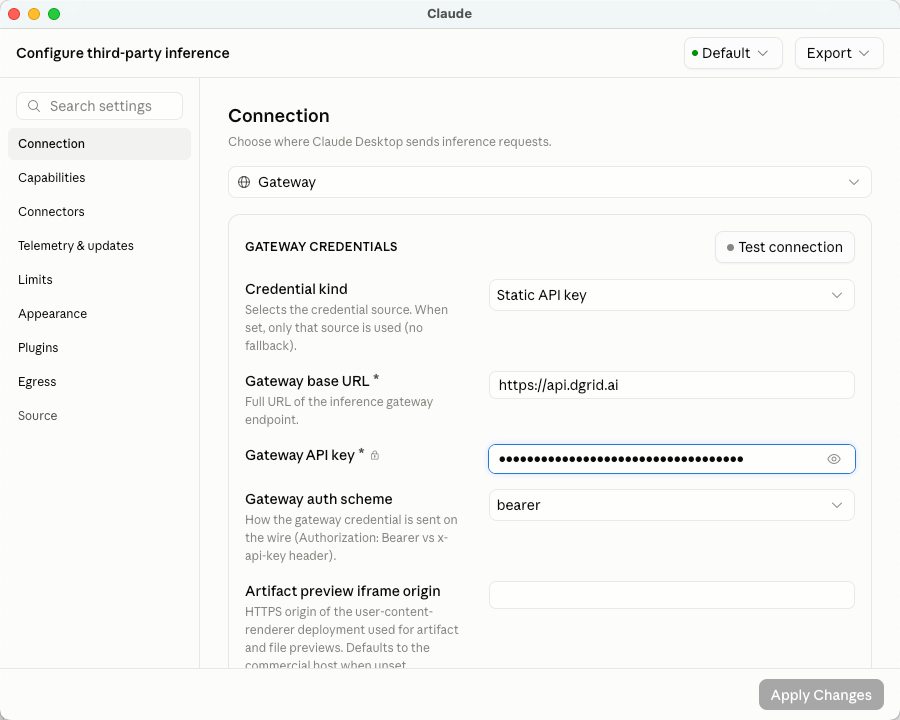
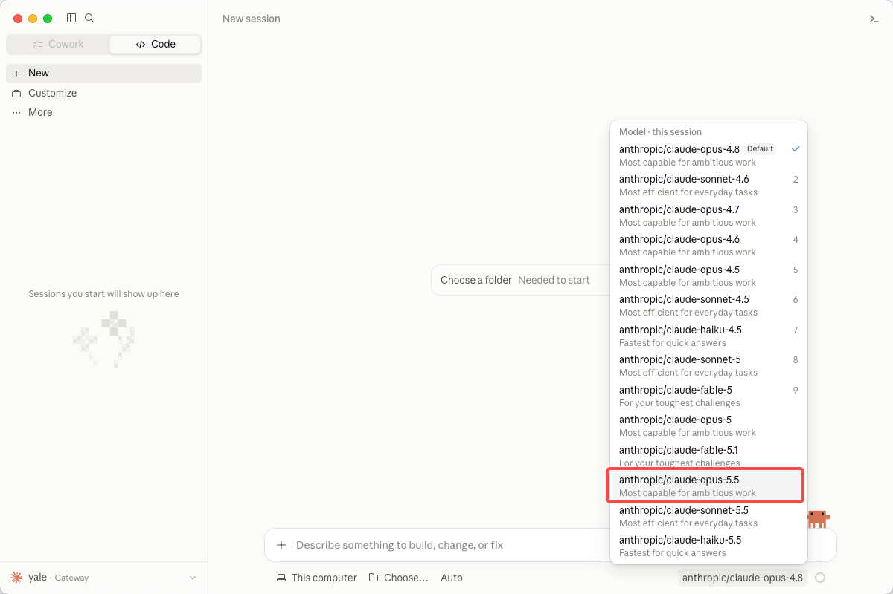
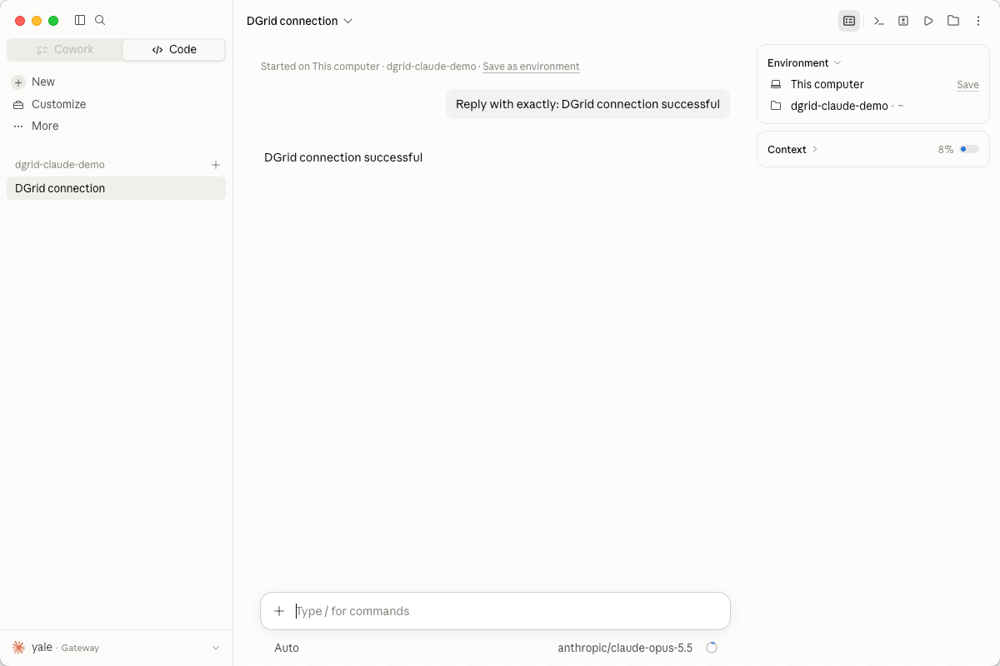

<Info>
Utilisez une DGrid Model API Key pour les requêtes aux modèles. Une Management API Key est une clé d'administration et ne convient pas à ce tutoriel. Vérifiez les crédits disponibles et l'accès au modèle choisi.
</Info>

Connectez Claude Code à DGrid avec votre clé API DGrid, l'URL de la passerelle et un modèle Claude accessible à cette clé. Ce guide présente d'abord le Terminal macOS, puis la configuration dans l'onglet **Code** de l'application Claude.

L'exemple utilise `anthropic/claude-opus-5.5`. Conservez l'ID DGrid complet, préfixe `anthropic/` inclus. Vous pouvez le remplacer par un autre modèle Claude disponible dans tout le guide.

## Avant de commencer

- Un Mac connecté à Internet. Les commandes utilisent Zsh, le shell par défaut de macOS.
- Un [compte DGrid](https://dgrid.ai/) disposant de crédits et d'un accès au modèle Claude choisi.
- Pour l'installation avec npm : **Node.js 22 ou version ultérieure et npm**. Les instructions figurent ci-dessous.

Les captures CLI utilisent Claude Code `2.1.306`. Les menus et les modèles disponibles peuvent varier selon la version. La configuration de bureau est indépendante : vous pouvez la suivre sans installer la CLI.

## Étape 1 : créer une clé API DGrid et choisir un modèle

1. Connectez-vous à [DGrid](https://dgrid.ai/) et ouvrez [API Keys](https://dgrid.ai/api-keys).
2. Cliquez sur **Create New Key**, nommez la clé et créez-la.
3. Copiez la clé pour la suite. Ne montrez jamais la clé complète dans les captures ou fichiers partagés.
4. Dans la liste DGrid, trouvez un modèle Claude disponible et copiez son ID complet. Ce guide utilise `anthropic/claude-opus-5.5`.

Voici les paramètres de connexion :

| Paramètre | Valeur |
| --- | --- |
| Base URL | `https://api.dgrid.ai` |
| Identifiant d'authentification | Votre clé API DGrid |
| ID du modèle d'exemple | `anthropic/claude-opus-5.5` |

**N'ajoutez ni `/v1` ni `/v1/messages` à l'URL de base.** Claude Code ajoute le chemin de l'API Messages lors des requêtes.

<Tabs>
<Tab title="CLI">

### Étape 2 : installer Claude Code


Si Claude Code est déjà installé, exécutez `claude --version`. Si un numéro s'affiche, passez à l'étape 3.

#### Installation avec npm

Vérifiez d'abord la présence de Node.js et npm :

```zsh
node -v
npm -v
```

Si une commande est introuvable ou si Node.js est antérieur à 22, installez la version **LTS** actuelle depuis la [page Node.js](https://nodejs.org/en/download). Choisissez l'installateur macOS, qui inclut npm. Ouvrez ensuite un nouveau terminal et relancez les deux commandes.

Installez Claude Code dans votre répertoire utilisateur :

```zsh
npm install -g @anthropic-ai/claude-code --prefix "$HOME/.local"
```

Ajoutez le répertoire d'installation au PATH du terminal et vérifiez la version :

```zsh
export PATH="$HOME/.local/bin:$PATH"
claude --version
```

Cette installation utilisateur ne nécessite pas `sudo`. Pour conserver le PATH dans les nouveaux terminaux, ajoutez la même ligne `export PATH` à `~/.zshrc` avec un éditeur de texte.

#### Alternative : installateur natif

Vous pouvez utiliser l'[installateur natif officiel](https://code.claude.com/docs/en/setup#install-claude-code), sans installation séparée de Node.js :

```zsh
curl -fsSL https://claude.ai/install.sh | bash
```

Après l'installation, ouvrez un terminal et vérifiez `claude --version`. Si la commande est introuvable, ajoutez `~/.local/bin` au PATH comme ci-dessus. Choisissez une seule méthode. Si l'URL renvoie du HTML ou si le téléchargement échoue, installez Node.js et utilisez npm.

### Étape 3 : configurer DGrid dans le terminal actuel

Exécutez ce bloc dans Zsh. La dernière commande demande la clé sans afficher votre saisie :

```zsh
export ANTHROPIC_BASE_URL="https://api.dgrid.ai"
unset ANTHROPIC_API_KEY
export ANTHROPIC_AUTH_TOKEN
read -rs "ANTHROPIC_AUTH_TOKEN?Paste your DGrid API key (hidden): "
```

À l'invite **Paste your DGrid API key (hidden):**, collez votre clé DGrid et appuyez sur Entrée. Le terminal revient à l'invite sans afficher la clé.

Continuez dans ce terminal pour que Claude Code hérite des variables. Ces paramètres ne valent que pour cette session. Dans un nouveau terminal, répétez cette étape ou utilisez la configuration de projet facultative ci-dessous.

Les paramètres d'un ancien fournisseur peuvent encore s'appliquer. `unset` supprime une variable du shell, pas une entrée de fichier. Vérifiez la connexion à l'étape 5 ; si une autre clé est détectée, consultez le dépannage.

### Étape 4 : lancer Claude Code

Créez un dossier dédié à votre première session, puis lancez Claude Code avec l'ID DGrid complet :

```zsh
mkdir -p "$HOME/dgrid-claude-demo"
cd "$HOME/dgrid-claude-demo"
claude --model "anthropic/claude-opus-5.5"
```

Si Claude Code demande si le dossier est fiable, vérifiez le chemin et sélectionnez **Yes, I trust this folder** pour le dossier créé. Terminez les éventuels réglages d'apparence du premier lancement.

### Étape 5 : vérifier la connexion active

Dans Claude Code, saisissez :

```text
/status
```

L'onglet **Status** doit afficher :

| Champ d'état | Valeur attendue |
| --- | --- |
| Auth token | `ANTHROPIC_AUTH_TOKEN` |
| Anthropic base URL | `https://api.dgrid.ai` |
| Model | `anthropic/claude-opus-5.5` |

<Frame caption="État de Claude Code : URL DGrid, source du jeton et modèle choisi">
  
</Frame>

Si vous avez choisi un autre modèle Claude, vérifiez son ID complet. Appuyez sur Échap pour revenir à la conversation.

### Étape 6 : envoyer votre premier message

Saisissez :

```text
Reply with exactly: DGrid connection successful
```

Appuyez sur Entrée et attendez la réponse :

```text
DGrid connection successful
```

<Frame caption="Réponse obtenue dans le Terminal Claude Code">
  
</Frame>

Vous pouvez continuer à utiliser Claude Code via DGrid. Pour consulter l'utilisation, retrouvez le modèle et l'heure dans l'historique DGrid. Une requête terminée porte le statut **Success**.

<Frame caption="Requête Claude terminée dans DGrid">
  
</Frame>

Le nombre de tokens et les frais varient selon la requête. La capture montre un exemple incluant l'écriture en cache.

#### Facultatif : enregistrer les paramètres du projet

Pour éviter de ressaisir les variables, configurez `.claude/settings.local.json` dans le projet. Avant de créer ce fichier, ajoutez `.claude/settings.local.json` au `.gitignore` du projet pour exclure la clé du suivi de versions.

Créez ou modifiez le fichier local en remplaçant la valeur de substitution par votre clé DGrid :

```json
{
  "env": {
    "ANTHROPIC_BASE_URL": "https://api.dgrid.ai",
    "ANTHROPIC_AUTH_TOKEN": "<your-dgrid-api-key>",
    "ANTHROPIC_API_KEY": ""
  },
  "model": "anthropic/claude-opus-5.5"
}
```

Fusionnez ces champs avec les paramètres existants. La clé est stockée dans un fichier local : gardez-le privé. Dans un nouveau terminal, ouvrez le dossier du projet, lancez `claude` et vérifiez avec `/status`. Les portées sont décrites dans le [guide officiel de la passerelle](https://code.claude.com/docs/en/llm-gateway-connect#set-in-a-settings-file).

</Tab>
<Tab title="Application de bureau">

Claude Code est aussi disponible dans l'onglet **Code** de l'application Claude. Configurez sa passerelle séparément de la CLI. Les variables du terminal ne configurent pas la connexion d'inférence tierce de l'application.

### 1 Ouvrir les paramètres d'inférence tierce

1. Téléchargez et installez l'[application Claude](https://claude.com/download) pour macOS, puis ouvrez-la.
2. Dans la barre de menus macOS, choisissez **Help → Troubleshooting → Enable Developer Mode**.
3. Autorisez le redémarrage si nécessaire, puis choisissez **Developer → Configure Third-Party Inference…**.
4. Si une erreur de passerelle propose **Open Setup**, ce bouton ouvre aussi la configuration.

Si le menu Developer disparaît après la première configuration tierce, réactivez Developer Mode depuis Help. Le [guide officiel de configuration dans l'application](https://claude.com/docs/third-party/claude-desktop/in-app-configuration) explique ce comportement et l'option locale Apply Changes.

### 2 Saisir les paramètres de connexion DGrid

Ouvrez **Connection** et utilisez ces valeurs :

| Champ | Valeur à saisir ou sélectionner |
| --- | --- |
| Inference provider | **Gateway** |
| Credential kind | **Static API key** |
| Gateway base URL | `https://api.dgrid.ai` |
| Gateway API key | Votre clé API DGrid |
| Gateway auth scheme | **bearer** |

Laissez **Artifact preview iframe origin** à sa valeur par défaut. Masquez la clé avec l'icône en forme d'œil avant toute capture.

<Frame caption="Paramètres de connexion à la passerelle DGrid dans Claude">
  
</Frame>

Cliquez sur **Apply Changes** pour appliquer la configuration locale ; l'application redémarre. Vous pouvez aussi utiliser **Test connection**. En cas d'échec, ouvrez les détails et vérifiez le modèle testé et la réponse.

### 3 Choisir le modèle et démarrer une session locale

1. Ouvrez l'onglet **Code** et créez une session.
2. Si un sélecteur d'environnement apparaît, choisissez **This computer**.
3. Dans le sélecteur, choisissez **`anthropic/claude-opus-5.5`** ou un autre modèle Claude disponible.
4. Cliquez sur **Choose a folder** ou sur le contrôle du dossier de projet et choisissez `dgrid-claude-demo`. Si vous avez ignoré la CLI, créez et sélectionnez un nouveau dossier.

<Frame caption="Sélection de l'ID DGrid complet du modèle Claude dans l'application">
  
</Frame>

Envoyez :

```text
Reply with exactly: DGrid connection successful
```

Attendez la réponse. Le nom du modèle sous la zone de saisie doit correspondre à votre choix.

<Frame caption="Réponse DGrid obtenue dans l'onglet Code de Claude">
  
</Frame>

Vous pouvez poursuivre votre travail avec DGrid dans cette session.

</Tab>
</Tabs>

## Dépannage

### Le terminal indique command not found ou permission denied

Vérifiez la commande trouvée par le shell :

```zsh
type -a claude
```

Avec l'installation utilisateur ci-dessus, vérifiez que `~/.local/bin` figure dans le PATH. Vous pouvez tester directement le lanceur installé :

```zsh
"$HOME/.local/bin/claude" --version
```

Si le fichier est absent ou inutilisable, vérifiez la sortie de l'installateur et terminez l'installation avant de configurer la passerelle. Voir le [dépannage de l'installation Claude Code](https://code.claude.com/docs/en/troubleshooting).

### Claude Code détecte une autre clé API ou une mauvaise passerelle

Les paramètres utilisateur ou du projet peuvent contenir des variables de fournisseur. Si le premier lancement propose une ancienne `ANTHROPIC_API_KEY` indésirable, choisissez **No**. Vérifiez ensuite avec `/status` l'URL DGrid, la source `ANTHROPIC_AUTH_TOKEN` et le modèle.

Si l'état est incorrect, examinez `env` dans `~/.claude/settings.json`, `.claude/settings.json`, `.claude/settings.local.json` et vos outils de changement de fournisseur. Les fichiers peuvent remplacer les variables du shell. Modifiez les champs concernés ou utilisez la configuration locale ci-dessus en conservant le reste. Redémarrez la session et revérifiez `/status`.

### Une requête échoue avec une erreur d'authentification ou de modèle

Vérifiez la clé DGrid, les crédits et l'accès au modèle Claude. Utilisez l'ID DGrid complet sans supposer qu'un alias intégré correspond au catalogue. Ressaisissez la clé sans l'afficher si nécessaire.

### L'application de bureau signale une erreur de passerelle

Ouvrez **Details** et examinez l'URL, le statut HTTP, le message et, le cas échéant, `probedModel`. Le test peut utiliser un autre modèle que le chat. Vérifiez l'accès de la clé au modèle indiqué.

Un `HTTP 500` avec `upstream_error` ne permet pas à lui seul d'identifier une erreur de clé, de routage ou de service amont. Vérifiez les paramètres enregistrés et l'accès au modèle, puis réessayez. Si l'erreur persiste, transmettez l'heure et les détails au support DGrid, sans clé API.

### Le modèle attendu n'apparaît pas dans l'application

Rouvrez les paramètres d'inférence tierce et vérifiez l'application de la passerelle DGrid, de la clé et de l'accès au modèle. La liste peut provenir de la découverte par la passerelle ou d'une configuration explicite. Voir la [configuration officielle des modèles de passerelle](https://claude.com/docs/third-party/claude-desktop/gateway#models).

## Ressources connexes

- [Vue d'ensemble des tutoriels d'intégration](/fr/ai-gateway/integrations)
- [Démarrage rapide AI Gateway](/fr/ai-gateway/overview#démarrage-rapide)
- [Utiliser Claude Code avec DGrid](https://blog.dgrid.ai/posts/2026-03-12/)
