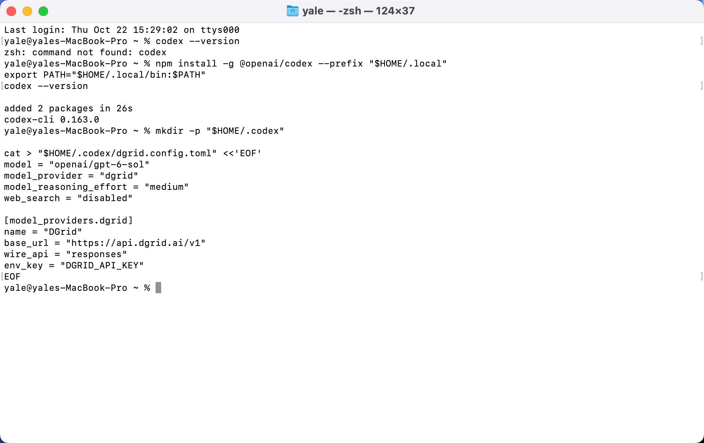
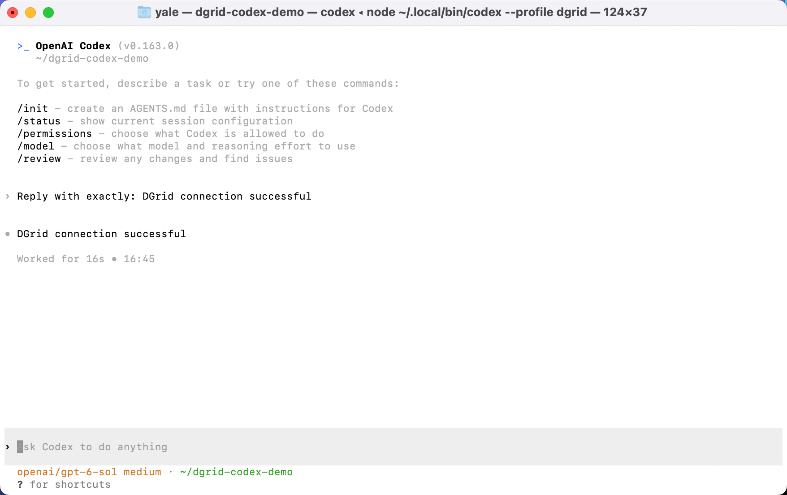
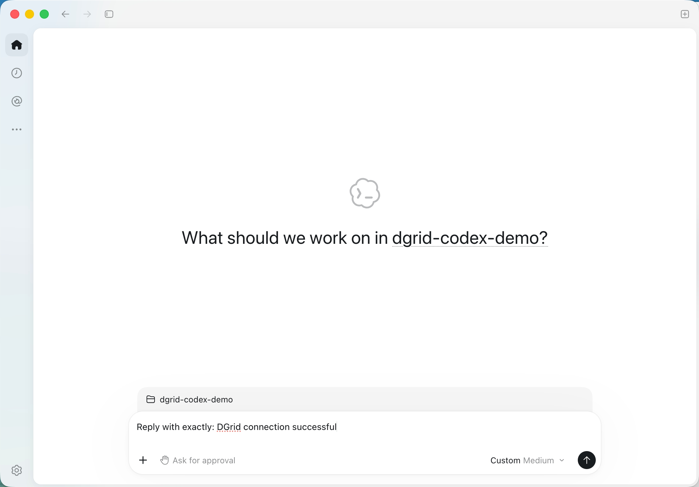
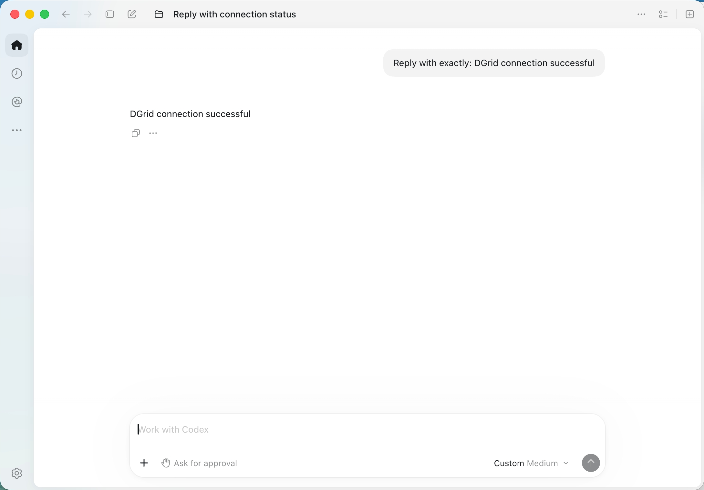
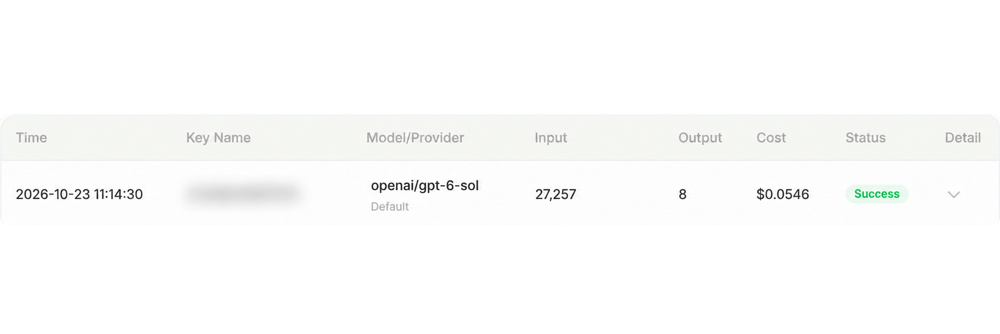

<Info>
Utilisez une DGrid Model API Key pour les requêtes aux modèles. Une Management API Key est une clé d'administration et ne convient pas à ce tutoriel. Vérifiez les crédits disponibles et l'accès au modèle choisi.
</Info>

Connectez **Codex CLI** ou **Codex dans l'application de bureau** à DGrid avec votre clé API, l'URL de base Responses et l'ID complet du modèle.

Le téléchargement actuel est l'**application ChatGPT qui inclut Codex**. Certaines installations conservent le nom Codex. Téléchargez l'application depuis la [page officielle](https://chatgpt.com/download/).

Ce guide utilise `openai/gpt-6-sol`. Les captures et le parcours de bureau concernent macOS ; l'installation et la CLI sous Windows sont aussi décrites.

## Avant de commencer

- Un [compte DGrid](https://dgrid.ai/) avec des crédits et l'accès à un modèle compatible avec l'API Responses.
- Une clé API DGrid : connectez-vous et créez ou copiez une clé depuis [API Keys](https://dgrid.ai/api-keys).
- Pour l'installation avec npm, prévoyez Node.js et npm. La méthode de bureau est indépendante de la CLI.

Ne montrez pas la clé complète dans les captures ou fichiers partagés. Conservez l'ID complet, préfixe `openai/` inclus.

<Note>
Si Codex signale une erreur de métadonnées ou de catalogue, demandez à DGrid les paramètres adaptés à votre version. Les alias personnalisés peuvent nécessiter des métadonnées correspondantes. N'inventez pas d'URL de catalogue. Voir le [guide officiel de configuration de passerelle](https://learn.chatgpt.com/docs/enterprise/connect-to-a-gateway).
</Note>

## Choisir votre méthode

| Méthode | Configuration | Activation |
| --- | --- | --- |
| CLI | `~/.codex/dgrid.config.toml` | Exécutez `codex --profile dgrid`. |
| Application de bureau macOS | `~/.codex/config.toml` | L'application lit sa configuration principale au démarrage. |

Le profil CLI sélectionne DGrid uniquement pour les exécutions lancées avec ce profil. Modifier le fichier principal change le fournisseur par défaut des clients qui le lisent. Si vous utilisez votre environnement actuel au quotidien, suivez le parcours de bureau sur un autre ordinateur.

Les deux méthodes utilisent ces paramètres :

| Paramètre | Valeur |
| --- | --- |
| Model | `openai/gpt-6-sol` |
| Base URL | `https://api.dgrid.ai/v1` |
| Format de l'API | `responses` |
| Variable d'environnement de la clé | `DGRID_API_KEY` |

<Tabs>
<Tab title="CLI">

### 1. Installer Node.js et Codex CLI

Si nécessaire, installez la version LTS actuelle depuis la [page Node.js](https://nodejs.org/en/download). Exécutez l'installateur macOS ou Windows ; les installateurs standard incluent npm.

Ouvrez Terminal sur macOS ou PowerShell sur Windows et vérifiez :

```shell
node -v
npm -v
```

Suivez la [méthode officielle d'installation de Codex avec npm](https://learn.chatgpt.com/docs/codex/cli).

**macOS :** installez dans votre répertoire utilisateur.

```zsh
npm install -g @openai/codex --prefix "$HOME/.local"
export PATH="$HOME/.local/bin:$PATH"
codex --version
```

La commande PATH ne vaut que pour ce terminal. Relancez-la dans les nouveaux terminaux ou ajoutez le répertoire à la configuration PATH du shell.

**Windows PowerShell :**

```powershell
npm install -g @openai/codex
codex --version
```

Si PowerShell bloque `npm.ps1`, remplacez `npm` par `npm.cmd`.

Les captures utilisent `codex-cli 0.163.0`. Le format de profil séparé ci-dessous s'applique à Codex `0.134.0` et versions ultérieures ; voir les [profils de configuration](https://learn.chatgpt.com/docs/config-file/config-advanced#profiles).

### 2. Créer un profil DGrid

Créez `~/.codex/dgrid.config.toml` sur macOS ou `%USERPROFILE%\.codex\dgrid.config.toml` sur Windows. Collez ce contenu :

```toml
model = "openai/gpt-6-sol"
model_provider = "dgrid"
model_reasoning_effort = "medium"
web_search = "disabled"

[model_providers.dgrid]
name = "DGrid"
base_url = "https://api.dgrid.ai/v1"
wire_api = "responses"
env_key = "DGRID_API_KEY"
```

Sur macOS, créez et ouvrez le fichier ainsi :

```zsh
mkdir -p "$HOME/.codex"
touch "$HOME/.codex/dgrid.config.toml"
open -t "$HOME/.codex/dgrid.config.toml"
```

Si le profil existe, modifiez les paramètres concernés. Enregistrez en texte brut avec des guillemets droits. `env_key` désigne le nom de variable : conservez `DGRID_API_KEY`.

<Frame caption="Installation de Codex CLI et création d'un profil DGrid distinct dans Terminal">
  
</Frame>

### 3. Saisir la clé API

Utilisez le terminal depuis lequel vous lancerez Codex.

**Terminal macOS avec Zsh :**

```zsh
export DGRID_API_KEY
read -rs "DGRID_API_KEY?Paste your DGrid API key (hidden): "
```

Collez la clé à l'invite et appuyez sur Entrée. Aucun caractère n'apparaît. Attendez le retour de l'invite avant la commande suivante.

**Windows PowerShell :** exécutez la première ligne, saisissez la clé à l'invite masquée, puis exécutez les lignes restantes.

```powershell
$dgridSecureKey = Read-Host "Paste your DGrid API key (hidden)" -AsSecureString
$env:DGRID_API_KEY = [System.Net.NetworkCredential]::new("", $dgridSecureKey).Password
Remove-Variable dgridSecureKey
```

La clé est définie pour cette session du terminal. Ressaisissez-la dans un nouveau terminal.

### 4. Lancer Codex et envoyer un message

Sur macOS :

```zsh
mkdir -p "$HOME/dgrid-codex-demo"
cd "$HOME/dgrid-codex-demo"
codex --profile dgrid
```

Dans Windows PowerShell :

```powershell
New-Item -ItemType Directory -Force "$HOME/dgrid-codex-demo" | Out-Null
Set-Location "$HOME/dgrid-codex-demo"
codex --profile dgrid
```

Si Codex demande si le dossier est fiable, confirmez pour le dossier de démonstration créé. Vérifiez le modèle `openai/gpt-6-sol`. Vous pouvez aussi consulter la session avec `/status`.

Envoyez :

```text
Reply with exactly: DGrid connection successful
```

La réponse attendue est :

```text
DGrid connection successful
```

<Frame caption="Réponse affichée dans Codex CLI avec le modèle DGrid sélectionné">
  
</Frame>

Le message `Running without the shared background server: --profile requires embedded mode.` décrit le mode d'exécution du profil. Appuyez sur F2 pour le consulter et Échap pour le fermer, puis continuez. Certains claviers Mac utilisent Fn + F2.

</Tab>
<Tab title="Application de bureau (macOS)">

### 1. Installer l'application de bureau

Ouvrez la [page officielle de téléchargement](https://chatgpt.com/download/) et choisissez votre système.

- **macOS :** ouvrez l'installateur téléchargé, glissez l'application dans Applications et ouvrez-la.
- **Windows :** lancez l'installateur téléchargé et suivez les instructions.

Choisissez l'application actuelle qui inclut Codex. Le parcours ci-dessous utilise macOS et le chemin `/Applications/ChatGPT.app`.

Pour utiliser vos identifiants DGrid, configurez le fournisseur et l'environnement de lancement ci-dessous. Le champ initial `OpenAI API key` ne définit pas l'URL de base DGrid.

### 2. Configurer DGrid dans le fichier principal

**Quittez complètement l'application avec Command + Q.** Fermer la fenêtre peut la laisser active.

Dans Terminal sur macOS, exécutez :

```zsh
mkdir -p "$HOME/.codex"
touch "$HOME/.codex/config.toml"
open -t "$HOME/.codex/config.toml"
```

Utilisez ces paramètres dans `config.toml` :

```toml
model = "openai/gpt-6-sol"
model_provider = "dgrid"
model_reasoning_effort = "medium"
web_search = "disabled"

[model_providers.dgrid]
name = "DGrid"
base_url = "https://api.dgrid.ai/v1"
wire_api = "responses"
env_key = "DGRID_API_KEY"
```

Dans un fichier existant, modifiez les clés de premier niveau et placez-les **avant le premier en-tête de table** (`[section]`). Ajoutez la table DGrid à la fin ou modifiez-la si elle existe. Conservez les autres paramètres sans dupliquer les clés ou tables. Utilisez du texte brut et des guillemets droits.

L'application lit ce fichier principal. Un profil CLI seul n'active pas DGrid dans l'application. Sous Windows, utilisez `%USERPROFILE%\.codex\config.toml`. Voir le [guide officiel de configuration de passerelle](https://learn.chatgpt.com/docs/enterprise/connect-to-a-gateway).

### 3. Saisir la clé et lancer l'application

Dans Terminal macOS avec Zsh :

```zsh
export DGRID_API_KEY
read -rs "DGRID_API_KEY?Paste your DGrid API key (hidden): "
```

Collez la clé DGrid et appuyez sur Entrée. Au retour de l'invite, exécutez ceci **comme commande séparée dans le même terminal** :

```zsh
open -a "/Applications/ChatGPT.app" --env "DGRID_API_KEY=$DGRID_API_KEY"
```

Si l'application se nomme `Codex.app`, utilisez son chemin réel.

Si Terminal indique que l'application est déjà active et que les variables ne peuvent pas être définies, quittez-la avec Command + Q et relancez la commande.

La clé est transmise au processus lancé. Pour un prochain lancement depuis un nouveau terminal, répétez la saisie masquée et la commande. Ouvrir l'application depuis le Dock ne transmet pas une variable définie uniquement dans ce terminal.

### 4. Choisir un projet et envoyer un message

Créez un dossier de démonstration :

```zsh
mkdir -p "$HOME/dgrid-codex-demo"
```

Dans l'application de bureau :

1. Cliquez sur **Choose project** et sélectionnez `dgrid-codex-demo` dans votre dossier personnel.
2. Saisissez le prompt ci-dessous.
3. Cliquez sur la flèche d'envoi.

```text
Reply with exactly: DGrid connection successful
```

<Frame caption="Projet sélectionné et prompt de connexion prêt à être envoyé dans Codex">
  
</Frame>

La réponse attendue est :

```text
DGrid connection successful
```

<Frame caption="Réponse du modèle dans l'application Codex">
  
</Frame>

Certaines versions affichent un libellé comme **Custom Medium**. Vérifiez l'ID complet dans la configuration et la requête DGrid correspondante pour confirmer le modèle et le routage.

</Tab>
</Tabs>

## Vérifier la requête dans DGrid

Dans l'historique DGrid, retrouvez l'heure et l'ID complet du modèle. Une requête terminée affiche **Success**.

<Frame caption="Historique DGrid avec openai/gpt-6-sol et Success ; Key Name est flouté">
  
</Frame>

Key Name est flouté pour préserver la confidentialité. Les tokens et les coûts varient selon le modèle et le contexte envoyé par Codex.

## Dépannage

| Symptôme | Points à vérifier |
| --- | --- |
| `codex: command not found` | Vérifiez l'installation. Sur macOS, exécutez `export PATH="$HOME/.local/bin:$PATH"` dans le terminal actuel. |
| Clé API manquante | Définissez la clé dans le terminal qui lance le client. `env_key` nomme une variable, sans en définir la valeur. |
| Application déjà active ; variables non définies | Quittez avec Command + Q, puis répétez la commande de lancement. |
| Échec de connexion ou de requête après ouverture depuis le Dock | Quittez l'application, saisissez la clé dans Terminal et lancez avec `--env`. |
| Erreur d'authentification ou d'accès au modèle | Vérifiez la clé DGrid, les crédits, la prise en charge de Responses et l'ID complet du modèle. |
| Paramètres du fournisseur ignorés | Utilisez les fichiers utilisateur ci-dessus. Le fichier `.codex/config.toml` du projet ne peut pas sélectionner de fournisseur personnalisé. |
| Revenir au fournisseur de bureau précédent | Restaurez les paramètres de modèle, de fournisseur et d'authentification, puis quittez et rouvrez l'application. |

La [référence de configuration Codex](https://learn.chatgpt.com/docs/config-file/config-reference) décrit les paramètres des fournisseurs. Ce guide couvre la connexion et la réception d'une réponse. Les outils, la recherche web et les tâches longues dépendent du modèle et de la passerelle.

## Ressources connexes

- [Vue d'ensemble des tutoriels d'intégration](/fr/ai-gateway/integrations)
- [Démarrage rapide AI Gateway](/fr/ai-gateway/overview#démarrage-rapide)
- [Utiliser Codex CLI avec DGrid](https://blog.dgrid.ai/posts/2026-03-23/)
