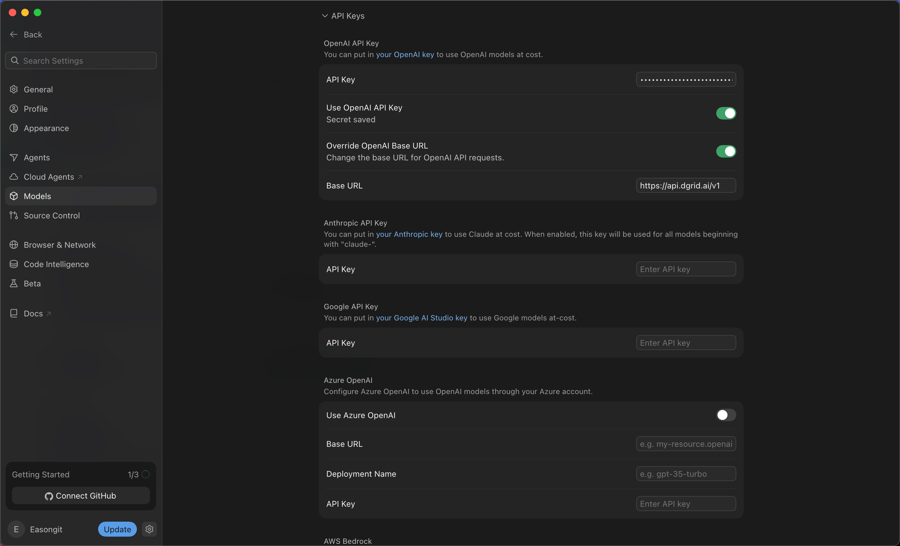
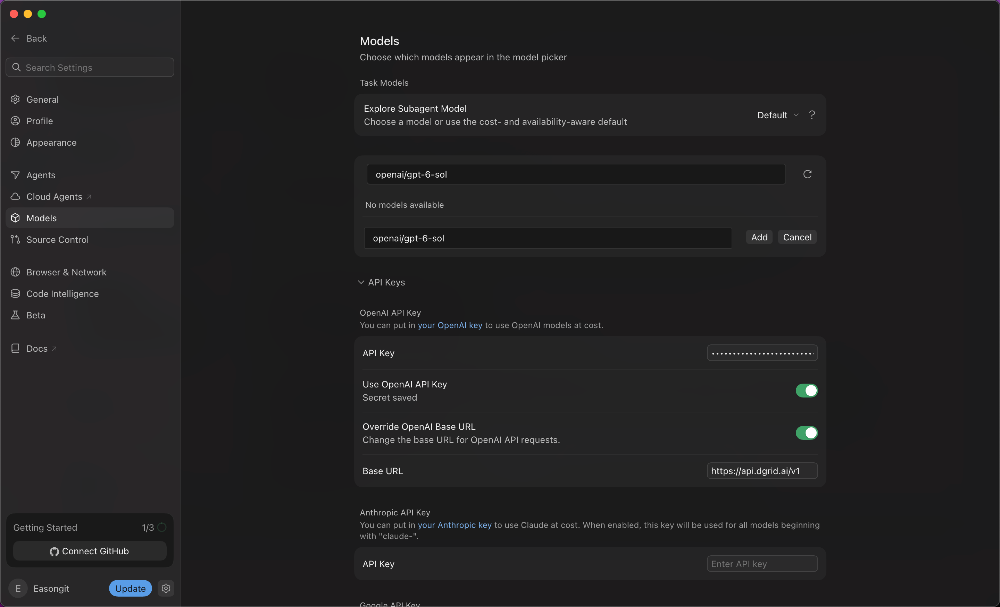
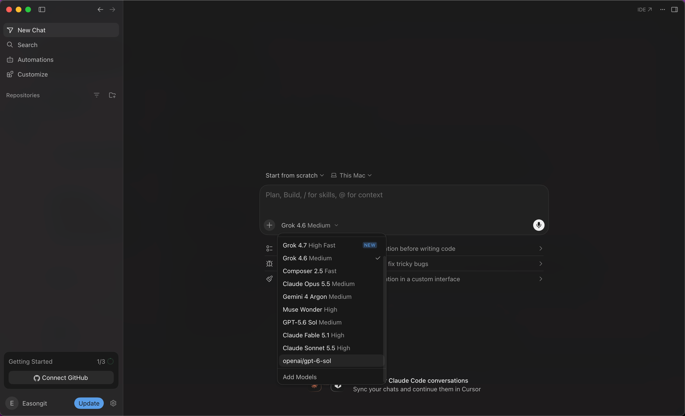
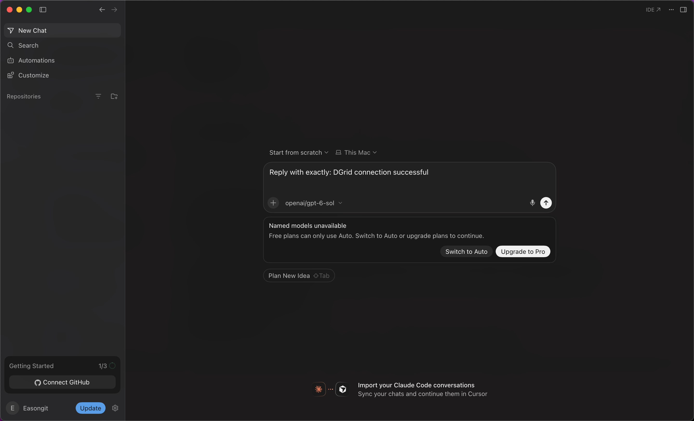

<Info>
Utilisez une DGrid Model API Key pour les requêtes aux modèles. Une Management API Key est une clé d'administration et ne convient pas à ce tutoriel. Vérifiez les crédits disponibles et l'accès au modèle choisi.
</Info>

Configurez Cursor avec votre clé DGrid et une URL de base compatible OpenAI, puis ajoutez et sélectionnez le modèle avec son ID DGrid complet. L'exemple utilise `openai/gpt-6-sol`.

## Avant de commencer

- Un ordinateur macOS ou Windows connecté à Internet.
- Un compte Cursor. Vérifiez que votre offre autorise votre propre clé (BYOK) et le modèle personnalisé choisi. Dans la version illustrée, le compte gratuit enregistrait les paramètres, mais ne pouvait pas envoyer de message au modèle choisi.
- Un [compte DGrid](https://dgrid.ai/) avec des crédits et l'accès au modèle choisi.

L'abonnement Cursor et l'utilisation des modèles DGrid sont facturés séparément. Les captures montrent une limite de l'offre gratuite ; vérifiez les fonctions disponibles dans votre compte et la documentation actuelle. Voir l'[explication du support Cursor](https://forum.cursor.com/t/youve-hit-your-usage-limit-still-after-setting-my-key/150496/3).

L'installation couvre macOS et Windows. La configuration et les captures utilisent Cursor `3.24.18` sur macOS. Les menus peuvent varier selon la version.

## Étape 1 : installer et ouvrir Cursor

Sur la [page officielle de Cursor](https://cursor.com/download), choisissez l'installateur adapté à votre système.

### macOS

1. Choisissez **Mac (ARM64)** pour Apple Silicon ou **Mac (x64)** pour Intel. **Mac Universal** prend en charge les deux.
2. Ouvrez le `.dmg` téléchargé et glissez **Cursor** dans **Applications**.
3. Ouvrez Cursor depuis Applications, terminez la configuration initiale et connectez-vous à votre compte.

### Windows

1. Choisissez **Windows (x64) (User)** pour Intel ou AMD, ou **Windows (ARM64) (User)** pour Windows sur ARM. L'installateur User installe Cursor pour votre compte Windows.
2. Exécutez le `.exe` téléchargé et suivez l'assistant.
3. Ouvrez Cursor depuis le menu Démarrer ou son raccourci, terminez la configuration initiale et connectez-vous.

La suite illustre la configuration sur macOS.

## Étape 2 : créer une clé API DGrid

1. Connectez-vous à [DGrid](https://dgrid.ai/) et ouvrez [API Keys](https://dgrid.ai/api-keys).
2. Cliquez sur **Create New Key**, nommez la clé, par exemple `Cursor`, et créez-la.
3. Copiez la clé pour l'étape suivante. Ne montrez pas la clé complète dans les captures ou fichiers partagés.
4. Dans la liste DGrid, vérifiez l'accès de la clé au modèle souhaité et copiez son ID complet. L'exemple utilise `openai/gpt-6-sol`.

## Étape 3 : configurer la clé API et l'URL de base

1. Cliquez sur l'**icône d'engrenage** près de votre nom de compte, en bas à gauche de Cursor.
2. Sélectionnez **Models** dans les paramètres.
3. Faites défiler vers le bas et développez **API Keys**.
4. Sous **OpenAI API Key**, collez votre **clé API DGrid** dans **API Key**. Cliquez sur Save si le bouton apparaît. **Secret saved** confirme l'enregistrement.
5. Activez **Override OpenAI Base URL** et saisissez :

```text
https://api.dgrid.ai/v1
```

6. Activez **Use OpenAI API Key**. Si la confirmation **Enable OpenAI API Key** apparaît, lisez les limites et cliquez sur **Enable OpenAI API Key**.

Vérifiez que les paramètres correspondent au tableau :

| Champ | Valeur |
| --- | --- |
| API Key sous OpenAI API Key | Votre clé API DGrid |
| Use OpenAI API Key | Activé |
| Override OpenAI Base URL | Activé |
| Base URL | `https://api.dgrid.ai/v1` |

Conservez le suffixe `/v1`. Masquez la clé dans les captures.

<Frame caption="Clé DGrid enregistrée, clé API et URL de base activées">
  
</Frame>

## Étape 4 : ajouter l'ID DGrid complet du modèle

1. Remontez à la liste des modèles sur la même page **Models**.
2. Dans **Add or search model**, saisissez :

```text
openai/gpt-6-sol
```

3. Si **No models available** apparaît, cliquez sur **Add Custom Model**.
4. Dans le nouveau champ, saisissez le même ID complet et cliquez sur **Add**.

<Frame caption="Ajout de l'ID DGrid complet comme modèle personnalisé">
  
</Frame>

5. Vérifiez que **openai/gpt-6-sol** figure dans la liste et que son interrupteur est activé.

Conservez le préfixe `openai/`. Pour un autre modèle, utilisez son ID DGrid exact dans les paramètres et dans le chat.

## Étape 5 : choisir le modèle dans un nouveau chat

1. Cliquez sur **Back** en haut à gauche pour revenir au chat. Créez-en un nouveau si nécessaire.
2. Cliquez sur le nom du modèle sous la zone de saisie pour ouvrir le sélecteur.
3. Choisissez **`openai/gpt-6-sol`**, l'entrée personnalisée ajoutée.
4. Vérifiez que la zone de saisie indique **`openai/gpt-6-sol`** comme modèle sélectionné.

<Frame caption="Sélection du modèle DGrid personnalisé dans le chat">
  
</Frame>

## Abonnement requis et premier message

<Note>
La capture ci-dessous montre une limite d'abonnement, pas une requête réussie. Confirmez le routage en recevant une réponse et en retrouvant la requête dans DGrid.
</Note>

Si Cursor affiche **Named models unavailable — Free plans can only use Auto**, l'offre du compte bloque le modèle. Connectez-vous à un compte payant éligible ou décidez si vous souhaitez changer d'offre. Passer à Auto ne prouve pas que le modèle DGrid choisi est utilisé.

<Frame caption="Limite de l'offre gratuite Cursor lors de l'envoi au modèle personnalisé">
  
</Frame>

Avec une offre éligible, envoyez un message court, par exemple :

```text
Reply with exactly: DGrid connection successful
```

Après la réponse, vérifiez le modèle, l'heure et le statut **Success** dans l'historique DGrid.

## Remarques et dépannage

- **Fonctions prises en charge :** les clés personnalisées s'appliquent aux modèles de chat compatibles. La complétion Tab utilise les modèles intégrés de Cursor. Consultez la [documentation des clés API Cursor](https://cursor.com/help/models-and-usage/api-keys) pour les fonctions et la facturation.
- **La clé est enregistrée mais inutilisée :** vérifiez l'activation de **Use OpenAI API Key** et **Override OpenAI Base URL**, ainsi que l'URL `https://api.dgrid.ai/v1`.
- **Le modèle manque dans le sélecteur :** vérifiez que l'ID complet a été ajouté et activé, puis rouvrez le sélecteur dans un nouveau chat.
- **La requête échoue malgré l'abonnement :** vérifiez la clé DGrid, les crédits, l'ID complet et les droits d'accès. Ajouter un modèle à Cursor ne garantit pas la réussite des requêtes.
- **Retour à un autre fournisseur :** vérifiez l'URL de base remplacée avant d'utiliser d'autres modèles OpenAI, car ce réglage change la destination des requêtes.

## Ressources connexes

- [Vue d'ensemble des tutoriels d'intégration](/fr/ai-gateway/integrations)
- [Démarrage rapide AI Gateway](/fr/ai-gateway/overview#démarrage-rapide)
- [Configurer DGrid AI Gateway dans Cursor](https://blog.dgrid.ai/posts/2026-02-18/)
