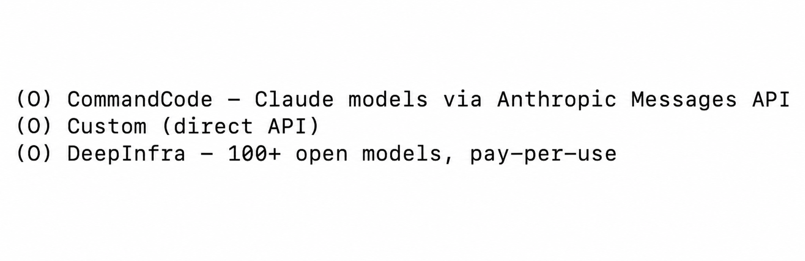
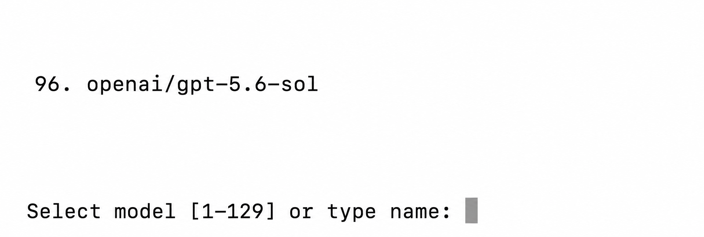
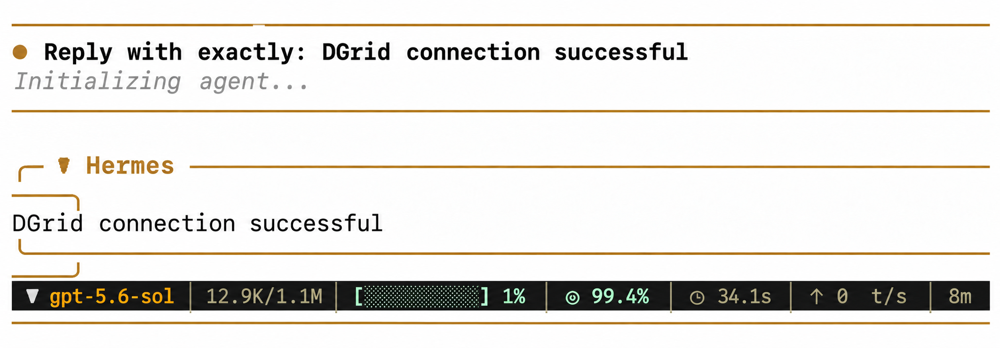
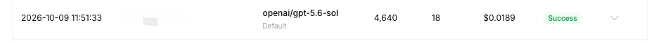

<Info>
Utilisez une DGrid Model API Key pour les requêtes aux modèles. Une Management API Key est une clé d'administration et ne convient pas à ce tutoriel. Vérifiez les crédits disponibles et l'accès au modèle choisi.
</Info>

Pour utiliser les modèles DGrid dans Hermes Agent, ajoutez un fournisseur API personnalisé avec votre clé et l'endpoint DGrid. Ce guide suit l'assistant initial avec le modèle `openai/gpt-5.6-sol`.

## Avant de commencer

- Un [compte DGrid](https://dgrid.ai/) avec des crédits disponibles.
- Un ordinateur avec un terminal. Les commandes pour macOS, Linux, WSL2 et Windows natif figurent ci-dessous.

## Étape 1 : créer une clé API DGrid

1. Connectez-vous à la [console DGrid](https://dgrid.ai/) et ouvrez **Credits → Keys**, ou accédez à [API Keys](https://dgrid.ai/api-keys).
2. Sélectionnez **Create New Key**, nommez la clé, par exemple `Hermes`, et créez-la.
3. Copiez la clé pour l'invite **API key** de Hermes. Ne l'incluez pas dans les captures ou documents publics.

## Étape 2 : installer Hermes et ouvrir la configuration

Sur macOS, Linux ou WSL2, exécutez :

```bash
curl -fsSL https://hermes-agent.nousresearch.com/install.sh | bash
```

Sous Windows natif, exécutez dans PowerShell :

```powershell
iex (irm https://hermes-agent.nousresearch.com/install.ps1)
```

Si `prerequisites ok` ou `Cloning ... hermes-agent.git` apparaît, l'installation continue. Attendez l'assistant de configuration.

À **How would you like to set up Hermes?**, sélectionnez **Full setup — configure every provider, tool & option yourself (bring your own keys)** avec les flèches, puis appuyez sur Entrée ou Espace.

Si l'installation se termine sans assistant, exécutez `hermes model` et passez à l'étape 3.

## Étape 3 : choisir un fournisseur API personnalisé

Dans **Select provider**, choisissez **Custom (direct API)** vers le bas de la liste. Si vous êtes passé par `hermes model`, choisissez **Custom endpoint (enter URL manually)**.

<Frame caption="Option Custom direct API dans le menu des fournisseurs Hermes">
  
</Frame>

## Étape 4 : saisir l'endpoint et le modèle DGrid

Suivez les invites dans cet ordre :

| Invite de l'assistant | Valeur à saisir ou sélectionner |
| --- | --- |
| **API base URL** | `https://api.dgrid.ai/v1` |
| **API key** | Votre clé API DGrid de l'étape 1 |
| **Select API compatibility mode** | **Chat Completions**, option `2` dans l'assistant actuel |
| **Select model** | ID complet du modèle `openai/gpt-5.6-sol` |
| **Context length in tokens** | Laissez vide pour la détection automatique |
| **Display name** | `DGrid` |

L'URL de base s'arrête à `/v1` ; n'ajoutez pas `/chat/completions`. La mention générique `[optional]` près d'**API key** ne s'applique pas à la connexion DGrid.

Après la saisie de la clé, Hermes charge les modèles accessibles. Dans **Select model**, trouvez `openai/gpt-5.6-sol` et saisissez son numéro ou son ID complet. La capture indique `96`, mais ce numéro peut varier : fiez-vous à l'ID. S'il est absent, choisissez un autre modèle DGrid disponible compatible avec Chat Completions.

<Frame caption="Modèle d'exemple et invite de sélection dans Hermes">
  
</Frame>

La configuration est terminée lorsque Hermes confirme l'enregistrement du modèle et du fournisseur personnalisé.

## Étape 5 : lancer Hermes et utiliser le modèle DGrid

Exécutez :

```bash
hermes
```

Au premier lancement, **Help improve Hermes?** peut demander votre préférence de partage des données d'utilisation. Choisissez librement ; **No thanks** permet aussi de continuer. Saisissez un message, par exemple :

```text
Reply with exactly: DGrid connection successful
```

Après la réponse, poursuivez la conversation. Pour confirmer le passage par DGrid, retrouvez l'ID du modèle et le statut **Success** à l'heure correspondante dans l'historique. Les images montrent un exemple de réponse et de requête.

<Frame caption="Conversation avec un modèle DGrid dans Hermes">
  
</Frame>

<Frame caption="Requête au modèle dans la console DGrid">
  
</Frame>

## Questions fréquentes

- **L'assistant ne s'ouvre pas :** exécutez `hermes model`, choisissez l'endpoint personnalisé et saisissez les valeurs de l'étape 4.
- **Entrée insère `^M` :** appuyez sur **Control+J** pour valider le texte.
- **Vérifier ou changer le modèle :** exécutez `hermes status` pour voir Model et Provider, puis `hermes model` pour choisir un autre modèle.
- **Une réponse arrive, puis `Auxiliary title generation failed: Request timed out` apparaît :** ce message concerne le titre automatique de la conversation et n'annule pas la réponse.

Consultez le [guide d'installation Hermes](https://hermes-agent.nousresearch.com/docs/getting-started/installation/) et la [documentation des fournisseurs](https://hermes-agent.nousresearch.com/docs/integrations/providers/).

## Ressources connexes

- [Vue d'ensemble des tutoriels d'intégration](/fr/ai-gateway/integrations)
- [Démarrage rapide AI Gateway](/fr/ai-gateway/overview#démarrage-rapide)
