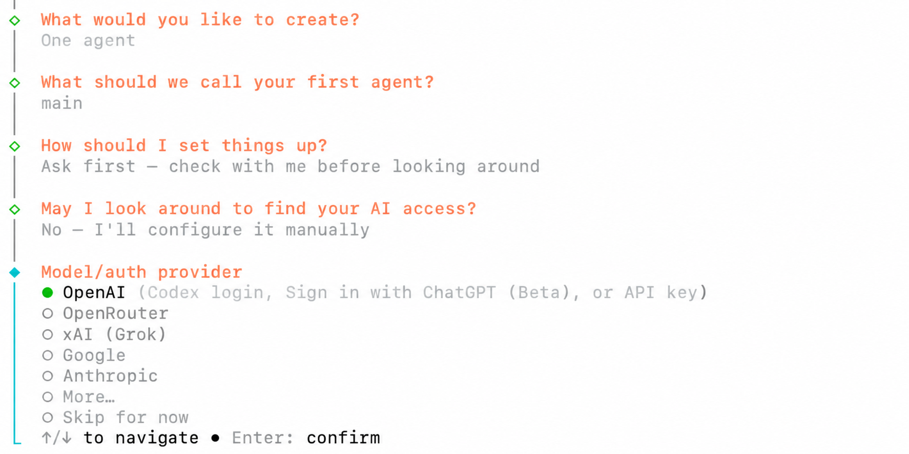
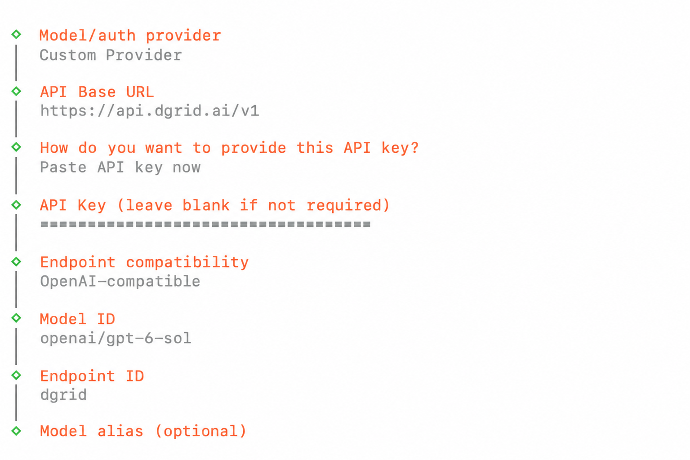
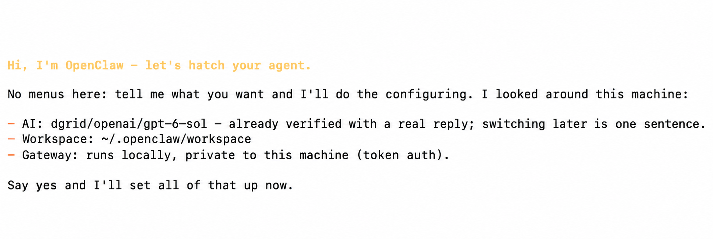
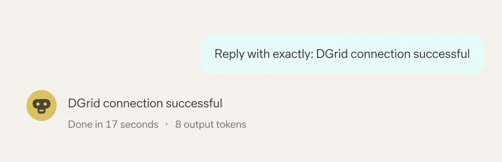
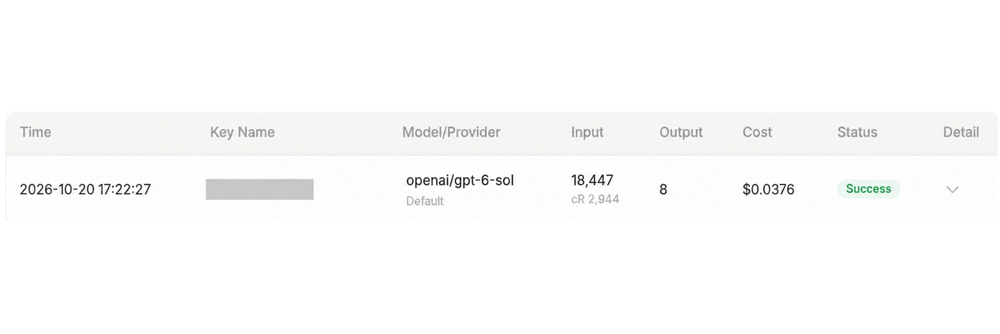

<Info>
Utilisez une DGrid Model API Key pour les requêtes aux modèles. Une Management API Key est une clé d'administration et ne convient pas à ce tutoriel. Vérifiez les crédits disponibles et l'accès au modèle choisi.
</Info>

<Note>
OpenClaw Gateway est un service local qui connecte le tableau de bord OpenClaw sur votre ordinateur. DGrid AI Gateway est l'API distante qui reçoit les requêtes aux modèles. Leurs identifiants d'accès sont distincts.
</Note>

Connectez OpenClaw à DGrid en ajoutant un Custom Provider avec votre clé, l'URL de base et un modèle. Ce guide couvre l'installation sur macOS, la configuration et le premier message dans le tableau de bord web. L'exemple utilise `openai/gpt-6-sol`.

## Avant de commencer

- Un Mac avec Terminal et une connexion Internet.
- Un [compte DGrid](https://dgrid.ai/) avec des crédits et l'accès au modèle souhaité.

Les menus et captures correspondent à OpenClaw `2026.10.5`. Les modèles disponibles dépendent de votre compte DGrid. Vous pouvez choisir un autre modèle accessible compatible avec Chat Completions ; saisissez son ID DGrid complet.

## Étape 1 : créer une clé API DGrid

1. Connectez-vous à [DGrid](https://dgrid.ai/) et ouvrez [API Keys](https://dgrid.ai/api-keys).
2. Cliquez sur **Create New Key**, nommez la clé, par exemple `OpenClaw`, et créez-la.
3. Copiez la clé pour l'assistant OpenClaw à l'étape 4. Ne montrez pas la clé complète dans les captures ou documents partagés.

## Étape 2 : installer OpenClaw

Ouvrez Terminal et exécutez :

```bash
curl -fsSL https://openclaw.ai/install-cli.sh | bash
```

L'installateur officiel place OpenClaw et un environnement Node.js compatible sous `~/.openclaw`. Attendez la confirmation d'installation et le retour de l'invite.

Lancez l'assistant avec une commande séparée :

```bash
"$HOME/.openclaw/bin/openclaw" onboard
```

Ce guide utilise le chemin complet de la commande pour permettre une exécution immédiate après cette installation.

## Étape 3 : choisir la configuration manuelle du fournisseur

Si le menu propose **Quick start** et **Custom setup**, choisissez **Custom setup**. Lisez l'avertissement et sélectionnez **Yes** si vous l'acceptez. Pour les statistiques d'utilisation, choisissez librement ; **No thanks** permet aussi de continuer.

Utilisez les flèches et Entrée pour ces choix :

| Invite de configuration | Valeur à choisir ou saisir |
| --- | --- |
| What would you like to create? | **One agent** |
| What should we call your first agent? | Conservez **main** |
| How should I set things up? | **Ask first - check with me before looking around** |
| May I look around to find your AI access? | **No - I'll configure it manually** |

Dans **Model/auth provider**, choisissez **More...** pour afficher tous les fournisseurs.

<Frame caption="Choix manuel puis ouverture de More dans le menu des fournisseurs">
  
</Frame>

Recherchez `custom`, sélectionnez **Custom Provider** et appuyez sur Entrée.

## Étape 4 : saisir les paramètres DGrid

Remplissez les champs dans cet ordre. Validez chaque saisie avec Entrée et utilisez les flèches et Entrée pour les menus.

| Invite de configuration | Valeur à saisir ou sélectionner |
| --- | --- |
| API Base URL | `https://api.dgrid.ai/v1` |
| How do you want to provide this API key? | **Paste API key now** |
| API Key | Votre clé API DGrid de l'étape 1 |
| Endpoint compatibility | **OpenAI-compatible (Uses /chat/completions)** |
| Model ID | `openai/gpt-6-sol` |
| Endpoint ID | Remplacez la valeur générée par `dgrid` |
| Model alias (optional) | Laissez vide et appuyez sur Entrée |

L'URL de base s'arrête à `/v1` ; n'ajoutez pas `/chat/completions`. Saisissez la clé DGrid même si l'invite générique indique qu'elle peut être facultative.

Utilisez `openai/gpt-6-sol` comme Model ID, préfixe `openai/` inclus. L'Endpoint ID `dgrid` est le nom local du fournisseur dans OpenClaw. Ensemble, ils forment la référence `dgrid/openai/gpt-6-sol`.

<Frame caption="URL de base DGrid, clé masquée, ID du modèle et de l'endpoint">
  
</Frame>

Après l'alias, OpenClaw teste la connexion au modèle. Attendez la fin. En cas d'échec, vérifiez l'URL, la clé, les crédits et l'ID complet avant de réessayer.

## Étape 5 : terminer la configuration et lancer le Gateway

L'assistant résume le modèle, l'espace de travail et le Gateway local. À **Say yes and I'll set all of that up now**, saisissez :

```text
yes
```

Appuyez sur Entrée et attendez la fin de l'application des paramètres.

<Frame caption="Vérification du résumé et saisie de yes pour appliquer les paramètres">
  
</Frame>

Dans un second terminal, installez le service Gateway en arrière-plan :

```bash
"$HOME/.openclaw/bin/openclaw" gateway install
```

Vérifiez que le Gateway est actif et accessible :

```bash
"$HOME/.openclaw/bin/openclaw" gateway status
```

Si l'assistant affiche **Gateway is not reachable yet**, terminez ces étapes avant d'ouvrir le tableau de bord. Si l'état reste **Runtime: stopped**, consultez le dépannage ci-dessous.

Ouvrez le tableau de bord web :

```bash
"$HOME/.openclaw/bin/openclaw" dashboard
```

Utilisez le lien ouvert par la commande pour accéder au Gateway local.

## Étape 6 : discuter avec le modèle DGrid

1. Dans le tableau de bord, ouvrez **Home** et la session **main**.
2. Vérifiez que le sélecteur sous la saisie indique **openai/gpt-6-sol (Custom Provider)**. Si vous avez choisi un autre modèle, sélectionnez-le.
3. Dans **Message main**, saisissez :

```text
Reply with exactly: DGrid connection successful
```

4. Cliquez sur le **bouton Send en forme de flèche vers le haut** et attendez la réponse.

<Frame caption="Envoi d'un message et réception d'une réponse dans OpenClaw">
  
</Frame>

Vous pouvez continuer à discuter avec le modèle DGrid. Dans l'historique DGrid, retrouvez le modèle et l'heure correspondants. Une requête terminée affiche **Success**.

<Frame caption="Requête DGrid réussie">
  
</Frame>

Pour rouvrir le tableau de bord ultérieurement :

```bash
"$HOME/.openclaw/bin/openclaw" dashboard
```

## Dépannage

**L'installateur indique qu'un TTY interactif est nécessaire**

Après l'installation, lancez l'assistant directement depuis Terminal :

```bash
"$HOME/.openclaw/bin/openclaw" onboard
```

**Le test de connexion au modèle échoue**

Vérifiez l'URL `https://api.dgrid.ai/v1`, les crédits et droits de la clé, ainsi que l'ID complet du modèle. Pour cette configuration Chat Completions, Endpoint compatibility doit être **OpenAI-compatible**.

**Le Gateway reste arrêté après une mise à jour**

Si le journal de démarrage indique précisément **Legacy device identity exists**, arrêtez le service et lancez la migration et la réparation intégrées :

```bash
"$HOME/.openclaw/bin/openclaw" gateway stop
"$HOME/.openclaw/bin/openclaw" doctor --fix
```

Suivez les invites de réparation. Doctor peut redémarrer et vérifier le Gateway automatiquement. Relancez `"$HOME/.openclaw/bin/openclaw" gateway status` ; si le service reste arrêté, exécutez :

```bash
"$HOME/.openclaw/bin/openclaw" gateway start
```

**Le navigateur ne se connecte pas au Gateway**

Vérifiez le service avec `"$HOME/.openclaw/bin/openclaw" gateway status`, puis rouvrez le tableau de bord avec la commande de l'étape 5. Le jeton Gateway du tableau de bord est distinct de la clé DGrid.

Voir le [guide d'installation OpenClaw](https://docs.openclaw.ai/install/installer), la [documentation de l'assistant](https://docs.openclaw.ai/start/wizard) et la [référence CLI Gateway](https://docs.openclaw.ai/cli/gateway).

## Ressources connexes

- [Vue d'ensemble des tutoriels d'intégration](/fr/ai-gateway/integrations)
- [Démarrage rapide AI Gateway](/fr/ai-gateway/overview#démarrage-rapide)
- [Configurer un agent OpenClaw avec DGrid](https://blog.dgrid.ai/posts/2026-02-02/)
- [Installation et configuration sans code d'OpenClaw](https://blog.dgrid.ai/posts/2026-02-27/)

Une vidéo antérieure est disponible ci-dessous. Son interface peut différer de la version présentée ici.

<video controls preload="metadata" style={{ width: "100%", borderRadius: "12px", marginTop: "12px" }}>
  <source src="/images/dgrid-openclaw-demo.mp4" type="video/mp4" />
  Votre navigateur ne prend pas en charge la balise video.
</video>
