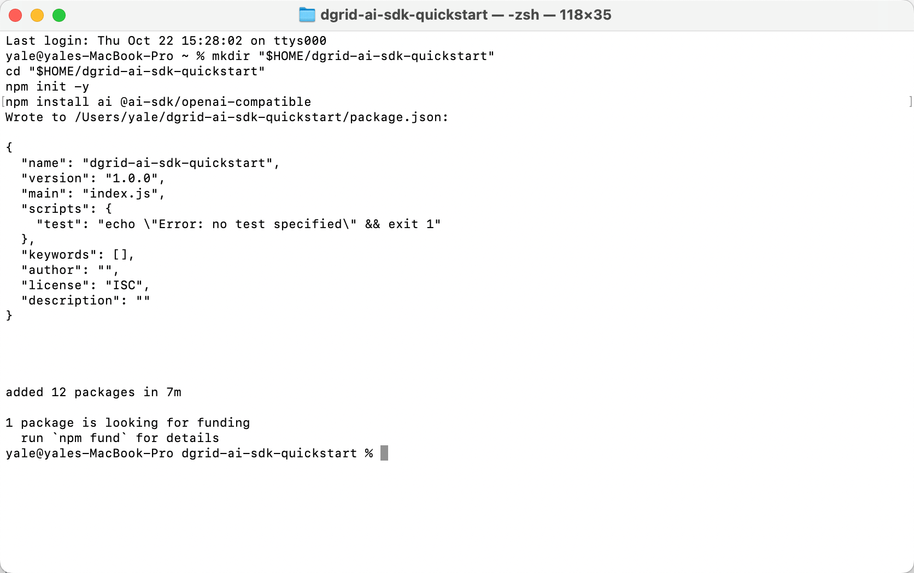
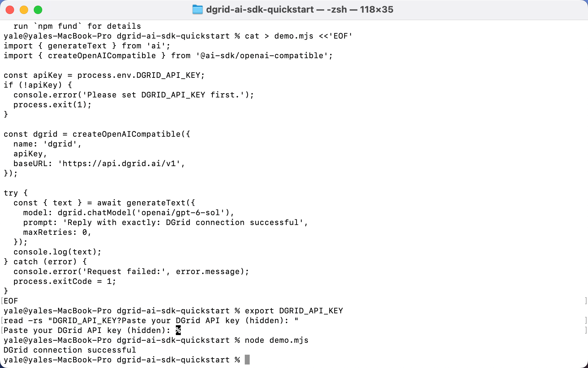

<Info>
Utilisez une DGrid Model API Key pour les requêtes aux modèles. Une Management API Key est une clé d'administration et ne convient pas à ce tutoriel. Vérifiez les crédits disponibles et l'accès au modèle choisi.
</Info>

Vercel distribue **AI SDK Core sous le nom de paquet npm `ai`**. Vous installerez ce paquet, importerez `generateText()` et connecterez DGrid via le fournisseur officiel compatible OpenAI. Voir l'[introduction à Vercel AI SDK](https://ai-sdk.dev/docs/introduction).

Configurez votre clé DGrid, l'URL de base compatible OpenAI et l'ID complet du modèle, puis exécutez un script Node.js pour afficher la réponse obtenue via Vercel AI SDK.

Ce guide utilise `openai/gpt-6-sol`. L'application s'exécute localement et transmet sa requête à DGrid via le fournisseur compatible OpenAI de l'AI SDK.

## Comment Vercel AI SDK se connecte à DGrid

Le SDK intervient dans l'installation et dans le code JavaScript :

| Paquet ou fonction | Rôle dans cet exemple |
| --- | --- |
| `ai` | Vercel AI SDK Core, installé avec npm. |
| `generateText` importé depuis `ai` | Fonction Vercel AI SDK qui génère le texte et renvoie le résultat. |
| `@ai-sdk/openai-compatible` | Paquet fournisseur AI SDK pour les services compatibles OpenAI. |
| `createOpenAICompatible(...)` | Crée le fournisseur SDK avec votre clé DGrid et l'URL de base. |
| `dgrid.chatModel(...)` | Fournit un modèle DGrid à l'appel `generateText()` du SDK. |

La requête suit ce chemin :

**Votre script → Vercel AI SDK `generateText()` → fournisseur compatible OpenAI → DGrid → réponse du modèle**

Node.js exécute le programme, Vercel AI SDK fournit l'interface d'appel et DGrid traite la requête. L'[exemple officiel du fournisseur compatible](https://ai-sdk.dev/providers/openai-compatible-providers#example) associe aussi `generateText()` et `createOpenAICompatible()`.

## Avant de commencer

- Un ordinateur macOS ou Windows connecté à Internet.
- **Node.js 22 ou version ultérieure**, avec npm.
- Un [compte DGrid](https://dgrid.ai/) avec des crédits et l'accès au modèle souhaité.

L'environnement d'exemple utilise Node.js `22.14.0`, npm `10.9.2`, `ai` `7.0.148` et `@ai-sdk/openai-compatible` `3.0.75`. Les commandes installent AI SDK 7 et le fournisseur compatible 3. Les captures concernent macOS ; les différences Windows sont précisées.

## Étape 1 : installer Node.js et vérifier l'environnement

Si Node.js n'est pas installé, téléchargez la version **LTS** actuelle depuis la [page officielle](https://nodejs.org/en/download).

- **macOS :** choisissez l'installateur macOS, ouvrez le `.pkg` téléchargé et suivez les étapes.
- **Windows :** choisissez l'installateur adapté à l'architecture du PC, exécutez le `.msi` et suivez les étapes.

Les installateurs standard incluent npm. Ouvrez ensuite une nouvelle fenêtre **Terminal** sur macOS ou **PowerShell** sur Windows et exécutez :

```shell
node -v
npm -v
```

Les deux commandes doivent afficher un numéro de version. Si Node.js est antérieur à 22, mettez-le à jour avant de continuer.

## Étape 2 : créer une clé API DGrid

1. Connectez-vous à [DGrid](https://dgrid.ai/) et ouvrez [API Keys](https://dgrid.ai/api-keys).
2. Cliquez sur **Create New Key**, donnez un nom à la clé et créez-la.
3. Copiez la clé pour l'étape 5. Ne montrez pas la clé complète dans les captures ou fichiers partagés.
4. Dans la liste DGrid, vérifiez l'accès à `openai/gpt-6-sol` ou copiez l'ID complet d'un autre modèle compatible avec Chat Completions.

Utilisez l'ID complet avec le préfixe du fournisseur, ici `openai/gpt-6-sol`.

## Étape 3 : créer le projet et installer Vercel AI SDK

Exécutez ces commandes dans Terminal sur macOS ou PowerShell sur Windows :

```shell
mkdir "$HOME/dgrid-ai-sdk-quickstart"
cd "$HOME/dgrid-ai-sdk-quickstart"
npm init -y
npm install ai@7 @ai-sdk/openai-compatible@3
```

Cette commande installe **Vercel AI SDK Core** (`ai@7`) et son **fournisseur compatible OpenAI** (`@ai-sdk/openai-compatible@3`). L'étape suivante importe les deux paquets pour appeler DGrid.

Attendez que npm confirme l'ajout des paquets et que l'invite réapparaisse. La durée dépend de la connexion.

<Frame caption="Projet d'exemple et dépendances SDK installés dans Terminal">
  
</Frame>

## Étape 4 : appeler DGrid avec Vercel AI SDK

Dans un éditeur, créez **`demo.mjs`** dans `dgrid-ai-sdk-quickstart`, à côté de `package.json`. Collez le code et enregistrez en texte brut. Vérifiez le nom `demo.mjs`, et non `demo.mjs.txt`.

L'extension `.mjs` permet à Node.js d'utiliser les instructions `import` de l'exemple.

```javascript
// Vercel AI SDK Core: the text-generation API.
import { generateText } from 'ai';
// AI SDK provider: connects to OpenAI-compatible services such as DGrid.
import { createOpenAICompatible } from '@ai-sdk/openai-compatible';

const apiKey = process.env.DGRID_API_KEY;
if (!apiKey) {
  console.error('Please set DGRID_API_KEY first.');
  process.exit(1);
}

// Configure the AI SDK provider with the DGrid key and endpoint.
const dgrid = createOpenAICompatible({
  name: 'dgrid',
  apiKey,
  baseURL: 'https://api.dgrid.ai/v1',
});

try {
  // Run the DGrid model request through Vercel AI SDK Core.
  const { text } = await generateText({
    model: dgrid.chatModel('openai/gpt-6-sol'),
    prompt: 'Reply with exactly: DGrid connection successful',
    maxRetries: 0,
  });
  console.log(text);
} catch (error) {
  console.error('Request failed:', error.message);
  process.exitCode = 1;
}
```

Voici les principaux paramètres de connexion :

| Code | Rôle |
| --- | --- |
| `process.env.DGRID_API_KEY` | Lit la clé depuis l'environnement du terminal. |
| `baseURL: 'https://api.dgrid.ai/v1'` | Envoie les requêtes à DGrid. Conservez le suffixe `/v1`. |
| `dgrid.chatModel('openai/gpt-6-sol')` | Sélectionne l'ID DGrid complet via l'adaptateur Chat Completions. |
| `generateText(...)` | Vercel AI SDK Core transmet le prompt au fournisseur configuré et renvoie le texte généré. |

Si vous avez choisi un autre modèle à l'étape 2, remplacez `openai/gpt-6-sol` par son ID complet. `name: 'dgrid'` est un libellé local du SDK.

## Étape 5 : saisir votre clé API DGrid

Suivez les instructions de votre shell. Saisissez la clé dans le terminal qui exécutera le script.

### Terminal macOS avec Zsh

Exécutez :

```zsh
export DGRID_API_KEY
read -rs "DGRID_API_KEY?Paste your DGrid API key (hidden): "
```

À **Paste your DGrid API key (hidden):**, collez la clé et appuyez sur Entrée. Elle ne s'affiche pas à l'écran.

### Windows PowerShell

Exécutez la première commande, saisissez la clé à l'invite masquée et appuyez sur Entrée. Exécutez ensuite les autres commandes pour la transmettre à Node.js :

```powershell
$dgridSecureKey = Read-Host "Paste your DGrid API key (hidden)" -AsSecureString
$env:DGRID_API_KEY = [System.Net.NetworkCredential]::new("", $dgridSecureKey).Password
Remove-Variable dgridSecureKey
```

Ces paramètres ne valent que pour la session actuelle. Redéfinissez la clé dans un nouveau terminal. Ne la placez ni dans `demo.mjs` ni dans le suivi de versions.

## Étape 6 : exécuter l'exemple

Depuis le dossier du projet, dans le terminal où vous avez saisi la clé, exécutez :

```shell
node demo.mjs
```

Attendez la réponse du modèle. Pour le prompt de l'exemple, le résultat attendu est :

```text
DGrid connection successful
```

<Frame caption="Exécution du script et réception de la réponse via DGrid">
  
</Frame>

Pour poser une autre question, modifiez `prompt` dans `demo.mjs`, enregistrez et relancez `node demo.mjs`. Chaque exécution crée une requête.

## Étape 7 : consulter la requête dans DGrid

Dans l'historique DGrid, retrouvez le modèle et l'heure de la requête. Une requête terminée affiche **Success**.

<Frame caption="Historique DGrid avec le modèle choisi et Success ; Key Name est flouté">
  
</Frame>

Key Name est flouté pour préserver la confidentialité. Les tokens, le cache et les frais varient selon la requête.

## Dépannage

| Message ou symptôme | Points à vérifier |
| --- | --- |
| `Please set DGRID_API_KEY first.` | Répétez l'étape 5 dans le même terminal, puis relancez le script. |
| `Cannot find module` ou `ERR_MODULE_NOT_FOUND` | Vérifiez que vous êtes dans `dgrid-ai-sdk-quickstart` et que les dépendances y sont installées. |
| Le terminal ne trouve pas `demo.mjs` | Vérifiez le dossier et le nom du fichier, notamment un éventuel suffixe `.txt`. |
| Erreur d'authentification | Ressaisissez la clé DGrid et vérifiez sa validité. |
| Erreur de modèle ou d'accès | Vérifiez l'ID complet, les droits d'accès et les crédits DGrid disponibles. |
| Erreur réseau | Vérifiez l'accès de votre ordinateur à l'API DGrid, puis réessayez. |
| PowerShell bloque `npm.ps1` | Remplacez `npm` par `npm.cmd` pour l'initialisation et l'installation. |

Voir le [guide AI SDK pour Node.js](https://ai-sdk.dev/docs/getting-started/nodejs) et la [documentation du fournisseur compatible OpenAI](https://ai-sdk.dev/providers/openai-compatible-providers).

## Ressources connexes

- [Vue d'ensemble des tutoriels d'intégration](/fr/ai-gateway/integrations)
- [Démarrage rapide AI Gateway](/fr/ai-gateway/overview#démarrage-rapide)
- [Utiliser DGrid avec Vercel AI SDK](https://blog.dgrid.ai/posts/2026-03-26/)
