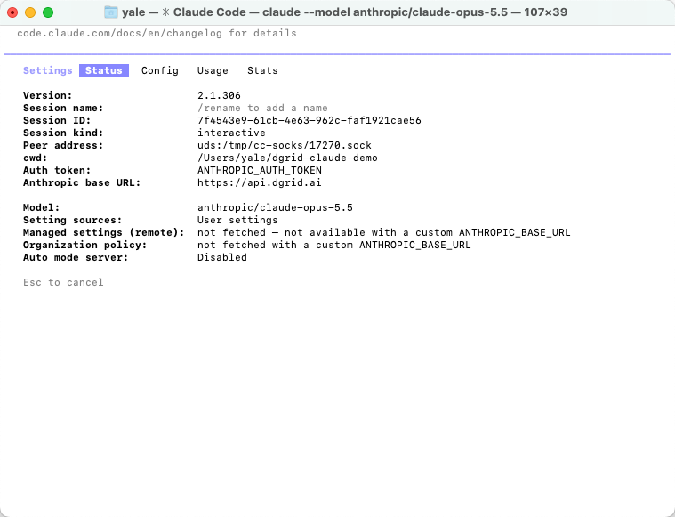
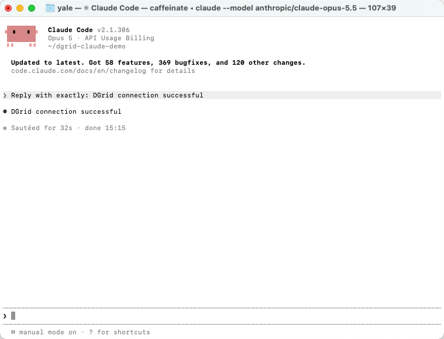
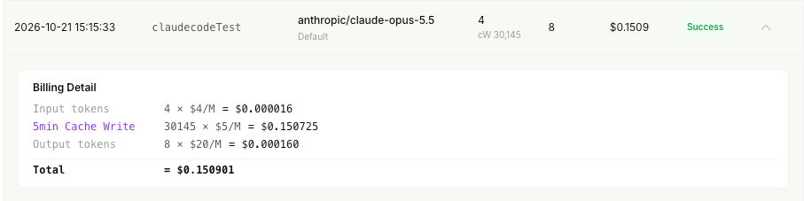
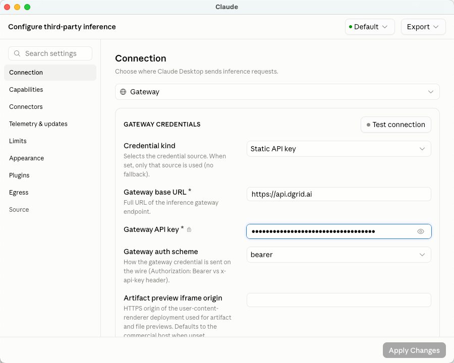
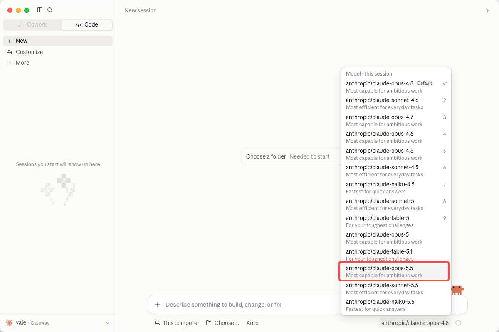
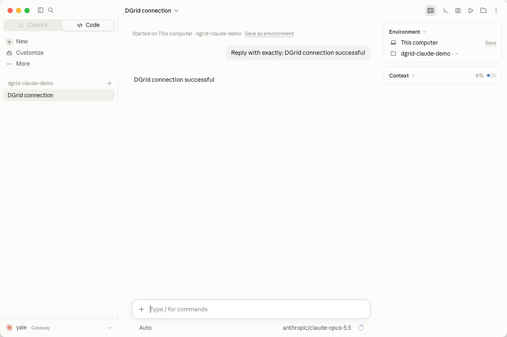

<Info>
모델 요청에는 DGrid Model API Key를 사용하세요. Management API Key는 관리용 자격 증명이므로 이 가이드에 사용할 수 없습니다. 키에 사용 가능한 잔액과 선택한 모델의 접근 권한이 있는지 확인하세요.
</Info>

DGrid API 키, 게이트웨이 URL 및 키로 접근할 수 있는 Claude 모델을 사용하여 Claude Code를 DGrid에 연결합니다. 먼저 macOS 터미널 설정을 설명한 다음 Claude 데스크톱 앱의 <strong>Code</strong> 탭에서 설정하는 방법을 안내합니다.

예제 모델은 `anthropic/claude-opus-5.5`입니다. `anthropic/` 접두사를 포함한 전체 DGrid 모델 ID를 사용하세요. 가이드 전체에서 접근 가능한 다른 Claude 모델로 바꿔도 됩니다.

## 시작하기 전에

- 인터넷에 연결된 macOS 컴퓨터가 필요합니다. 아래 터미널 명령은 macOS 기본 셸인 Zsh를 사용합니다.
- 사용 가능한 잔액과 선택한 Claude 모델의 접근 권한이 있는 [DGrid 계정](https://dgrid.ai/)이 필요합니다.
- npm으로 설치하려면 <strong>Node.js 22 이상과 npm</strong>이 필요합니다. 아래에 설치 방법이 안내되어 있습니다.

CLI 스크린샷은 Claude Code `2.1.306`을 사용합니다. 다른 버전에서는 메뉴와 사용 가능한 모델이 다를 수 있습니다. 데스크톱 설정은 독립적이므로 CLI를 설치하지 않고 해당 탭부터 진행해도 됩니다.

## 1단계: DGrid API 키 생성 및 모델 선택

1. [DGrid](https://dgrid.ai/)에 로그인하고 [API Keys](https://dgrid.ai/api-keys)를 여세요.
2. <strong>Create New Key</strong>를 클릭하고 이름을 입력한 다음 키를 생성하세요.
3. 아래 설정에 사용할 키를 복사하세요. 스크린샷이나 공유 파일에 전체 키를 노출하지 마세요.
4. DGrid 모델 목록에서 접근 가능한 Claude 모델을 찾아 전체 ID를 복사하세요. 이 가이드는 `anthropic/claude-opus-5.5`를 사용합니다.

연결 설정은 다음과 같습니다.

| 설정 | 값 |
| --- | --- |
| Base URL | `https://api.dgrid.ai` |
| 자격 증명 | DGrid API 키 |
| 예제 모델 ID | `anthropic/claude-opus-5.5` |

<strong>Base URL에 <code>/v1</code> 또는 <code>/v1/messages</code>를 추가하지 마세요.</strong> Claude Code가 요청 시 Messages API 경로를 추가합니다.

<Tabs>
<Tab title="CLI">

### 2단계: Claude Code 설치


이미 설치했다면 `claude --version`을 실행하세요. 버전 번호가 표시되면 3단계로 이동하세요.

#### npm으로 설치

먼저 Node.js와 npm이 설치되어 있는지 확인하세요.

```zsh
node -v
npm -v
```

명령을 찾을 수 없거나 Node.js가 22 미만이면 [Node.js 다운로드 페이지](https://nodejs.org/en/download)에서 현재 <strong>LTS</strong> 버전을 설치하세요. npm이 포함된 macOS 설치 프로그램을 선택하세요. 설치 후 새 터미널에서 두 명령을 다시 실행하세요.

사용자 디렉터리에 Claude Code를 설치하세요.

```zsh
npm install -g @anthropic-ai/claude-code --prefix "$HOME/.local"
```

설치 디렉터리를 현재 터미널의 PATH에 추가하고 버전을 확인하세요.

```zsh
export PATH="$HOME/.local/bin:$PATH"
claude --version
```

사용자 디렉터리에 설치하므로 `sudo`가 필요하지 않습니다. 새 터미널에서도 PATH 설정을 사용하려면 텍스트 편집기로 동일한 `export PATH` 줄을 `~/.zshrc`에 추가하세요.

#### 대안: 네이티브 설치 프로그램

[공식 네이티브 설치 프로그램](https://code.claude.com/docs/en/setup#install-claude-code)을 사용할 수도 있습니다. 이 방법은 Node.js를 별도로 설치할 필요가 없습니다.

```zsh
curl -fsSL https://claude.ai/install.sh | bash
```

설치 후 새 터미널에서 `claude --version`을 확인하세요. 명령을 찾을 수 없으면 위 명령으로 `~/.local/bin`을 PATH에 추가하세요. 두 설치 방법 중 하나를 선택하세요. 스크립트 URL이 HTML을 반환하거나 다운로드에 실패하면 Node.js를 설치한 후 npm 방법을 사용하세요.

### 3단계: 현재 터미널에서 DGrid 설정

Zsh에서 아래 명령을 실행하세요. 마지막 명령은 입력 내용을 표시하지 않고 키를 요청합니다.

```zsh
export ANTHROPIC_BASE_URL="https://api.dgrid.ai"
unset ANTHROPIC_API_KEY
export ANTHROPIC_AUTH_TOKEN
read -rs "ANTHROPIC_AUTH_TOKEN?Paste your DGrid API key (hidden): "
```

<strong>Paste your DGrid API key (hidden):</strong>가 표시되면 DGrid API 키를 붙여넣고 Enter를 누르세요. 터미널 프롬프트가 다시 표시되며 키는 숨겨진 상태로 유지됩니다.

Claude Code가 변수를 상속하도록 같은 터미널에서 계속 진행하세요. 설정은 현재 터미널 세션에만 적용됩니다. 새 터미널에서는 이 단계를 반복하거나 아래의 선택적 프로젝트 설정을 사용하세요.

이전에 설정한 다른 공급자의 설정이 남아 있을 수 있습니다. `unset`은 셸 변수만 제거하며 설정 파일의 항목은 삭제하지 않습니다. 5단계에서 실제 연결을 확인하고 다른 키가 감지되면 문제 해결을 참고하세요.

### 4단계: Claude Code 시작

첫 세션용 폴더를 만든 다음 전체 DGrid 모델 ID로 Claude Code를 시작하세요.

```zsh
mkdir -p "$HOME/dgrid-claude-demo"
cd "$HOME/dgrid-claude-demo"
claude --model "anthropic/claude-opus-5.5"
```

폴더 신뢰 여부를 물으면 경로를 확인하고 방금 만든 폴더에 대해 <strong>Yes, I trust this folder</strong>를 선택하세요. 최초 실행의 화면 설정도 완료하세요.

### 5단계: 활성 연결 확인

Claude Code에서 다음을 입력하세요.

```text
/status
```

<strong>Status</strong> 탭에 다음 값이 표시되어야 합니다.

| 상태 필드 | 예상 값 |
| --- | --- |
| Auth token | `ANTHROPIC_AUTH_TOKEN` |
| Anthropic base URL | `https://api.dgrid.ai` |
| Model | `anthropic/claude-opus-5.5` |

<Frame caption="DGrid URL, 토큰 출처 및 선택한 모델을 보여 주는 Claude Code Status">
  
</Frame>

다른 Claude 모델을 선택했다면 해당 전체 모델 ID를 확인하세요. Esc를 눌러 대화로 돌아가세요.

### 6단계: 첫 메시지 보내기

다음을 입력하세요.

```text
Reply with exactly: DGrid connection successful
```

Enter를 누르고 응답을 기다리세요.

```text
DGrid connection successful
```

<Frame caption="Claude Code 터미널에서 받은 정상 응답">
  
</Frame>

이제 DGrid를 통해 Claude Code를 계속 사용할 수 있습니다. 사용량을 확인하려면 DGrid 요청 기록에서 모델과 요청 시간이 일치하는 항목을 찾으세요. 완료된 요청에는 <strong>Success</strong>가 표시됩니다.

<Frame caption="DGrid에서 완료된 Claude 모델 요청">
  
</Frame>

토큰 수와 요금은 요청에 따라 달라집니다. 스크린샷은 캐시 쓰기 사용량을 포함한 예시입니다.

#### 선택 사항: 프로젝트 설정 저장

셸 변수를 매번 입력하지 않으려면 프로젝트의 `.claude/settings.local.json`을 설정하세요. 생성 전에 `.claude/settings.local.json`을 프로젝트의 `.gitignore`에 추가하여 키가 버전 관리에 포함되지 않도록 하세요.

로컬 설정 파일을 만들거나 편집하고 자리표시자를 DGrid 키로 바꾸세요.

```json
{
  "env": {
    "ANTHROPIC_BASE_URL": "https://api.dgrid.ai",
    "ANTHROPIC_AUTH_TOKEN": "<your-dgrid-api-key>",
    "ANTHROPIC_API_KEY": ""
  },
  "model": "anthropic/claude-opus-5.5"
}
```

기존 로컬 설정에 이 필드를 병합하세요. 키가 로컬 파일에 저장되므로 비공개로 유지하세요. 새 터미널에서 프로젝트 폴더로 이동해 `claude`를 실행하고 `/status`로 설정을 다시 확인하세요. 설정 범위는 [공식 게이트웨이 설정 안내](https://code.claude.com/docs/en/llm-gateway-connect#set-in-a-settings-file)를 참고하세요.

</Tab>
<Tab title="데스크톱">

Claude 데스크톱 앱의 <strong>Code</strong> 탭에서도 Claude Code를 사용할 수 있습니다. 게이트웨이는 CLI와 별도로 설정하세요. 터미널 환경 변수만으로는 데스크톱 앱의 타사 추론 연결이 설정되지 않습니다.

### 1 타사 추론 설정 열기

1. macOS용 [Claude 데스크톱 앱](https://claude.com/download)을 다운로드하여 설치한 다음 여세요.
2. macOS 메뉴 막대에서 <strong>Help → Troubleshooting → Enable Developer Mode</strong>를 선택하세요.
3. 메시지가 표시되면 앱을 재시작하세요. 그런 다음 <strong>Developer → Configure Third-Party Inference…</strong>를 선택하세요.
4. 기존 게이트웨이 오류에 <strong>Open Setup</strong> 버튼이 표시되면 이 버튼으로도 설정 창을 열 수 있습니다.

첫 타사 설정 적용 후 Developer 메뉴가 사라지면 Help에서 Developer Mode를 다시 켜세요. [공식 앱 내 설정 안내](https://claude.com/docs/third-party/claude-desktop/in-app-configuration)에서 이 동작과 로컬 Apply Changes 옵션을 설명합니다.

### 2 DGrid 연결 정보 입력

<strong>Connection</strong>을 열고 다음 값을 입력하세요.

| 필드 | 입력 또는 선택할 값 |
| --- | --- |
| Inference provider | <strong>Gateway</strong> |
| Credential kind | <strong>Static API key</strong> |
| Gateway base URL | `https://api.dgrid.ai` |
| Gateway API key | DGrid API 키 |
| Gateway auth scheme | <strong>bearer</strong> |

이 설정에서는 <strong>Artifact preview iframe origin</strong>을 기본값으로 두세요. 스크린샷을 찍기 전에 눈 아이콘으로 키를 숨기세요.

<Frame caption="Claude 데스크톱 앱의 DGrid 게이트웨이 연결 설정">
  
</Frame>

<strong>Apply Changes</strong>를 클릭하여 로컬 설정을 적용하면 앱이 재시작됩니다. <strong>Test connection</strong>으로 연결을 검사할 수도 있습니다. 실패하면 오류 상세에서 사용된 모델과 응답을 확인하세요.

### 3 모델 선택 및 로컬 세션 시작

1. <strong>Code</strong> 탭을 열고 새 세션을 시작하세요.
2. 환경 선택기가 표시되면 <strong>This computer</strong>를 선택하세요.
3. 모델 선택기를 열고 <strong><code>anthropic/claude-opus-5.5</code></strong> 또는 접근 가능한 다른 Claude 모델을 선택하세요.
4. <strong>Choose a folder</strong> 또는 프로젝트 폴더 버튼을 클릭하고 `dgrid-claude-demo`를 선택하세요. CLI 설정을 건너뛰었다면 새 폴더를 직접 만들어 선택하세요.

<Frame caption="데스크톱 모델 선택기에서 전체 DGrid Claude 모델 ID 선택">
  
</Frame>

다음을 보내세요.

```text
Reply with exactly: DGrid connection successful
```

응답을 기다리세요. 입력창 아래의 모델 이름이 선택한 모델과 일치해야 합니다.

<Frame caption="Claude 데스크톱 Code 탭의 정상 DGrid 응답">
  
</Frame>

이 데스크톱 세션에서 DGrid로 작업을 계속할 수 있습니다.

</Tab>
</Tabs>

## 문제 해결

### 터미널에 command not found 또는 permission denied 표시

셸이 찾는 명령을 확인하세요.

```zsh
type -a claude
```

위의 사용자 디렉터리 설치 방법을 사용했다면 `~/.local/bin`이 PATH에 있는지 확인하세요. 설치된 실행 파일을 직접 확인할 수도 있습니다.

```zsh
"$HOME/.local/bin/claude" --version
```

파일이 없거나 실행되지 않으면 설치 출력을 확인하고 설치를 완료한 후 게이트웨이를 설정하세요. [Claude Code 설치 문제 해결](https://code.claude.com/docs/en/troubleshooting)을 참고하세요.

### 다른 API 키 또는 잘못된 게이트웨이 감지

기존 사용자 또는 프로젝트 설정에 공급자 변수가 있을 수 있습니다. 첫 실행에서 사용하지 않을 기존 `ANTHROPIC_API_KEY`를 제안하면 <strong>No</strong>를 선택하세요. `/status`로 DGrid URL, `ANTHROPIC_AUTH_TOKEN` 출처 및 모델을 확인하세요.

상태가 잘못되면 `~/.claude/settings.json`, `.claude/settings.json`, `.claude/settings.local.json`의 `env`와 공급자 전환 도구를 확인하세요. 파일 설정이 셸 변수를 덮어쓸 수 있습니다. 관련 필드를 수정하거나 위의 프로젝트 로컬 설정을 사용하되 다른 설정은 유지하세요. 세션을 재시작하고 `/status`를 다시 확인하세요.

### 인증 또는 모델 오류로 요청 실패

DGrid 키, 잔액 및 선택한 Claude 모델의 접근 권한을 확인하세요. 기본 모델 별칭이 DGrid 카탈로그와 일치한다고 가정하지 말고 전체 ID를 사용하세요. 필요하면 키를 숨긴 상태로 다시 입력하세요.

### 데스크톱 앱의 게이트웨이 오류

<strong>Details</strong>에서 요청 URL, HTTP 상태, 응답 메시지 및 표시되는 경우 `probedModel`을 확인하세요. 연결 검사는 채팅에서 선택한 모델과 다른 모델을 사용할 수 있습니다. 키가 보고된 모델에 접근할 수 있는지 확인하세요.

`HTTP 500`과 `upstream_error`만으로 키, 모델 라우팅 또는 업스트림 서비스 중 원인을 특정할 수는 없습니다. 저장된 설정과 모델 접근 권한을 확인한 후 재시도하세요. 계속 실패하면 API 키를 제외한 요청 시간과 오류 상세를 DGrid 지원팀에 전달하세요.

### 데스크톱 앱에 예상 모델이 없음

타사 추론 설정을 다시 열어 DGrid 게이트웨이와 키가 적용되었는지, 키가 모델에 접근할 수 있는지 확인하세요. 데스크톱 모델 목록은 게이트웨이 검색 또는 명시적 목록에서 가져올 수 있습니다. [공식 게이트웨이 모델 설정](https://claude.com/docs/third-party/claude-desktop/gateway#models)을 참고하세요.

## 관련 자료

- [통합 가이드 개요](/ko/ai-gateway/integrations)
- [AI Gateway 빠른 시작](/ko/ai-gateway/overview#빠른-시작)
- [DGrid로 Claude Code 사용하기](https://blog.dgrid.ai/posts/2026-03-12/)
