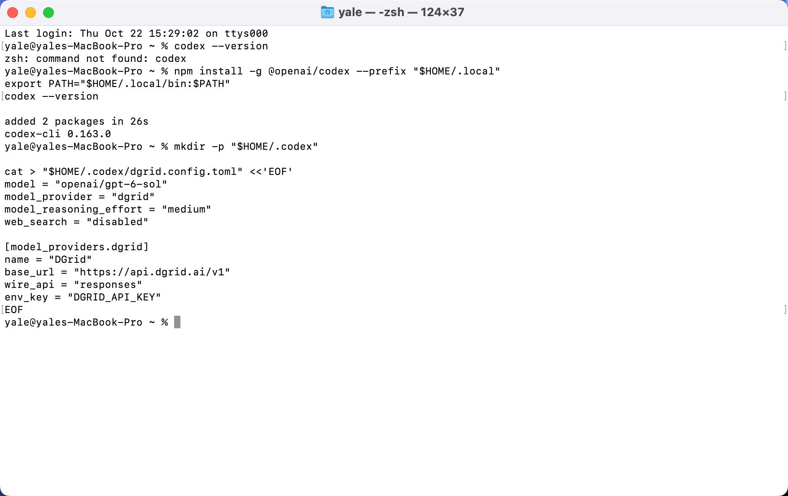
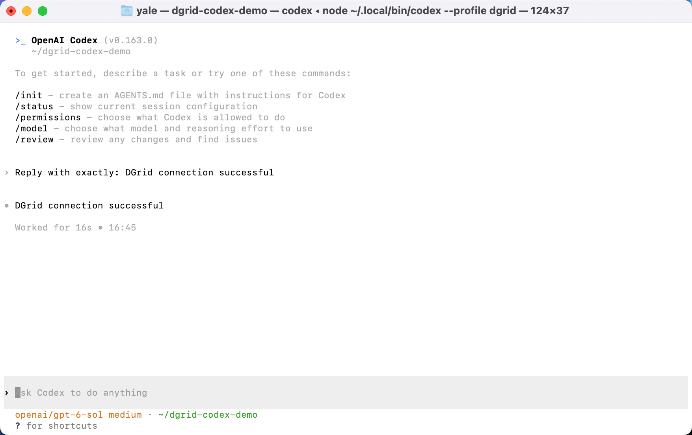
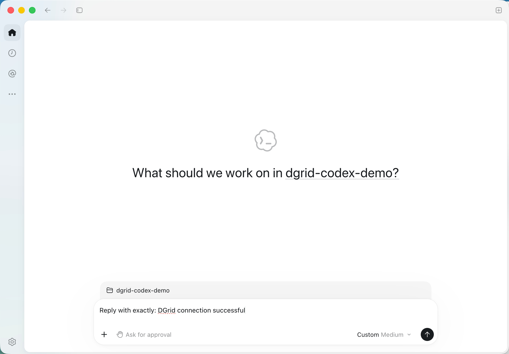
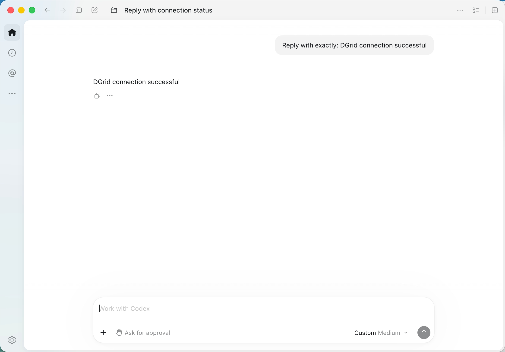
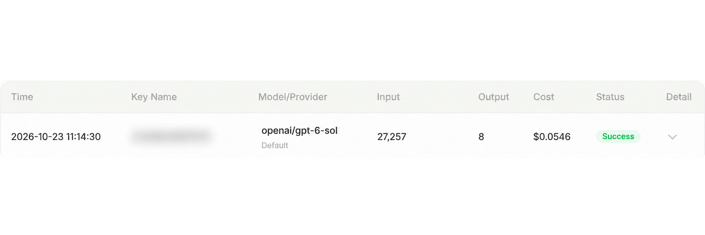

<Info>
모델 요청에는 DGrid Model API Key를 사용하세요. Management API Key는 관리용 자격 증명이므로 이 가이드에 사용할 수 없습니다. 키에 사용 가능한 잔액과 선택한 모델의 접근 권한이 있는지 확인하세요.
</Info>

API 키, Responses API Base URL 및 전체 모델 ID로 <strong>Codex CLI</strong> 또는 <strong>데스크톱 앱의 Codex</strong>를 DGrid에 연결합니다.

현재 데스크톱 다운로드는 <strong>Codex가 포함된 ChatGPT 데스크톱 앱</strong>입니다. 기존 설치에서는 Codex라는 이름이 남아 있을 수 있습니다. [공식 다운로드 페이지](https://chatgpt.com/download/)에서 앱을 받으세요.

이 가이드는 `openai/gpt-6-sol`을 사용합니다. 스크린샷과 데스크톱 상세 절차는 macOS 기준이며 Windows 설치 및 CLI 안내도 포함합니다.

## 시작하기 전에

- 사용 가능한 잔액과 Responses API 지원 모델의 접근 권한이 있는 [DGrid 계정](https://dgrid.ai/)이 필요합니다.
- DGrid에 로그인하여 [API Keys](https://dgrid.ai/api-keys)에서 API 키를 만들거나 복사하세요.
- npm 설치에는 Node.js와 npm이 필요합니다. 데스크톱 앱은 CLI와 독립적으로 사용할 수 있습니다.

스크린샷과 공유 파일에 전체 키를 노출하지 마세요. `openai/` 접두사를 포함한 전체 모델 ID를 유지하세요.

<Note>
모델 메타데이터 또는 카탈로그 오류가 발생하면 Codex 버전에 맞는 카탈로그 설정을 DGrid에 문의하세요. 사용자 지정 모델 별칭에는 해당 메타데이터가 필요할 수 있습니다. 카탈로그 URL을 추측하지 마세요. [공식 게이트웨이 설정 안내](https://learn.chatgpt.com/docs/enterprise/connect-to-a-gateway)를 참고하세요.
</Note>

## 설정 방법 선택

| 방법 | 설정 파일 | 사용 방법 |
| --- | --- | --- |
| CLI | `~/.codex/dgrid.config.toml` | `codex --profile dgrid`를 실행하세요. |
| macOS 데스크톱 | `~/.codex/config.toml` | 앱이 시작 시 기본 설정 파일을 읽습니다. |

CLI 프로필은 해당 프로필로 시작한 실행에서 DGrid를 선택합니다. 데스크톱 기본 파일을 수정하면 이 파일을 읽는 클라이언트의 기본 공급자가 바뀝니다. 현재 데스크톱 환경을 업무에 사용 중이라면 다른 컴퓨터에서 데스크톱 절차를 진행하세요.

두 방법 모두 다음 연결 설정을 사용합니다.

| 설정 | 값 |
| --- | --- |
| Model | `openai/gpt-6-sol` |
| Base URL | `https://api.dgrid.ai/v1` |
| API 형식 | `responses` |
| 자격 증명 환경 변수 | `DGRID_API_KEY` |

<Tabs>
<Tab title="CLI">

### 1. Node.js 및 Codex CLI 설치

필요하면 [Node.js 다운로드 페이지](https://nodejs.org/en/download)에서 현재 LTS 버전을 설치하세요. macOS 또는 Windows용 설치 프로그램을 실행하세요. 표준 설치 프로그램에는 npm이 포함됩니다.

macOS 터미널 또는 Windows PowerShell에서 확인하세요.

```shell
node -v
npm -v
```

[공식 Codex npm 설치 방법](https://learn.chatgpt.com/docs/codex/cli)에 따라 설치하세요.

<strong>macOS:</strong> 사용자 디렉터리에 설치하세요.

```zsh
npm install -g @openai/codex --prefix "$HOME/.local"
export PATH="$HOME/.local/bin:$PATH"
codex --version
```

PATH 명령은 현재 터미널에만 적용됩니다. 새 터미널에서 다시 실행하거나 셸 PATH 설정에 디렉터리를 추가하세요.

<strong>Windows PowerShell:</strong>

```powershell
npm install -g @openai/codex
codex --version
```

PowerShell이 `npm.ps1`을 차단하면 `npm` 대신 `npm.cmd`를 사용하세요.

CLI 스크린샷은 `codex-cli 0.163.0`을 사용합니다. 아래 독립 프로필 파일 형식은 Codex `0.134.0` 이상에 적용됩니다. [프로필 설정](https://learn.chatgpt.com/docs/config-file/config-advanced#profiles)을 참고하세요.

### 2. DGrid 프로필 생성

macOS에서 `~/.codex/dgrid.config.toml`, Windows에서 `%USERPROFILE%\.codex\dgrid.config.toml`을 만드세요. 다음 내용을 붙여넣으세요.

```toml
model = "openai/gpt-6-sol"
model_provider = "dgrid"
model_reasoning_effort = "medium"
web_search = "disabled"

[model_providers.dgrid]
name = "DGrid"
base_url = "https://api.dgrid.ai/v1"
wire_api = "responses"
env_key = "DGRID_API_KEY"
```

macOS에서는 다음 명령으로 파일을 만들고 열 수 있습니다.

```zsh
mkdir -p "$HOME/.codex"
touch "$HOME/.codex/dgrid.config.toml"
open -t "$HOME/.codex/dgrid.config.toml"
```

프로필이 이미 있으면 해당 설정을 수정하세요. 일반 텍스트로 저장하고 곧은 따옴표를 사용하세요. `env_key`는 변수 이름이므로 `DGRID_API_KEY`로 유지하세요.

<Frame caption="터미널에서 Codex CLI 설치 및 별도 DGrid 프로필 생성">
  
</Frame>

### 3. API 키 입력

Codex를 시작할 동일한 터미널을 사용하세요.

<strong>macOS 터미널(Zsh):</strong>

```zsh
export DGRID_API_KEY
read -rs "DGRID_API_KEY?Paste your DGrid API key (hidden): "
```

프롬프트에 키를 붙여넣고 Enter를 누르세요. 입력한 문자는 표시되지 않습니다. 터미널 프롬프트가 돌아온 뒤 다음 명령을 실행하세요.

<strong>Windows PowerShell:</strong> 첫 줄을 실행하고 숨겨진 입력 프롬프트에 키를 입력한 다음 나머지 줄을 실행하세요.

```powershell
$dgridSecureKey = Read-Host "Paste your DGrid API key (hidden)" -AsSecureString
$env:DGRID_API_KEY = [System.Net.NetworkCredential]::new("", $dgridSecureKey).Password
Remove-Variable dgridSecureKey
```

현재 터미널 세션에 키가 설정됩니다. 새 터미널에서는 다시 입력해야 합니다.

### 4. Codex 시작 및 메시지 전송

macOS에서 실행하세요.

```zsh
mkdir -p "$HOME/dgrid-codex-demo"
cd "$HOME/dgrid-codex-demo"
codex --profile dgrid
```

Windows PowerShell에서 실행하세요.

```powershell
New-Item -ItemType Directory -Force "$HOME/dgrid-codex-demo" | Out-Null
Set-Location "$HOME/dgrid-codex-demo"
codex --profile dgrid
```

폴더 신뢰 여부를 물으면 방금 만든 예제 폴더를 신뢰하도록 선택하세요. 선택한 모델이 `openai/gpt-6-sol`인지 확인하세요. `/status`로 세션을 확인할 수도 있습니다.

다음을 보내세요.

```text
Reply with exactly: DGrid connection successful
```

예상 응답은 다음과 같습니다.

```text
DGrid connection successful
```

<Frame caption="DGrid 모델을 선택하고 응답을 표시하는 Codex CLI">
  
</Frame>

시작 시 `Running without the shared background server: --profile requires embedded mode.`가 표시되면 프로필 세션의 실행 방식에 대한 안내입니다. F2로 확인하고 Esc로 닫은 다음 계속하세요. 일부 Mac 키보드는 Fn + F2를 사용합니다.

</Tab>
<Tab title="데스크톱(macOS)">

### 1. 데스크톱 앱 설치

[공식 다운로드 페이지](https://chatgpt.com/download/)를 열고 운영체제를 선택하세요.

- <strong>macOS:</strong> 다운로드한 설치 프로그램을 열고 앱을 Applications로 드래그한 다음 여세요.
- <strong>Windows:</strong> 다운로드한 설치 프로그램을 실행하고 안내를 따르세요.

Codex가 포함된 현재 앱을 선택하세요. 아래 절차는 macOS 및 `/Applications/ChatGPT.app` 경로를 기준으로 합니다.

DGrid 자격 증명을 사용하려면 아래의 공급자 및 실행 환경을 설정하세요. 첫 로그인 화면의 `OpenAI API key` 필드만으로는 DGrid Base URL이 설정되지 않습니다.

### 2. 기본 파일에 DGrid 설정

<strong>Command + Q로 데스크톱 앱을 완전히 종료하세요.</strong> 창만 닫으면 앱이 계속 실행될 수 있습니다.

macOS 터미널에서 실행하세요.

```zsh
mkdir -p "$HOME/.codex"
touch "$HOME/.codex/config.toml"
open -t "$HOME/.codex/config.toml"
```

`config.toml`에 다음 설정을 사용하세요.

```toml
model = "openai/gpt-6-sol"
model_provider = "dgrid"
model_reasoning_effort = "medium"
web_search = "disabled"

[model_providers.dgrid]
name = "DGrid"
base_url = "https://api.dgrid.ai/v1"
wire_api = "responses"
env_key = "DGRID_API_KEY"
```

기존 파일에서는 해당 최상위 키를 수정하고 <strong>첫 테이블 헤더 앞</strong>(`[section]`)에 배치하세요. 파일 끝에 DGrid 공급자 테이블을 추가하거나 기존 테이블을 수정하세요. 다른 설정은 유지하고 키나 테이블을 중복 정의하지 마세요. 일반 텍스트와 곧은 따옴표를 사용하세요.

앱은 이 기본 파일을 읽습니다. CLI 프로필 파일만으로 데스크톱 앱에서 DGrid가 선택되지는 않습니다. Windows 경로는 `%USERPROFILE%\.codex\config.toml`입니다. [공식 게이트웨이 설정 안내](https://learn.chatgpt.com/docs/enterprise/connect-to-a-gateway)를 참고하세요.

### 3. 키 입력 및 앱 시작

macOS 터미널의 Zsh에서 실행하세요.

```zsh
export DGRID_API_KEY
read -rs "DGRID_API_KEY?Paste your DGrid API key (hidden): "
```

DGrid 키를 붙여넣고 Enter를 누르세요. 터미널 프롬프트가 돌아오면 <strong>같은 터미널에서 별도의 명령으로</strong> 다음을 실행하세요.

```zsh
open -a "/Applications/ChatGPT.app" --env "DGRID_API_KEY=$DGRID_API_KEY"
```

앱 이름이 `Codex.app`이면 실제 설치 경로로 바꾸세요.

앱이 이미 실행 중이어서 환경 변수를 설정할 수 없다는 메시지가 나오면 Command + Q로 완전히 종료한 후 실행 명령을 다시 입력하세요.

키는 이번에 시작한 앱 프로세스에 전달됩니다. 새 터미널에서 다시 시작할 때는 숨겨진 키 입력과 실행 명령을 반복하세요. Dock에서 앱을 열면 이 터미널에만 설정한 변수가 전달되지 않습니다.

### 4. 프로젝트 선택 및 메시지 전송

예제 폴더를 만드세요.

```zsh
mkdir -p "$HOME/dgrid-codex-demo"
```

데스크톱 앱에서 진행하세요.

1. <strong>Choose project</strong>를 클릭하고 홈 폴더의 `dgrid-codex-demo`를 선택하세요.
2. 아래 프롬프트를 입력하세요.
3. 전송 화살표를 클릭하세요.

```text
Reply with exactly: DGrid connection successful
```

<Frame caption="Codex에서 프로젝트 선택 후 연결 확인 프롬프트 전송 준비">
  
</Frame>

예상 응답은 다음과 같습니다.

```text
DGrid connection successful
```

<Frame caption="모델 응답을 표시하는 Codex 데스크톱 앱">
  
</Frame>

일부 버전은 <strong>Custom Medium</strong> 같은 이름을 표시합니다. 설정의 전체 모델 ID와 DGrid 요청 기록을 비교하여 실제 모델 및 경로를 확인하세요.

</Tab>
</Tabs>

## DGrid에서 요청 확인

DGrid 요청 기록에서 요청 시간과 전체 모델 ID가 일치하는 항목을 찾으세요. 완료된 요청에는 <strong>Success</strong> 상태가 표시됩니다.

<Frame caption="openai/gpt-6-sol과 Success가 표시된 DGrid 요청 기록. Key Name은 흐림 처리됨">
  
</Frame>

개인정보 보호를 위해 Key Name을 흐림 처리했습니다. 토큰 수와 비용은 모델 및 Codex가 보내는 컨텍스트에 따라 달라집니다.

## 문제 해결

| 증상 | 확인 사항 |
| --- | --- |
| `codex: command not found` | 설치가 완료되었는지 확인하세요. macOS에서는 현재 터미널에서 `export PATH="$HOME/.local/bin:$PATH"`를 실행하세요. |
| API 키를 찾을 수 없음 | 클라이언트를 시작하는 터미널에 키를 설정하세요. `env_key`는 변수 이름이며 값을 설정하지는 않습니다. |
| 앱이 이미 실행 중이어서 환경 변수 설정 실패 | Command + Q로 완전히 종료한 다음 데스크톱 실행 명령을 다시 입력하세요. |
| Dock에서 연 뒤 로그인 또는 요청 실패 | 앱을 종료하고 터미널에서 키를 입력한 다음 `--env`로 시작하세요. |
| 인증 또는 모델 접근 오류 | DGrid 키, 잔액, Responses 지원 및 전체 모델 ID를 확인하세요. |
| 공급자 설정이 무시됨 | 위의 사용자 수준 파일을 사용하세요. 프로젝트의 `.codex/config.toml`에서는 사용자 지정 공급자를 선택할 수 없습니다. |
| 기존 데스크톱 공급자로 복원 | 기존 모델, 공급자 및 인증 설정을 복원한 후 앱을 완전히 종료하고 다시 여세요. |

[Codex 설정 참고 문서](https://learn.chatgpt.com/docs/config-file/config-reference)에서 공급자 설정을 확인할 수 있습니다. 이 가이드는 연결 및 응답 수신을 다룹니다. 도구, 웹 검색 및 긴 에이전트 작업은 선택한 모델과 게이트웨이의 지원 범위에 따라 달라집니다.

## 관련 자료

- [통합 가이드 개요](/ko/ai-gateway/integrations)
- [AI Gateway 빠른 시작](/ko/ai-gateway/overview#빠른-시작)
- [DGrid로 Codex CLI 사용하기](https://blog.dgrid.ai/posts/2026-03-23/)
