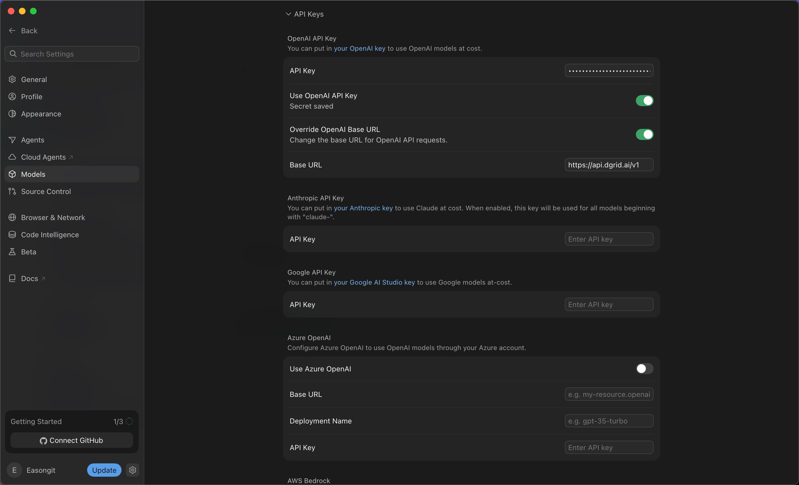
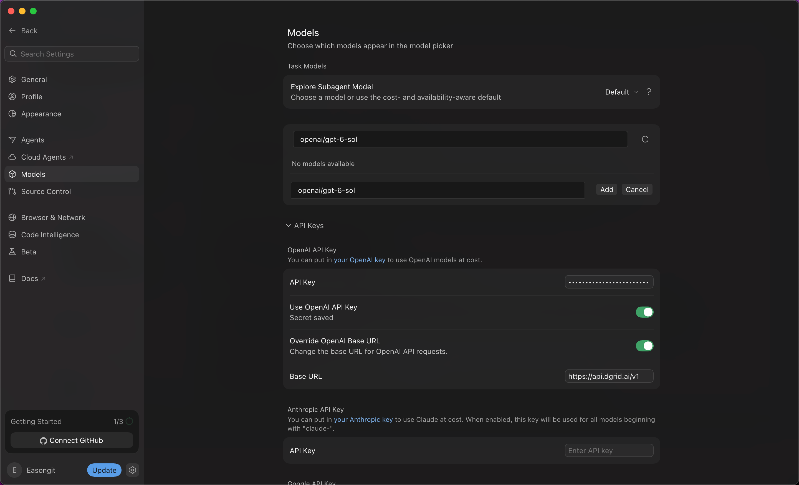
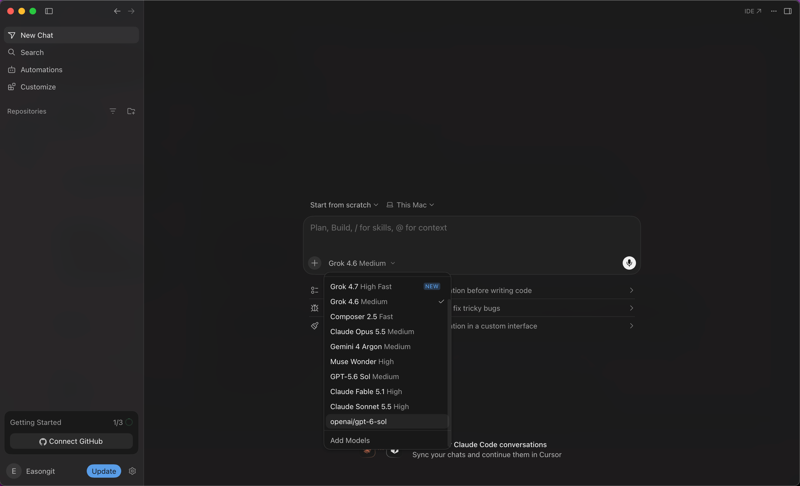
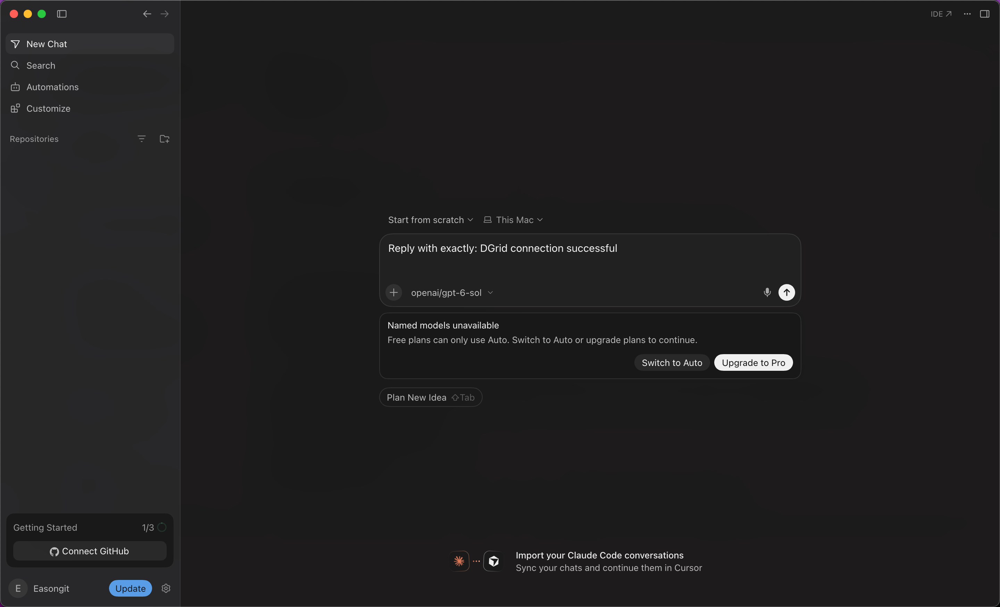

<Info>
모델 요청에는 DGrid Model API Key를 사용하세요. Management API Key는 관리용 자격 증명이므로 이 가이드에 사용할 수 없습니다. 키에 사용 가능한 잔액과 선택한 모델의 접근 권한이 있는지 확인하세요.
</Info>

DGrid API 키와 OpenAI 호환 Base URL을 설정한 다음 전체 DGrid 모델 ID로 모델을 추가하고 선택하세요. 이 가이드는 `openai/gpt-6-sol`을 예제로 사용합니다.

## 시작하기 전에

- 인터넷에 연결된 macOS 또는 Windows 컴퓨터가 필요합니다.
- Cursor 계정이 필요합니다. 요금제가 자체 키 사용(BYOK)과 선택한 사용자 지정 모델을 지원하는지 확인하세요. 이 가이드의 버전에서는 무료 계정으로 설정을 저장할 수 있었지만 선택한 모델로 메시지를 보내는 것은 제한되었습니다.
- 사용 가능한 잔액과 선택한 모델의 접근 권한이 있는 [DGrid 계정](https://dgrid.ai/)이 필요합니다.

Cursor 구독료와 DGrid 모델 사용료는 별도입니다. 스크린샷은 무료 요금제의 제한을 보여 줍니다. 현재 기능은 계정 및 Cursor 공식 문서에서 확인하세요. 배경은 [Cursor 지원 안내](https://forum.cursor.com/t/youve-hit-your-usage-limit-still-after-setting-my-key/150496/3)를 참고하세요.

설치 안내는 macOS와 Windows를 다룹니다. 이후 설정과 스크린샷은 macOS용 Cursor `3.24.18` 기준입니다. 다른 버전에서는 메뉴 이름이 다를 수 있습니다.

## 1단계: Cursor 설치 및 실행

[Cursor 공식 다운로드 페이지](https://cursor.com/download)에서 운영체제에 맞는 데스크톱 설치 프로그램을 선택하세요.

### macOS

1. Apple Silicon은 <strong>Mac (ARM64)</strong>, Intel은 <strong>Mac (x64)</strong>를 선택하세요. <strong>Mac Universal</strong>은 둘 다 지원합니다.
2. 다운로드한 `.dmg`를 열고 <strong>Cursor</strong>를 <strong>Applications</strong>로 드래그하세요.
3. Applications에서 Cursor를 열고 초기 설정을 완료한 다음 Cursor 계정에 로그인하세요.

### Windows

1. Intel 또는 AMD 컴퓨터는 <strong>Windows (x64) (User)</strong>, Windows on ARM 컴퓨터는 <strong>Windows (ARM64) (User)</strong>를 선택하세요. User 설치 프로그램은 현재 Windows 사용자 계정에 Cursor를 설치합니다.
2. 다운로드한 `.exe`를 실행하고 설치 마법사의 안내를 따르세요.
3. 시작 메뉴 또는 바탕 화면 바로가기에서 Cursor를 열고 초기 설정을 완료한 다음 Cursor 계정에 로그인하세요.

이후 설정은 macOS를 기준으로 설명합니다.

## 2단계: DGrid API 키 생성

1. [DGrid](https://dgrid.ai/)에 로그인하고 [API Keys](https://dgrid.ai/api-keys)를 여세요.
2. <strong>Create New Key</strong>를 클릭하고 `Cursor` 같은 이름을 입력한 다음 키를 생성하세요.
3. 다음 단계에서 사용할 키를 복사하세요. 스크린샷이나 공유 파일에 전체 키를 노출하지 마세요.
4. DGrid 모델 목록에서 키가 원하는 모델에 접근할 수 있는지 확인하고 전체 ID를 복사하세요. 아래 예제는 `openai/gpt-6-sol`입니다.

## 3단계: API 키 및 Base URL 설정

1. Cursor 왼쪽 아래 계정 이름 옆의 <strong>톱니바퀴 아이콘</strong>을 클릭하세요.
2. 설정 사이드바에서 <strong>Models</strong>를 선택하세요.
3. 아래로 스크롤하여 <strong>API Keys</strong>를 펼치세요.
4. <strong>OpenAI API Key</strong>의 <strong>API Key</strong> 필드에 <strong>DGrid API 키</strong>를 붙여넣으세요. Save 버튼이 있으면 저장하세요. 저장되면 <strong>Secret saved</strong>가 표시됩니다.
5. <strong>Override OpenAI Base URL</strong>을 켜고 다음 값을 입력하세요.

```text
https://api.dgrid.ai/v1
```

6. <strong>Use OpenAI API Key</strong>를 켜세요. <strong>Enable OpenAI API Key</strong> 확인 창이 나타나면 기능 제한을 읽고 <strong>Enable OpenAI API Key</strong>를 클릭하세요.

설정이 다음 표와 일치하는지 확인하세요.

| 필드 | 값 |
| --- | --- |
| OpenAI API Key 아래의 API Key | DGrid API 키 |
| Use OpenAI API Key | 켜짐 |
| Override OpenAI Base URL | 켜짐 |
| Base URL | `https://api.dgrid.ai/v1` |

`/v1` 접미사를 유지하세요. 스크린샷에서는 키를 숨기세요.

<Frame caption="저장된 DGrid 키와 활성화된 API 키 및 Base URL 설정">
  
</Frame>

## 4단계: 전체 DGrid 모델 ID 추가

1. 같은 <strong>Models</strong> 설정 페이지에서 위로 스크롤하여 모델 목록으로 이동하세요.
2. <strong>Add or search model</strong>에 다음을 입력하세요.

```text
openai/gpt-6-sol
```

3. <strong>No models available</strong>이 표시되면 <strong>Add Custom Model</strong>을 클릭하세요.
4. 새 모델 필드에 동일한 전체 ID를 입력하고 <strong>Add</strong>를 클릭하세요.

<Frame caption="전체 DGrid 모델 ID를 사용자 지정 모델로 추가">
  
</Frame>

5. 모델 목록에 <strong>openai/gpt-6-sol</strong>이 표시되고 스위치가 켜져 있는지 확인하세요.

`openai/` 접두사를 유지하세요. 다른 모델을 사용하면 설정과 채팅 선택 모두 정확한 DGrid ID로 바꾸세요.

## 5단계: 새 채팅에서 모델 선택

1. 왼쪽 위의 <strong>Back</strong>을 클릭하여 채팅으로 돌아가세요. 필요하면 새 채팅을 시작하세요.
2. 메시지 입력창 아래의 모델 이름을 클릭하여 모델 선택기를 여세요.
3. 방금 추가한 사용자 지정 모델 <strong><code>openai/gpt-6-sol</code></strong>을 선택하세요.
4. 입력 영역의 선택된 모델이 <strong><code>openai/gpt-6-sol</code></strong>인지 확인하세요.

<Frame caption="채팅 모델 선택기에서 사용자 지정 DGrid 모델 선택">
  
</Frame>

## 구독 요구 사항 및 첫 메시지

<Note>
아래 스크린샷은 성공한 모델 요청이 아닌 요금제 제한의 예시입니다. 응답을 받은 후 DGrid에서 해당 요청을 찾아 경로를 확인하세요.
</Note>

<strong>Named models unavailable — Free plans can only use Auto</strong>가 표시되면 현재 계정이 Cursor 요금제 제한에 걸린 것입니다. 선택한 사용자 지정 모델을 사용하려면 지원되는 유료 계정에 로그인하거나 구독 업그레이드 여부를 결정하세요. Auto로 전환해도 선택한 DGrid 모델을 사용한다는 증거가 되지 않습니다.

<Frame caption="사용자 지정 모델 메시지 전송 시 Cursor 무료 요금제 제한">
  
</Frame>

지원되는 요금제에서는 다음과 같은 짧은 메시지를 보낼 수 있습니다.

```text
Reply with exactly: DGrid connection successful
```

응답을 받은 후 DGrid 요청 기록에서 모델, 요청 시간 및 <strong>Success</strong> 상태를 확인하세요.

## 참고 사항 및 문제 해결

- <strong>지원 범위:</strong> 사용자 지정 API 키는 지원되는 채팅 모델에 적용됩니다. Tab 자동 완성은 Cursor 내장 모델을 사용합니다. 기능 및 과금은 [Cursor API 키 문서](https://cursor.com/help/models-and-usage/api-keys)를 참고하세요.
- <strong>키는 저장되었지만 요청에 사용되지 않음:</strong> <strong>Use OpenAI API Key</strong>와 <strong>Override OpenAI Base URL</strong>이 모두 켜져 있고 URL이 `https://api.dgrid.ai/v1`인지 확인하세요.
- <strong>선택기에 모델이 없음:</strong> 전체 사용자 지정 모델 ID를 추가하고 활성화했는지 확인한 후 새 채팅에서 선택기를 다시 여세요.
- <strong>구독 확인 후에도 요청 실패:</strong> DGrid 키, 잔액, 전체 모델 ID 및 접근 권한을 확인하세요. Cursor 목록에 모델을 추가한 것만으로 요청 성공이 보장되지는 않습니다.
- <strong>다른 공급자로 복귀:</strong> 다른 OpenAI 모델을 사용하기 전에 Base URL 재정의를 확인하세요. 이 설정이 요청의 전송 주소를 변경합니다.

## 관련 자료

- [통합 가이드 개요](/ko/ai-gateway/integrations)
- [AI Gateway 빠른 시작](/ko/ai-gateway/overview#빠른-시작)
- [Cursor에서 DGrid AI Gateway 설정하기](https://blog.dgrid.ai/posts/2026-02-18/)
