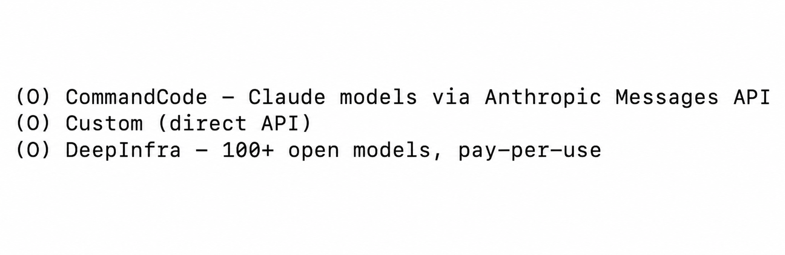
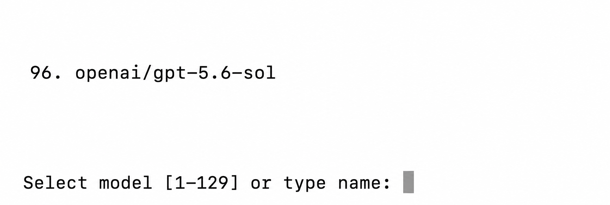
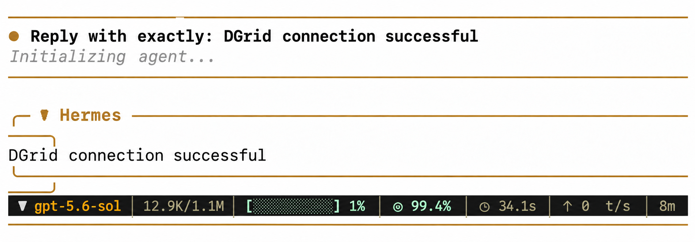
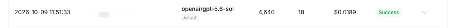

<Info>
모델 요청에는 DGrid Model API Key를 사용하세요. Management API Key는 관리용 자격 증명이므로 이 가이드에 사용할 수 없습니다. 키에 사용 가능한 잔액과 선택한 모델의 접근 권한이 있는지 확인하세요.
</Info>

Hermes Agent에서 사용자 지정 API 공급자를 추가하고 DGrid API 키와 엔드포인트를 입력하면 DGrid 모델을 사용할 수 있습니다. 이 가이드는 최초 설정 마법사 순서로 진행하며 예제 모델은 `openai/gpt-5.6-sol`입니다.

## 시작하기 전에

- 사용 가능한 잔액이 있는 [DGrid 계정](https://dgrid.ai/)이 필요합니다.
- 터미널을 사용할 수 있는 컴퓨터가 필요합니다. 아래에 macOS, Linux, WSL2 및 네이티브 Windows 설치 명령을 제공합니다.

## 1단계: DGrid API 키 생성

1. [DGrid Console](https://dgrid.ai/)에 로그인하여 <strong>Credits → Keys</strong>를 열거나 [API Keys 페이지](https://dgrid.ai/api-keys)로 이동하세요.
2. <strong>Create New Key</strong>를 선택하고 `Hermes` 같은 이름을 입력한 다음 키를 생성하세요.
3. 키를 복사하세요. 나중에 Hermes의 <strong>API key</strong> 프롬프트에 붙여넣습니다. 스크린샷이나 공개 문서에 키를 포함하지 마세요.

## 2단계: Hermes 설치 및 설정 열기

macOS, Linux 또는 WSL2에서 실행하세요.

```bash
curl -fsSL https://hermes-agent.nousresearch.com/install.sh | bash
```

네이티브 Windows의 PowerShell에서 실행하세요.

```powershell
iex (irm https://hermes-agent.nousresearch.com/install.ps1)
```

`prerequisites ok` 또는 `Cloning ... hermes-agent.git`가 보이면 설치 중입니다. 설정 마법사가 나타날 때까지 기다리세요.

<strong>How would you like to set up Hermes?</strong>에서 방향키로 <strong>Full setup — configure every provider, tool & option yourself (bring your own keys)</strong>를 선택하고 Enter 또는 Space를 누르세요.

설치가 끝났는데 마법사가 열리지 않으면 터미널에서 `hermes model`을 실행하고 3단계로 이동하세요.

## 3단계: 사용자 지정 API 공급자 선택

<strong>Select provider</strong> 목록 아래쪽의 <strong>Custom (direct API)</strong>를 선택하세요. `hermes model`로 들어왔다면 <strong>Custom endpoint (enter URL manually)</strong>를 선택하세요.

<Frame caption="Hermes 공급자 메뉴의 Custom direct API 항목">
  
</Frame>

## 4단계: DGrid 엔드포인트 및 모델 입력

마법사에서 다음 순서로 입력하세요.

| 마법사 프롬프트 | 입력 또는 선택할 값 |
| --- | --- |
| <strong>API base URL</strong> | `https://api.dgrid.ai/v1` |
| <strong>API key</strong> | 1단계에서 복사한 DGrid API 키 |
| <strong>Select API compatibility mode</strong> | <strong>Chat Completions</strong>: 현재 마법사의 옵션 `2` |
| <strong>Select model</strong> | 전체 모델 ID `openai/gpt-5.6-sol` |
| <strong>Context length in tokens</strong> | 자동 감지를 위해 빈 값으로 제출 |
| <strong>Display name</strong> | `DGrid` |

Base URL은 `/v1`까지만 입력하고 `/chat/completions`를 추가하지 마세요. 일반 <strong>API key</strong> 프롬프트의 `[optional]` 표시는 DGrid 키 연결에는 적용되지 않습니다.

키 입력 후 Hermes가 접근 가능한 모델 목록을 불러옵니다. <strong>Select model</strong>에서 `openai/gpt-5.6-sol`을 찾아 행 번호 또는 전체 ID를 입력하세요. 스크린샷의 번호는 `96`이지만 실제 번호는 다를 수 있으므로 전체 ID로 확인하세요. 모델이 없으면 Chat Completions를 지원하는 다른 접근 가능한 DGrid 모델을 선택하세요.

<Frame caption="Hermes의 예제 모델 및 모델 선택 프롬프트">
  
</Frame>

모델과 사용자 지정 공급자가 저장되었다는 메시지가 표시되면 설정이 완료됩니다.

## 5단계: Hermes 시작 및 DGrid 모델 사용

다음을 실행하세요.

```bash
hermes
```

첫 실행에서 <strong>Help improve Hermes?</strong>가 사용 데이터 공유 여부를 물을 수 있습니다. 원하는 옵션을 선택하세요. <strong>No thanks</strong>를 선택해도 채팅을 계속할 수 있습니다. 다음과 같은 메시지를 입력하세요.

```text
Reply with exactly: DGrid connection successful
```

Hermes가 응답하면 채팅을 계속할 수 있습니다. DGrid 경유 여부를 확인하려면 해당 시간대의 요청 기록에서 모델 ID와 <strong>Success</strong> 상태를 찾으세요. 아래 이미지는 응답과 요청 기록의 예시입니다.

<Frame caption="Hermes에서 DGrid 모델로 채팅">
  
</Frame>

<Frame caption="DGrid Console의 모델 요청">
  
</Frame>

## 자주 묻는 질문

- <strong>마법사가 자동으로 열리지 않음:</strong> `hermes model`을 실행하고 사용자 지정 엔드포인트를 선택한 다음 4단계의 값을 입력하세요.
- <strong>Enter를 누르면 <code>^M</code>이 입력됨:</strong> <strong>Control+J</strong>로 현재 입력을 제출하세요.
- <strong>모델 확인 또는 변경:</strong> 터미널에서 `hermes status`로 현재 Model과 Provider를 확인하세요. 모델을 다시 선택하려면 `hermes model`을 실행하세요.
- <strong>응답 후 <code>Auxiliary title generation failed: Request timed out</code> 표시:</strong> 자동 대화 제목 생성에 관한 메시지이며 이미 받은 채팅 응답에는 영향을 주지 않습니다.

자세한 내용은 [Hermes 설치 안내](https://hermes-agent.nousresearch.com/docs/getting-started/installation/) 및 [공급자 문서](https://hermes-agent.nousresearch.com/docs/integrations/providers/)를 참고하세요.

## 관련 자료

- [통합 가이드 개요](/ko/ai-gateway/integrations)
- [AI Gateway 빠른 시작](/ko/ai-gateway/overview#빠른-시작)
