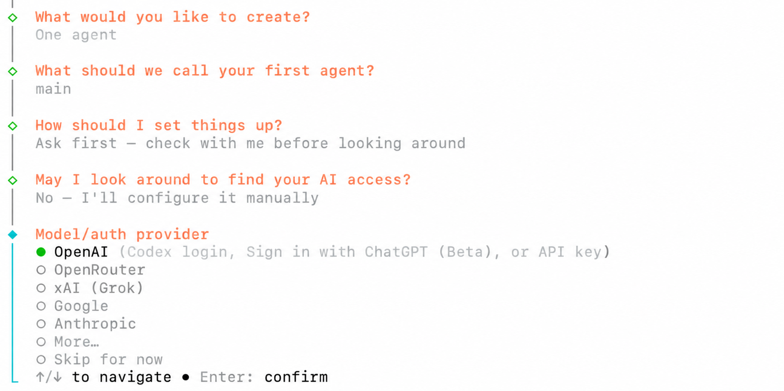
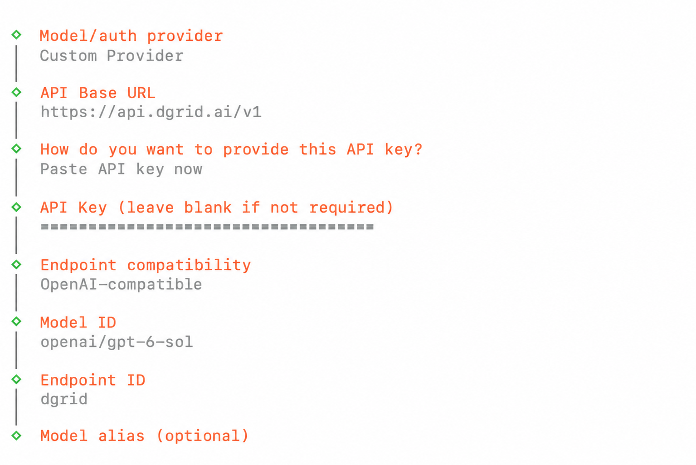
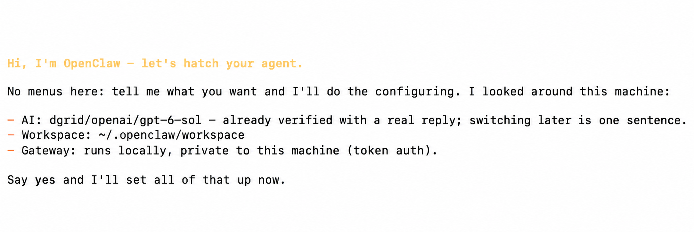
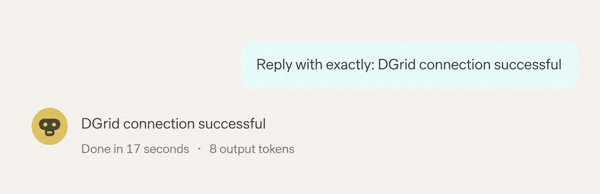
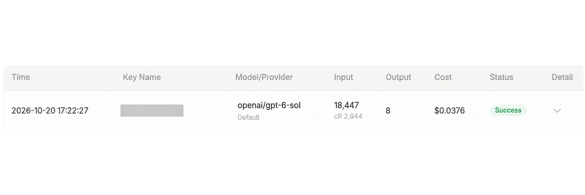

<Info>
모델 요청에는 DGrid Model API Key를 사용하세요. Management API Key는 관리용 자격 증명이므로 이 가이드에 사용할 수 없습니다. 키에 사용 가능한 잔액과 선택한 모델의 접근 권한이 있는지 확인하세요.
</Info>

<Note>
OpenClaw Gateway는 컴퓨터에서 실행되며 OpenClaw 대시보드를 연결하는 로컬 서비스입니다. DGrid AI Gateway는 모델 요청을 받는 원격 API 서비스입니다. 두 서비스의 접근 자격 증명은 서로 다릅니다.
</Note>

Custom Provider를 추가하고 DGrid API 키, Base URL 및 모델을 입력하여 OpenClaw를 DGrid에 연결하세요. 이 가이드는 macOS 설치 및 설정 후 브라우저 대시보드에서 첫 메시지를 보내는 방법을 설명합니다. 예제 모델은 `openai/gpt-6-sol`입니다.

## 시작하기 전에

- 터미널과 인터넷 연결이 가능한 macOS 컴퓨터가 필요합니다.
- 사용 가능한 잔액과 사용할 모델의 접근 권한이 있는 [DGrid 계정](https://dgrid.ai/)이 필요합니다.

아래 메뉴와 스크린샷은 OpenClaw `2026.10.5` 기준입니다. 모델 가용성은 DGrid 계정에 따라 달라집니다. Chat Completions를 지원하는 다른 접근 가능한 모델로 바꿔도 됩니다. 전체 DGrid 모델 ID를 입력하세요.

## 1단계: DGrid API 키 생성

1. [DGrid](https://dgrid.ai/)에 로그인하고 [API Keys 페이지](https://dgrid.ai/api-keys)를 여세요.
2. <strong>Create New Key</strong>를 클릭하고 `OpenClaw` 같은 이름을 입력한 다음 키를 생성하세요.
3. 키를 복사하세요. 4단계의 OpenClaw 설정 마법사에 붙여넣습니다. 스크린샷이나 공유 문서에 전체 키를 노출하지 마세요.

## 2단계: OpenClaw 설치

터미널을 열고 실행하세요.

```bash
curl -fsSL https://openclaw.ai/install-cli.sh | bash
```

공식 설치 프로그램이 OpenClaw와 지원되는 Node.js 런타임을 `~/.openclaw` 아래에 설치합니다. 설치 완료 메시지와 터미널 프롬프트가 표시될 때까지 기다리세요.

별도의 명령으로 설정 마법사를 시작하세요.

```bash
"$HOME/.openclaw/bin/openclaw" onboard
```

이 설치 방법을 사용한 직후 실행할 수 있도록 가이드 전체에서 명령의 전체 경로를 사용합니다.

## 3단계: 수동 공급자 설정 선택

시작 메뉴에 <strong>Quick start</strong>와 <strong>Custom setup</strong>이 있으면 <strong>Custom setup</strong>을 선택하세요. 안전 안내를 읽고 동의하면 <strong>Yes</strong>를 선택하세요. 사용 통계 여부는 원하는 대로 선택하세요. <strong>No thanks</strong>를 선택해도 계속할 수 있습니다.

방향키와 Enter로 다음을 선택하세요.

| 설정 프롬프트 | 선택 또는 입력할 값 |
| --- | --- |
| What would you like to create? | <strong>One agent</strong> |
| What should we call your first agent? | <strong>main</strong> 유지 |
| How should I set things up? | <strong>Ask first - check with me before looking around</strong> |
| May I look around to find your AI access? | <strong>No - I'll configure it manually</strong> |

<strong>Model/auth provider</strong>에서 <strong>More...</strong>를 선택하여 전체 공급자 목록을 여세요.

<Frame caption="수동 설정 선택 후 공급자 메뉴에서 More 열기">
  
</Frame>

공급자 검색에 `custom`을 입력하고 <strong>Custom Provider</strong>를 선택한 다음 Enter를 누르세요.

## 4단계: DGrid 연결 정보 입력

아래 순서대로 입력하세요. 텍스트 필드마다 Enter를 누르고 메뉴에서는 방향키와 Enter를 사용하세요.

| 설정 프롬프트 | 입력 또는 선택할 값 |
| --- | --- |
| API Base URL | `https://api.dgrid.ai/v1` |
| How do you want to provide this API key? | <strong>Paste API key now</strong> |
| API Key | 1단계에서 복사한 DGrid API 키 |
| Endpoint compatibility | <strong>OpenAI-compatible (Uses /chat/completions)</strong> |
| Model ID | `openai/gpt-6-sol` |
| Endpoint ID | 자동 생성된 값을 `dgrid`로 변경 |
| Model alias (optional) | 비워 두고 Enter 누르기 |

Base URL은 `/v1`까지만 입력하고 `/chat/completions`를 추가하지 마세요. 일반 API Key 안내에서 필수가 아니면 비워도 된다고 해도 DGrid 키를 입력해야 합니다.

Model ID에는 `openai/` 접두사를 포함한 `openai/gpt-6-sol`을 입력하세요. Endpoint ID `dgrid`는 OpenClaw에서 공급자를 구분하는 로컬 이름입니다. 둘을 합치면 모델 참조는 `dgrid/openai/gpt-6-sol`입니다.

<Frame caption="DGrid Base URL, 숨겨진 API 키, 모델 ID 및 엔드포인트 ID">
  
</Frame>

별칭 입력 후 OpenClaw가 모델 연결을 확인합니다. 완료될 때까지 기다리세요. 실패하면 URL, 키, 잔액 및 전체 모델 ID를 확인한 후 다시 시도하세요.

## 5단계: 설정 완료 및 Gateway 시작

설정 도우미가 모델, 작업 공간 및 로컬 Gateway 요약을 보여 줍니다. <strong>Say yes and I'll set all of that up now</strong>가 표시되면 다음을 입력하세요.

```text
yes
```

Enter를 누르고 설정 적용이 끝날 때까지 기다리세요.

<Frame caption="설정 요약 확인 후 yes를 입력하여 적용">
  
</Frame>

두 번째 터미널 창에서 Gateway 백그라운드 서비스를 설치하세요.

```bash
"$HOME/.openclaw/bin/openclaw" gateway install
```

Gateway가 실행 중이며 연결 가능한지 확인하세요.

```bash
"$HOME/.openclaw/bin/openclaw" gateway status
```

<strong>Gateway is not reachable yet</strong>가 표시되었다면 대시보드를 열기 전에 위 Gateway 단계를 완료하세요. 여전히 <strong>Runtime: stopped</strong>이면 아래 문제 해결을 참고하세요.

브라우저 대시보드를 여세요.

```bash
"$HOME/.openclaw/bin/openclaw" dashboard
```

명령으로 열린 링크를 사용하여 로컬 Gateway에 연결하세요.

## 6단계: DGrid 모델로 채팅 시작

1. 대시보드에서 <strong>Home</strong>과 <strong>main</strong> 세션을 여세요.
2. 입력창 아래 모델 선택기에 <strong>openai/gpt-6-sol (Custom Provider)</strong>가 표시되는지 확인하세요. 다른 모델을 사용했다면 해당 모델을 선택하세요.
3. <strong>Message main</strong>에 다음을 입력하세요.

```text
Reply with exactly: DGrid connection successful
```

4. 위쪽 화살표 모양의 <strong>Send 버튼</strong>을 클릭하고 응답을 기다리세요.

<Frame caption="OpenClaw에서 메시지 전송 및 응답 수신">
  
</Frame>

이제 DGrid 모델로 채팅을 계속할 수 있습니다. DGrid 요청 기록에서 해당 모델과 시간을 찾아보세요. 완료된 요청에는 <strong>Success</strong> 상태가 표시됩니다.

<Frame caption="성공한 DGrid 모델 요청">
  
</Frame>

나중에 브라우저 대시보드를 다시 열려면 실행하세요.

```bash
"$HOME/.openclaw/bin/openclaw" dashboard
```

## 문제 해결

<strong>설치 프로그램에서 대화형 TTY 필요 메시지 표시</strong>

설치 후 터미널에서 설정 마법사를 직접 실행하세요.

```bash
"$HOME/.openclaw/bin/openclaw" onboard
```

<strong>모델 연결 검사 실패</strong>

Base URL이 `https://api.dgrid.ai/v1`인지, 키에 잔액과 접근 권한이 있는지, 전체 모델 ID가 정확한지 확인하세요. 이 Chat Completions 설정에서는 Endpoint compatibility가 <strong>OpenAI-compatible</strong>이어야 합니다.

<strong>업그레이드 후 Gateway가 중지된 상태로 유지됨</strong>

시작 로그에 <strong>Legacy device identity exists</strong>가 표시되는 경우에만 서비스를 중지하고 내장 마이그레이션 및 복구 명령을 실행하세요.

```bash
"$HOME/.openclaw/bin/openclaw" gateway stop
"$HOME/.openclaw/bin/openclaw" doctor --fix
```

복구 안내를 따르세요. Doctor가 Gateway를 자동으로 재시작하고 확인할 수 있습니다. `"$HOME/.openclaw/bin/openclaw" gateway status`를 다시 실행하고 여전히 중지 상태면 다음을 실행하세요.

```bash
"$HOME/.openclaw/bin/openclaw" gateway start
```

<strong>브라우저가 Gateway에 연결되지 않음</strong>

`"$HOME/.openclaw/bin/openclaw" gateway status`로 서비스를 확인한 후 5단계 명령으로 대시보드를 다시 여세요. 대시보드 접근용 Gateway 토큰은 DGrid API 키와 다릅니다.

자세한 내용은 [OpenClaw 설치 안내](https://docs.openclaw.ai/install/installer), [설정 마법사 문서](https://docs.openclaw.ai/start/wizard) 및 [Gateway CLI 참고 문서](https://docs.openclaw.ai/cli/gateway)를 참고하세요.

## 관련 자료

- [통합 가이드 개요](/ko/ai-gateway/integrations)
- [AI Gateway 빠른 시작](/ko/ai-gateway/overview#빠른-시작)
- [DGrid로 OpenClaw 에이전트 설정하기](https://blog.dgrid.ai/posts/2026-02-02/)
- [OpenClaw 설치 및 노코드 설정](https://blog.dgrid.ai/posts/2026-02-27/)

아래에 이전 버전의 동영상 가이드가 있습니다. 이 가이드와 인터페이스가 다를 수 있습니다.

<video controls preload="metadata" style={{ width: "100%", borderRadius: "12px", marginTop: "12px" }}>
  <source src="/images/dgrid-openclaw-demo.mp4" type="video/mp4" />
  브라우저가 video 태그를 지원하지 않습니다.
</video>
