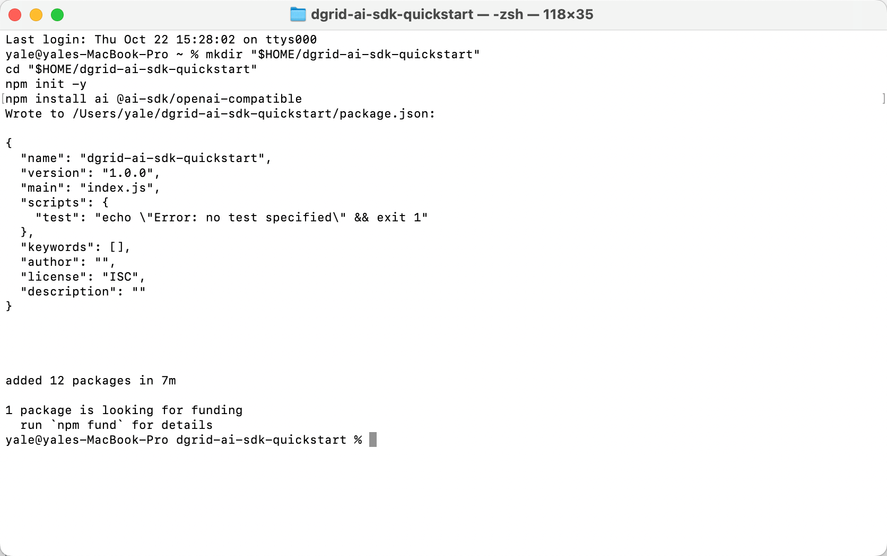
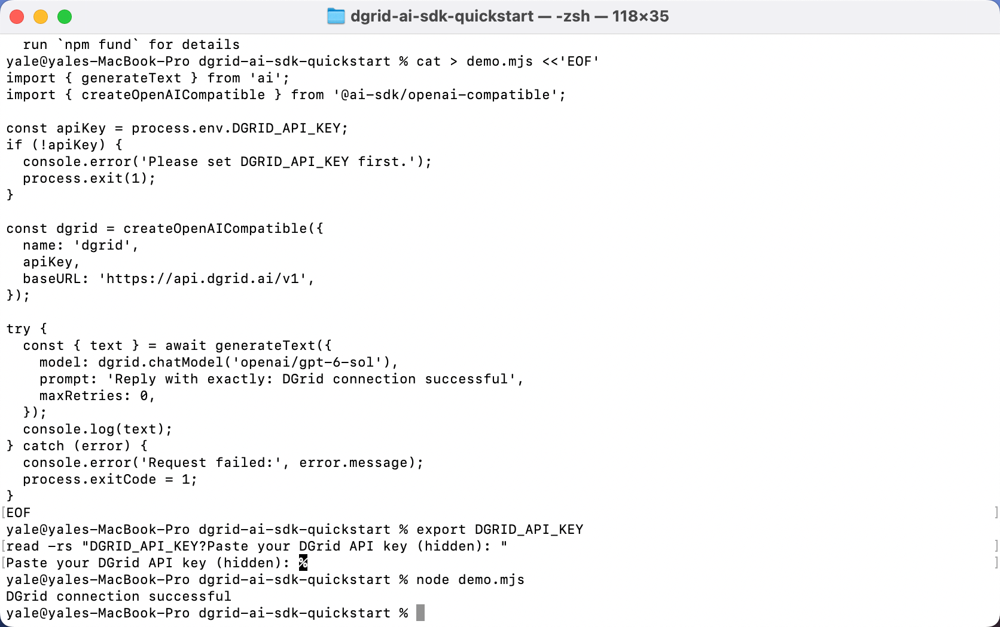

<Info>
모델 요청에는 DGrid Model API Key를 사용하세요. Management API Key는 관리용 자격 증명이므로 이 가이드에 사용할 수 없습니다. 키에 사용 가능한 잔액과 선택한 모델의 접근 권한이 있는지 확인하세요.
</Info>

Vercel은 <strong>AI SDK Core를 npm 패키지 <code>ai</code>로 배포</strong>합니다. 이 가이드에서는 패키지를 설치하고 `generateText()`를 가져온 다음 공식 OpenAI 호환 공급자로 DGrid에 연결합니다. [Vercel AI SDK 소개](https://ai-sdk.dev/docs/introduction)를 참고하세요.

DGrid API 키, OpenAI 호환 Base URL 및 전체 모델 ID를 설정하고 Node.js 스크립트 하나를 실행하여 Vercel AI SDK가 생성한 응답을 출력하세요.

이 가이드는 `openai/gpt-6-sol`을 사용합니다. 앱은 로컬에서 실행되며 AI SDK의 OpenAI 호환 공급자를 통해 DGrid에 모델 요청을 보냅니다.

## Vercel AI SDK의 DGrid 연결 방식

설치 명령과 JavaScript 코드 모두 SDK를 사용합니다.

| 패키지 또는 함수 | 예제에서의 역할 |
| --- | --- |
| `ai` | npm으로 설치하는 Vercel AI SDK Core입니다. |
| `ai`에서 가져온 `generateText` | 텍스트 생성을 실행하고 결과를 반환하는 Vercel AI SDK 함수입니다. |
| `@ai-sdk/openai-compatible` | OpenAI 호환 서비스를 지원하는 AI SDK 공급자 패키지입니다. |
| `createOpenAICompatible(...)` | DGrid 키와 Base URL로 SDK 공급자를 생성합니다. |
| `dgrid.chatModel(...)` | SDK의 `generateText()` 호출에 DGrid 모델을 전달합니다. |

요청 흐름은 다음과 같습니다.

<strong>스크립트 → Vercel AI SDK <code>generateText()</code> → OpenAI 호환 공급자 → DGrid → 모델 응답</strong>

Node.js는 프로그램을 실행하고 Vercel AI SDK는 모델 호출 인터페이스를 제공하며 DGrid는 모델 요청을 처리합니다. [공식 호환 공급자 예제](https://ai-sdk.dev/providers/openai-compatible-providers#example)도 `generateText()`와 `createOpenAICompatible()` 조합을 사용합니다.

## 시작하기 전에

- 인터넷에 연결된 macOS 또는 Windows 컴퓨터가 필요합니다.
- <strong>Node.js 22 이상</strong>과 npm이 필요합니다.
- 사용 가능한 잔액과 사용할 모델의 접근 권한이 있는 [DGrid 계정](https://dgrid.ai/)이 필요합니다.

예제 환경은 Node.js `22.14.0`, npm `10.9.2`, `ai` `7.0.148` 및 `@ai-sdk/openai-compatible` `3.0.75`입니다. 아래 명령은 AI SDK 7과 호환 공급자 3을 설치합니다. 스크린샷은 macOS 기준이며 셸 명령이 다르면 Windows 안내를 별도로 제공합니다.

## 1단계: Node.js 설치 및 환경 확인

Node.js가 없으면 [공식 Node.js 다운로드 페이지](https://nodejs.org/en/download)에서 현재 <strong>LTS</strong> 버전을 받으세요.

- <strong>macOS:</strong> macOS 설치 프로그램을 선택하고 다운로드한 `.pkg`를 실행한 후 안내를 따르세요.
- <strong>Windows:</strong> 컴퓨터 아키텍처에 맞는 설치 프로그램을 선택하고 다운로드한 `.msi`를 실행한 후 안내를 따르세요.

표준 설치 프로그램에는 npm이 포함됩니다. 설치 후 macOS의 새 <strong>터미널</strong> 창 또는 Windows의 <strong>PowerShell</strong> 창에서 실행하세요.

```shell
node -v
npm -v
```

두 명령 모두 버전 번호를 표시해야 합니다. Node.js가 22 미만이면 먼저 업데이트하세요.

## 2단계: DGrid API 키 생성

1. [DGrid](https://dgrid.ai/)에 로그인하고 [API Keys](https://dgrid.ai/api-keys)를 여세요.
2. <strong>Create New Key</strong>를 클릭하고 이름을 입력한 다음 키를 생성하세요.
3. 5단계에서 사용할 키를 복사하세요. 스크린샷과 공유 파일에 전체 키를 노출하지 마세요.
4. DGrid 모델 목록에서 키가 `openai/gpt-6-sol`에 접근할 수 있는지 확인하거나 Chat Completions를 지원하는 다른 모델의 전체 ID를 복사하세요.

공급자 접두사가 포함된 전체 모델 ID를 사용하세요. 이 예제에서는 `openai/gpt-6-sol`입니다.

## 3단계: 프로젝트 생성 및 Vercel AI SDK 설치

macOS 터미널 또는 Windows PowerShell에서 다음 명령을 실행하세요.

```shell
mkdir "$HOME/dgrid-ai-sdk-quickstart"
cd "$HOME/dgrid-ai-sdk-quickstart"
npm init -y
npm install ai@7 @ai-sdk/openai-compatible@3
```

이 명령은 <strong>Vercel AI SDK Core</strong>(`ai@7`)와 <strong>OpenAI 호환 공급자</strong>(`@ai-sdk/openai-compatible@3`)를 설치합니다. 다음 단계에서 두 패키지의 코드를 가져와 DGrid를 호출합니다.

npm이 패키지 추가를 완료하고 터미널 프롬프트가 돌아올 때까지 기다리세요. 설치 시간은 연결 상태에 따라 달라집니다.

<Frame caption="터미널에서 예제 프로젝트 생성 및 SDK 의존성 설치 완료">
  
</Frame>

## 4단계: Vercel AI SDK로 DGrid 호출

코드 편집기에서 `dgrid-ai-sdk-quickstart`의 `package.json` 옆에 <strong><code>demo.mjs</code></strong>를 만드세요. 아래 코드를 붙여넣고 일반 텍스트로 저장하세요. 파일 이름이 `demo.mjs.txt`가 아닌 `demo.mjs`인지 확인하세요.

`.mjs` 확장자를 사용하면 Node.js에서 예제의 `import` 구문을 사용할 수 있습니다.

```javascript
// Vercel AI SDK Core: the text-generation API.
import { generateText } from 'ai';
// AI SDK provider: connects to OpenAI-compatible services such as DGrid.
import { createOpenAICompatible } from '@ai-sdk/openai-compatible';

const apiKey = process.env.DGRID_API_KEY;
if (!apiKey) {
  console.error('Please set DGRID_API_KEY first.');
  process.exit(1);
}

// Configure the AI SDK provider with the DGrid key and endpoint.
const dgrid = createOpenAICompatible({
  name: 'dgrid',
  apiKey,
  baseURL: 'https://api.dgrid.ai/v1',
});

try {
  // Run the DGrid model request through Vercel AI SDK Core.
  const { text } = await generateText({
    model: dgrid.chatModel('openai/gpt-6-sol'),
    prompt: 'Reply with exactly: DGrid connection successful',
    maxRetries: 0,
  });
  console.log(text);
} catch (error) {
  console.error('Request failed:', error.message);
  process.exitCode = 1;
}
```

주요 연결 설정은 다음과 같습니다.

| 코드 | 용도 |
| --- | --- |
| `process.env.DGRID_API_KEY` | 터미널 환경에서 키를 읽습니다. |
| `baseURL: 'https://api.dgrid.ai/v1'` | 모델 요청을 DGrid로 보냅니다. `/v1` 접미사를 유지하세요. |
| `dgrid.chatModel('openai/gpt-6-sol')` | Chat Completions 어댑터로 전체 DGrid 모델 ID를 선택합니다. |
| `generateText(...)` | Vercel AI SDK Core가 설정된 공급자를 통해 프롬프트를 보내고 생성된 텍스트를 반환합니다. |

2단계에서 다른 모델을 선택했다면 `openai/gpt-6-sol`을 해당 전체 ID로 바꾸세요. 공급자의 `name: 'dgrid'`는 SDK의 로컬 이름입니다.

## 5단계: DGrid API 키 입력

사용하는 셸의 안내를 따르세요. 스크립트를 실행할 동일한 터미널에서 키를 입력하세요.

### macOS 터미널(Zsh)

다음을 실행하세요.

```zsh
export DGRID_API_KEY
read -rs "DGRID_API_KEY?Paste your DGrid API key (hidden): "
```

<strong>Paste your DGrid API key (hidden):</strong>가 표시되면 DGrid 키를 붙여넣고 Enter를 누르세요. 키는 화면에 표시되지 않습니다.

### Windows PowerShell

첫 명령을 실행하고 숨겨진 프롬프트에 키를 입력한 다음 Enter를 누르세요. 이후 나머지 명령을 실행하여 Node.js에 키를 전달하세요.

```powershell
$dgridSecureKey = Read-Host "Paste your DGrid API key (hidden)" -AsSecureString
$env:DGRID_API_KEY = [System.Net.NetworkCredential]::new("", $dgridSecureKey).Password
Remove-Variable dgridSecureKey
```

설정은 현재 터미널 세션에만 적용됩니다. 새 터미널에서는 키를 다시 설정하세요. `demo.mjs`에 키를 넣거나 버전 관리에 포함하지 마세요.

## 6단계: 예제 실행

프로젝트 디렉터리에서 키를 입력한 동일한 터미널로 실행하세요.

```shell
node demo.mjs
```

모델 응답을 기다리세요. 이 예제 프롬프트의 예상 출력은 다음과 같습니다.

```text
DGrid connection successful
```

<Frame caption="스크립트 실행 후 DGrid를 통한 모델 응답 수신">
  
</Frame>

다른 질문을 하려면 `demo.mjs`의 `prompt` 문자열을 수정하고 저장한 다음 `node demo.mjs`를 다시 실행하세요. 실행할 때마다 새 요청이 전송됩니다.

## 7단계: DGrid에서 요청 확인

DGrid 요청 기록에서 모델과 시간이 일치하는 요청을 찾으세요. 완료된 요청에는 <strong>Success</strong> 상태가 표시됩니다.

<Frame caption="선택한 모델과 Success 상태가 표시된 DGrid 요청 기록. Key Name은 흐림 처리됨">
  
</Frame>

스크린샷의 Key Name은 개인정보 보호를 위해 흐림 처리했습니다. 토큰 수, 캐시 사용량 및 요금은 요청에 따라 달라집니다.

## 문제 해결

| 메시지 또는 증상 | 확인 사항 |
| --- | --- |
| `Please set DGRID_API_KEY first.` | 같은 터미널에서 5단계를 반복한 다음 스크립트를 다시 실행하세요. |
| `Cannot find module` 또는 `ERR_MODULE_NOT_FOUND` | 현재 디렉터리가 `dgrid-ai-sdk-quickstart`이고 이 디렉터리에서 의존성 설치가 완료되었는지 확인하세요. |
| 터미널이 `demo.mjs`를 찾지 못함 | 현재 디렉터리와 파일 이름을 확인하고 `.txt` 확장자가 추가되어 있지 않은지 확인하세요. |
| 인증 오류 | DGrid 키를 다시 입력하고 유효한지 확인하세요. |
| 모델 또는 접근 오류 | 전체 모델 ID, 접근 권한 및 사용 가능한 DGrid 잔액을 확인하세요. |
| 네트워크 오류 | 컴퓨터에서 DGrid API에 연결할 수 있는지 확인한 후 재시도하세요. |
| PowerShell이 `npm.ps1`을 차단함 | 초기화 및 설치 명령에서 `npm` 대신 `npm.cmd`를 사용하세요. |

자세한 내용은 [AI SDK Node.js 안내](https://ai-sdk.dev/docs/getting-started/nodejs) 및 [OpenAI 호환 공급자 문서](https://ai-sdk.dev/providers/openai-compatible-providers)를 참고하세요.

## 관련 자료

- [통합 가이드 개요](/ko/ai-gateway/integrations)
- [AI Gateway 빠른 시작](/ko/ai-gateway/overview#빠른-시작)
- [Vercel AI SDK에서 DGrid 사용하기](https://blog.dgrid.ai/posts/2026-03-26/)
