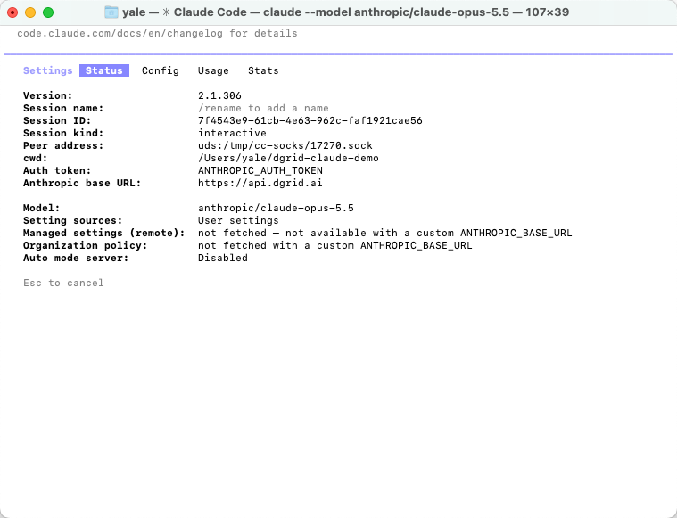
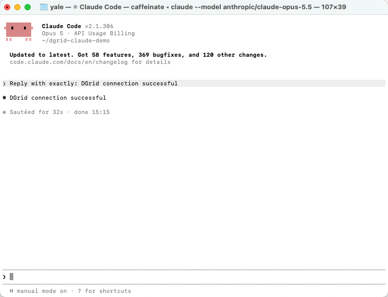
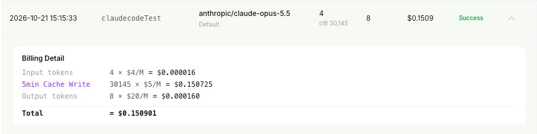
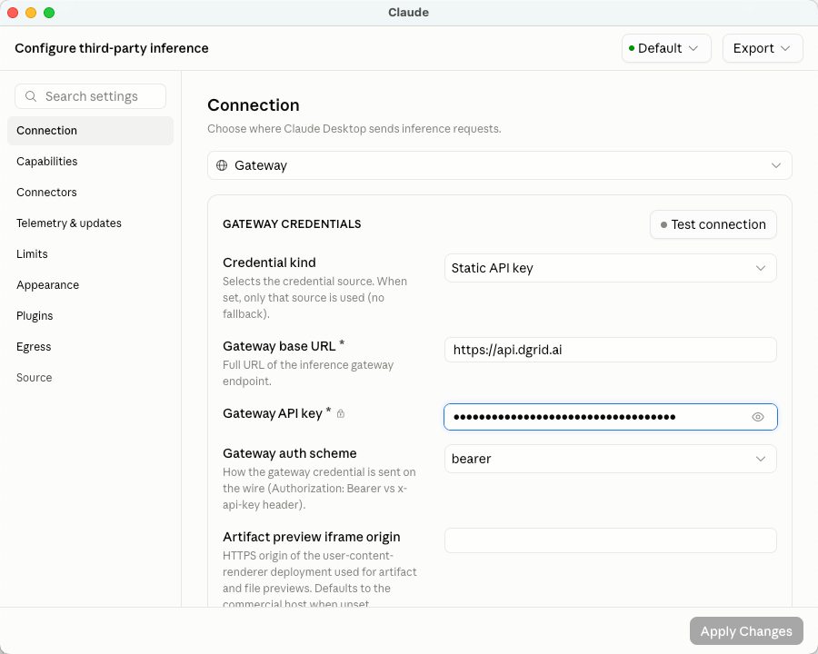
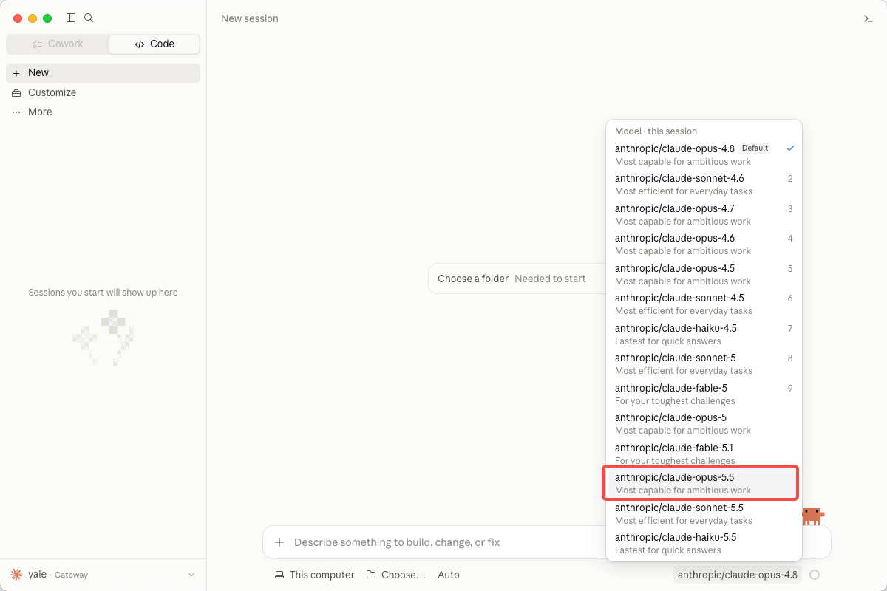
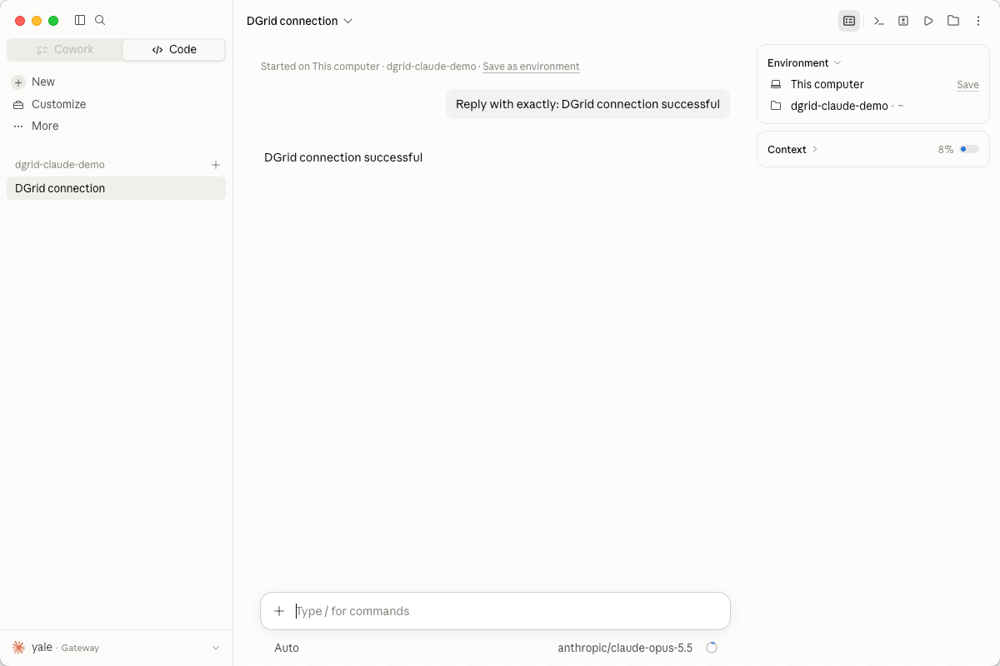

<Info>
使用 DGrid 的 Model API Key 呼叫模型；Management API Key 僅用於管理操作，無法用於本教學的模型請求。請確認金鑰具有可用餘額與目標模型的存取權限。
</Info>

透過 DGrid API Key、閘道地址和金鑰可存取的 Claude 模型，將 Claude Code 連線到 DGrid。本教學先介紹 macOS 終端機設定，再介紹 Claude 桌面應用 <strong>Code</strong> 分頁中的另一種設定方式。

範例模型為 `anthropic/claude-opus-5.5`。請使用包含 `anthropic/` 前綴的完整 DGrid 模型 ID，也可以將全文範例替換為其他可用的 Claude 模型。

## 開始之前

- 一台可以連線上網的 macOS 電腦。下文終端機指令使用 macOS 預設的 Zsh。
- 一個有可用餘額、且可以存取所選 Claude 模型的 [DGrid 帳號](https://dgrid.ai/)。
- 如果使用 npm 安裝：需要 <strong>Node.js 22 或更高版本，以及 npm</strong>。下文包含安裝提醒。

終端機截圖中的 Claude Code 版本為 `2.1.306`。其他版本的選單和可用模型可能不同。桌面端設定獨立進行，可以直接閱讀該章節，無需先完成終端機版安裝。

## 第 1 步 建立 DGrid API Key 並選擇模型

1. 登入 [DGrid](https://dgrid.ai/)，開啟 [API Keys](https://dgrid.ai/api-keys) 頁面。
2. 點選 <strong>Create New Key</strong>，填寫名稱並建立金鑰。
3. 複製金鑰，供下文設定使用。不要在截圖和共用檔案中展示完整金鑰。
4. 在 DGrid 模型列表中找到可用的 Claude 模型，複製完整模型 ID。本教學使用 `anthropic/claude-opus-5.5`。

連線參數如下：

| 設定項 | 內容 |
| --- | --- |
| Base URL | `https://api.dgrid.ai` |
| 憑證 | 您的 DGrid API Key |
| 範例模型 ID | `anthropic/claude-opus-5.5` |

<strong>Base URL 後面不要新增 <code>/v1</code> 或 <code>/v1/messages</code>。</strong> Claude Code 傳送請求時會自動新增 Messages API 路徑。

<Tabs>
<Tab title="CLI">

### 第 2 步 安裝 Claude Code


如果已經安裝 Claude Code，先執行 `claude --version`；能顯示版本號即可繼續第 3 步。

#### 使用 npm 安裝

先檢查 Node.js 和 npm 是否可用：

```zsh
node -v
npm -v
```

如果任一指令不存在，或 Node.js 版本低於 22，請先從 [Node.js 下載頁面](https://nodejs.org/en/download)安裝目前 <strong>LTS</strong> 版本。選擇 macOS 安裝套件，其中包含 npm。安裝後重新開啟終端機，再執行上面兩條指令確認。

將 Claude Code 安裝到使用者目錄：

```zsh
npm install -g @anthropic-ai/claude-code --prefix "$HOME/.local"
```

將安裝目錄加入目前終端機的 PATH，並檢查版本：

```zsh
export PATH="$HOME/.local/bin:$PATH"
claude --version
```

這種安裝到使用者目錄的方式不需要 `sudo`。如果希望新終端機也能找到指令，可以使用文字編輯器，將同一條 `export PATH` 設定加入 `~/.zshrc`。

#### 另一種安裝方式：原生安裝器

也可以選擇[官方原生安裝器](https://code.claude.com/docs/en/setup#install-claude-code)，這種方式不需要單獨安裝 Node.js：

```zsh
curl -fsSL https://claude.ai/install.sh | bash
```

安裝後開啟新終端機，執行 `claude --version`。如果找不到指令，使用上文指令將 `~/.local/bin` 加入 PATH。兩種安裝方式選擇一種即可。如果腳本地址回傳 HTML 網頁或下載失敗，可以安裝 Node.js 後改用 npm 方式。

### 第 3 步 在目前終端機設定 DGrid

在 Zsh 中執行以下指令。最後一條指令會提示輸入金鑰，並隱藏輸入內容：

```zsh
export ANTHROPIC_BASE_URL="https://api.dgrid.ai"
unset ANTHROPIC_API_KEY
export ANTHROPIC_AUTH_TOKEN
read -rs "ANTHROPIC_AUTH_TOKEN?Paste your DGrid API key (hidden): "
```

出現 <strong>Paste your DGrid API key (hidden):</strong> 後，貼上您的 DGrid API Key，再按 Enter。終端機會回傳指令提示字元，金鑰不會顯示出來。

請繼續使用同一個終端機，以便 Claude Code 繼承這些變數。上述設定僅對目前終端機工作階段生效。開啟新終端機後，需要重複本步驟，或使用後文可選的專案設定。

如果之前設定過其他供應商，其設定仍可能生效。`unset` 只能移除終端機中的變數，不會刪除設定檔中的條目。請在第 5 步檢查實際生效的連線；如果檢測到其他金鑰，參閱故障排查。

### 第 4 步 啟動 Claude Code

為首次工作階段建立一個單獨的資料夾，然後使用完整的 DGrid 模型 ID 啟動：

```zsh
mkdir -p "$HOME/dgrid-claude-demo"
cd "$HOME/dgrid-claude-demo"
claude --model "anthropic/claude-opus-5.5"
```

如果詢問是否信任該資料夾，核對路徑後，為剛建立的目錄選擇 <strong>Yes, I trust this folder</strong>。如有首次啟動的外觀設定提示，按需完成。

### 第 5 步 檢查目前連線

在 Claude Code 中輸入：

```text
/status
```

<strong>Status</strong> 分頁應顯示：

| 狀態欄位 | 預期內容 |
| --- | --- |
| Auth token | `ANTHROPIC_AUTH_TOKEN` |
| Anthropic base URL | `https://api.dgrid.ai` |
| Model | `anthropic/claude-opus-5.5` |

<Frame caption="Claude Code Status 中的 DGrid 地址、認證來源和所選模型">
  
</Frame>

如果選擇了其他 Claude 模型，這裡應顯示對應的完整模型 ID。按 Esc 返回對話。

### 第 6 步 傳送第一則訊息

輸入：

```text
Reply with exactly: DGrid connection successful
```

按 Enter 傳送，等待回覆：

```text
DGrid connection successful
```

<Frame caption="Claude Code 終端機中的成功回覆">
  
</Frame>

現在可以繼續透過 DGrid 使用 Claude Code。檢視用量時，開啟 DGrid 請求記錄，按模型和時間找到對應請求。已完成的請求顯示 <strong>Success</strong>。

<Frame caption="DGrid 中已完成的 Claude 模型請求">
  
</Frame>

Token 數量和費用隨請求變化。截圖展示的是一筆包含快取寫入用量的範例請求。

#### 可選：儲存此專案的設定

如果希望下次不用重新輸入終端機變數，可以在專案內設定 `.claude/settings.local.json`。建立前，先將 `.claude/settings.local.json` 加入專案的 `.gitignore`，避免金鑰進入版本控制。

建立或編輯本地設定檔，將佔位符替換為您的 DGrid API Key：

```json
{
  "env": {
    "ANTHROPIC_BASE_URL": "https://api.dgrid.ai",
    "ANTHROPIC_AUTH_TOKEN": "<your-dgrid-api-key>",
    "ANTHROPIC_API_KEY": ""
  },
  "model": "anthropic/claude-opus-5.5"
}
```

如果檔案已存在，請合併這些欄位，保留其他本地設定。這種方式會將金鑰存入本地檔案，請妥善保管。下次開啟終端機後，進入專案目錄並執行 `claude`，再透過 `/status` 檢查實際生效的設定。設定作用範圍詳見[官方閘道設定說明](https://code.claude.com/docs/en/llm-gateway-connect#set-in-a-settings-file)。

</Tab>
<Tab title="桌面版">

Claude 桌面應用的 <strong>Code</strong> 分頁也可以使用 Claude Code。桌面端的閘道需要單獨設定；終端機中的環境變數不會完成桌面端的第三方推理連線設定。

### 1 開啟第三方推理設定

1. 下載並安裝 macOS 版 [Claude 桌面應用](https://claude.com/download)，然後開啟。
2. 在 macOS 選單欄選擇 <strong>Help → Troubleshooting → Enable Developer Mode</strong>。
3. 如有提示，允許應用重啟。然後選擇 <strong>Developer → Configure Third-Party Inference…</strong>。
4. 如果已有閘道報錯，並提供 <strong>Open Setup</strong> 按鈕，也可以用該按鈕開啟設定視窗。

如果第一次應用第三方設定後 Developer 選單消失，從 Help 再次啟用 Developer Mode 即可。[官方應用內設定說明](https://claude.com/docs/third-party/claude-desktop/in-app-configuration)介紹了這一行為，以及本地應用設定的 Apply Changes 操作。

### 2 填寫 DGrid 連線參數

開啟 <strong>Connection</strong>，填寫以下內容：

| 欄位 | 填寫或選擇 |
| --- | --- |
| Inference provider | <strong>Gateway</strong> |
| Credential kind | <strong>Static API key</strong> |
| Gateway base URL | `https://api.dgrid.ai` |
| Gateway API key | 您的 DGrid API Key |
| Gateway auth scheme | <strong>bearer</strong> |

本設定中 <strong>Artifact preview iframe origin</strong> 保持預設即可。截圖前使用眼睛圖示隱藏金鑰。

<Frame caption="Claude 桌面應用中的 DGrid 閘道連線設定">
  
</Frame>

點選 <strong>Apply Changes</strong>，將設定應用到本機，應用會重啟。也可以在設定視窗點選 <strong>Test connection</strong> 檢查連線；如果失敗，開啟詳細錯誤，檢查檢測所用的模型和回傳資訊。

### 3 選擇模型並啟動本地工作階段

1. 開啟 <strong>Code</strong> 分頁，新建工作階段。
2. 如果有環境選擇器，將環境設為 <strong>This computer</strong>。
3. 開啟模型選擇器，選擇 <strong><code>anthropic/claude-opus-5.5</code></strong>，或您要使用的其他可用 Claude 模型。
4. 點選 <strong>Choose a folder</strong> 或專案資料夾控制元件，選擇 `dgrid-claude-demo`。如果跳過了終端機設定，可以自行建立並選擇一個新資料夾。

<Frame caption="在桌面端模型列表中選擇完整 DGrid Claude 模型 ID">
  
</Frame>

傳送：

```text
Reply with exactly: DGrid connection successful
```

等待回覆。輸入框下方的模型名稱應與您的選擇一致。

<Frame caption="Claude 桌面端 Code 分頁中的 DGrid 成功回覆">
  
</Frame>

現在可以在該桌面工作階段中繼續透過 DGrid 工作。

</Tab>
</Tabs>

## 故障排查

### 終端機提示 command not found 或 permission denied

先檢視終端機找到的是哪個指令：

```zsh
type -a claude
```

如果使用上面的使用者目錄安裝方式，確認 `~/.local/bin` 已加入 PATH。也可以使用完整路徑檢查安裝結果：

```zsh
"$HOME/.local/bin/claude" --version
```

如果檔案不存在或無法執行，先檢查安裝輸出，完成安裝後再設定閘道。詳見 [Claude Code 安裝故障排查](https://code.claude.com/docs/en/troubleshooting)。

### Claude Code 檢測到其他 API Key，或顯示錯誤的閘道

已有的使用者設定或專案設定可能包含供應商變數。如果首次啟動提示使用一枚您不打算使用的舊 `ANTHROPIC_API_KEY`，為該金鑰選擇 <strong>No</strong>，然後執行 `/status`，確認 DGrid 地址、`ANTHROPIC_AUTH_TOKEN` 認證來源和所選模型。

如果狀態不正確，檢查 `~/.claude/settings.json`、`.claude/settings.json` 和 `.claude/settings.local.json` 中的 `env`，以及您使用的供應商切換工具。設定檔中的值可能覆蓋終端機變數。調整相關供應商欄位，或使用上文專案本地設定，保留其他無關設定。重啟工作階段後再次檢查 `/status`。

### 請求出現認證或模型錯誤

檢查 DGrid 金鑰、可用餘額和所選 Claude 模型的存取權限。使用完整的 DGrid 模型 ID，不要假設內建模型別名一定對應 DGrid 模型目錄。必要時重新輸入金鑰，並保持隱藏。

### 桌面端提示閘道錯誤

開啟 <strong>Details</strong>，檢視請求地址、HTTP 狀態、回傳資訊，以及出現時的 `probedModel` 欄位。連線檢測可能使用與聊天所選模型不同的模型，請檢查金鑰是否有權存取檢測所用的模型。

僅憑 `HTTP 500` 和 `upstream_error`，不能確定問題出在金鑰、模型路由還是上游服務。先核對已儲存的連線參數和模型存取權限，再重試。如果持續報錯，向 DGrid 支援提供請求時間和錯誤詳情，不要提供 API Key。

### 桌面端模型列表沒有目標模型

重新開啟第三方推理設定，確認 DGrid 閘道和金鑰已經應用，並確認該金鑰可以存取目標模型。桌面端模型列表可能來自閘道自動發現，也可能來自顯式設定的列表；詳見[官方閘道模型設定說明](https://claude.com/docs/third-party/claude-desktop/gateway#models)。

## 相關資源

- [整合教學總覽](/zh-Hant/ai-gateway/integrations)
- [AI Gateway 快速入門](/zh-Hant/ai-gateway/overview#快速入門)
- [Claude Code 部落格教學](https://blog.dgrid.ai/posts/2026-03-12/)
