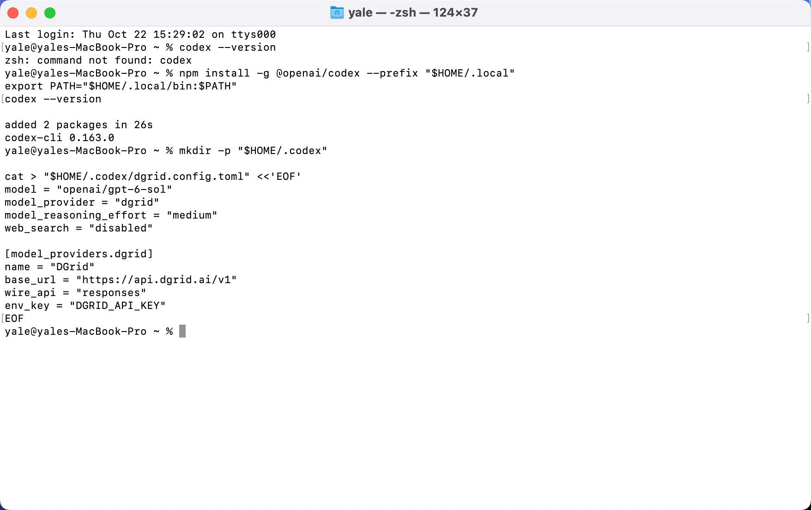
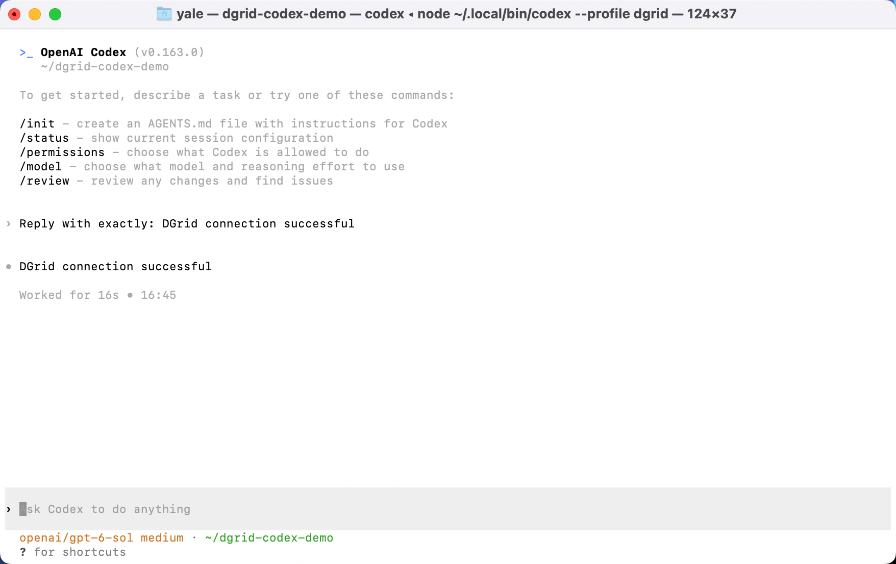
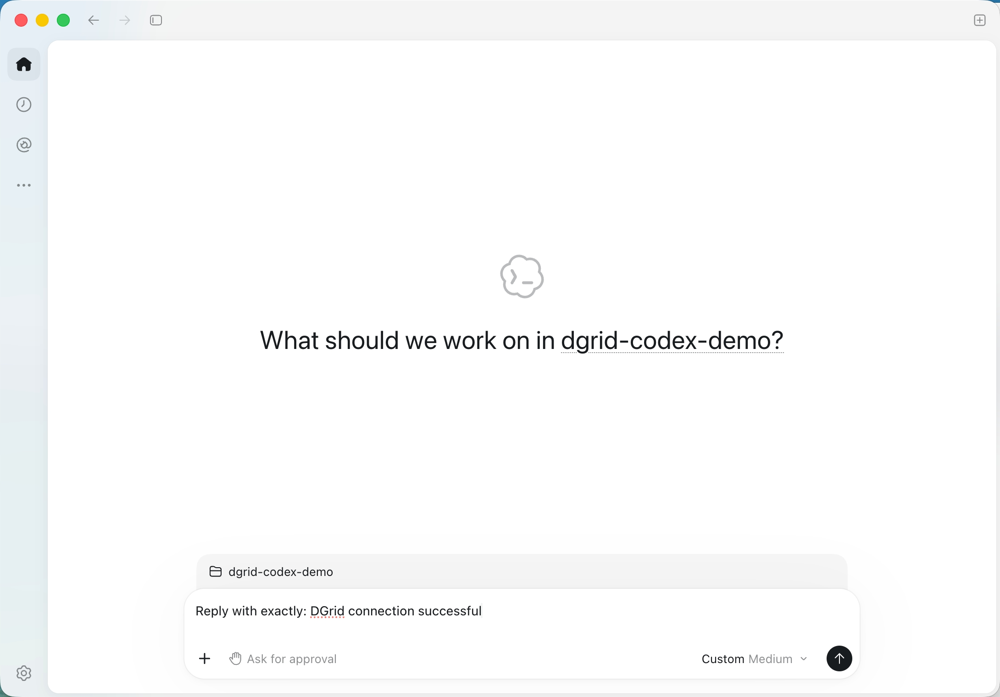
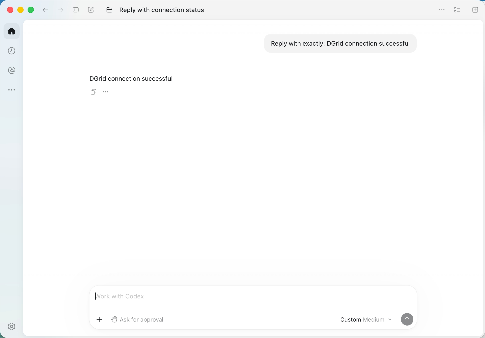
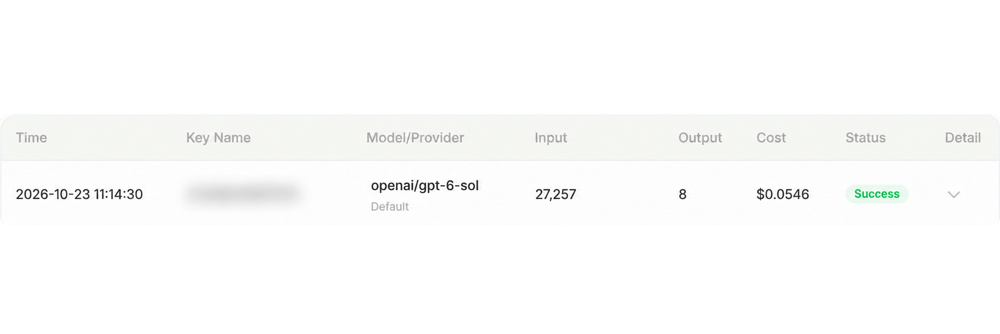

<Info>
使用 DGrid 的 Model API Key 呼叫模型；Management API Key 僅用於管理操作，無法用於本教學的模型請求。請確認金鑰具有可用餘額與目標模型的存取權限。
</Info>

透過 DGrid API Key、Responses API 地址和完整模型 ID，將 <strong>Codex 終端機版</strong>或<strong>桌面應用程式中的 Codex</strong> 串接 DGrid。

目前官方下載的新版 <strong>ChatGPT 桌面應用程式已包含 Codex</strong>；部分已有安裝仍使用 Codex 應用名稱。請從[官方下載頁](https://chatgpt.com/download/)取得用戶端。

本文使用 `openai/gpt-6-sol`。截圖及桌面端詳細操作以 macOS 為例，同時提供 Windows 安裝和 CLI 操作說明。

## 準備工作

- 一個 [DGrid 帳號](https://dgrid.ai/)，有可用餘額及支援 Responses API 的模型存取權限。
- 一枚 DGrid API Key：登入後開啟 [API Keys](https://dgrid.ai/api-keys)，建立或複製金鑰。
- 如果透過 npm 安裝終端機版，需要 Node.js 和 npm；桌面端可以獨立使用。

完整 Key 不應出現在截圖或分享的檔案中。模型 ID 需要保留 `openai/` 等供應商前綴。

<Note>
若 Codex 顯示模型中繼資料或目錄錯誤，請向 DGrid 確認適用於您 Codex 版本的模型目錄設定。自訂模型別名可能需要對應的目錄中繼資料；請勿自行猜測目錄網址。請參閱[官方閘道設定說明](https://learn.chatgpt.com/docs/enterprise/connect-to-a-gateway)。
</Note>

## 選擇設定方式

| 方式 | 設定檔 | 啟用方式 |
| --- | --- | --- |
| 終端機版 | `~/.codex/dgrid.config.toml` | 執行 `codex --profile dgrid`。 |
| macOS 桌面端 | `~/.codex/config.toml` | 應用啟動時讀取主設定。 |

終端機版的獨立設定用於指定該 profile 的 CLI 工作階段。修改桌面端主設定，會改變讀取該檔案的用戶端所使用的預設供應商。如果目前桌面環境承擔日常工作，可在另一台電腦完成桌面端設定。

兩種方式使用相同的串接參數：

| 設定 | 內容 |
| --- | --- |
| 模型 | `openai/gpt-6-sol` |
| Base URL | `https://api.dgrid.ai/v1` |
| 介面型別 | `responses` |
| 金鑰環境變數 | `DGRID_API_KEY` |

<Tabs>
<Tab title="CLI">

### 1. 安裝 Node.js 和 Codex CLI

如果尚未安裝 Node.js，從 [Node.js 官方下載頁](https://nodejs.org/en/download)安裝目前 LTS 版本。macOS 執行對應的安裝程式，Windows 執行 Windows 安裝程式；標準安裝套件包含 npm。

在 macOS 終端機或 Windows PowerShell 中檢查：

```shell
node -v
npm -v
```

然後按 [Codex 官方 npm 安裝方式](https://learn.chatgpt.com/docs/codex/cli)安裝。

<strong>macOS：</strong>安裝到使用者目錄。

```zsh
npm install -g @openai/codex --prefix "$HOME/.local"
export PATH="$HOME/.local/bin:$PATH"
codex --version
```

PATH 指令僅對目前終端機有效。新開終端機時可再次執行，或將該目錄加入 Shell 的 PATH 設定。

<strong>Windows PowerShell：</strong>

```powershell
npm install -g @openai/codex
codex --version
```

如果 PowerShell 阻止執行 `npm.ps1`，將指令中的 `npm` 換為 `npm.cmd`。

截圖中的 CLI 版本為 `0.163.0`。下文的獨立 profile 檔案格式適用於 Codex `0.134.0` 及以上版本，參見[官方 profile 說明](https://learn.chatgpt.com/docs/config-file/config-advanced#profiles)。

### 2. 建立 DGrid 獨立設定

macOS 建立 `~/.codex/dgrid.config.toml`；Windows 對應路徑為 `%USERPROFILE%\.codex\dgrid.config.toml`。將以下內容寫入檔案：

```toml
model = "openai/gpt-6-sol"
model_provider = "dgrid"
model_reasoning_effort = "medium"
web_search = "disabled"

[model_providers.dgrid]
name = "DGrid"
base_url = "https://api.dgrid.ai/v1"
wire_api = "responses"
env_key = "DGRID_API_KEY"
```

macOS 可透過以下指令建立並開啟檔案：

```zsh
mkdir -p "$HOME/.codex"
touch "$HOME/.codex/dgrid.config.toml"
open -t "$HOME/.codex/dgrid.config.toml"
```

如果 profile 已存在，修改對應設定。以純文字儲存，使用英文直引號。`env_key` 填的是變數名稱，保留為 `DGRID_API_KEY`。

<Frame caption="終端機中安裝 Codex CLI 並建立 DGrid 獨立設定">
  
</Frame>

### 3. 輸入 API Key

在接下來用於啟動 Codex 的同一個終端機中設定金鑰。

<strong>macOS 終端機，使用 Zsh：</strong>

```zsh
export DGRID_API_KEY
read -rs "DGRID_API_KEY?Paste your DGrid API key (hidden): "
```

出現提示後，貼上 Key 並按 Enter。輸入時不會顯示字元。等待終端機提示符重新出現，再執行下一條指令。

<strong>Windows PowerShell：</strong>先執行第一行，在隱藏輸入提示中輸入 Key；Enter後再執行其餘兩行。

```powershell
$dgridSecureKey = Read-Host "Paste your DGrid API key (hidden)" -AsSecureString
$env:DGRID_API_KEY = [System.Net.NetworkCredential]::new("", $dgridSecureKey).Password
Remove-Variable dgridSecureKey
```

這些指令設定的是目前終端機工作階段中的金鑰。新開終端機需要重新輸入。

### 4. 啟動 Codex 並傳送訊息

macOS 執行：

```zsh
mkdir -p "$HOME/dgrid-codex-demo"
cd "$HOME/dgrid-codex-demo"
codex --profile dgrid
```

Windows PowerShell 執行：

```powershell
New-Item -ItemType Directory -Force "$HOME/dgrid-codex-demo" | Out-Null
Set-Location "$HOME/dgrid-codex-demo"
codex --profile dgrid
```

如果提示是否信任目錄，可對剛建立的示範目錄選擇信任。確認目前模型為 `openai/gpt-6-sol`，也可以透過 `/status` 檢視工作階段設定。

傳送：

```text
Reply with exactly: DGrid connection successful
```

預期回覆：

```text
DGrid connection successful
```

<Frame caption="Codex CLI 使用 DGrid 模型並回傳訊息">
  
</Frame>

如果啟動時出現 `Running without the shared background server: --profile requires embedded mode.`，這是目前 profile 工作階段執行方式的提示。可按 F2 檢視、Esc 關閉並繼續；部分 Mac 鍵盤需要按 Fn + F2。

</Tab>
<Tab title="桌面版（macOS）">

### 1. 安裝桌面應用程式

開啟[官方下載頁](https://chatgpt.com/download/)，選擇對應作業系統。

- <strong>macOS：</strong>開啟下載的安裝套件，將應用拖入「應用程式」，然後開啟。
- <strong>Windows：</strong>執行下載的安裝程式，按照提示完成安裝。

選擇包含 Codex 的新版桌面應用程式。下文以 macOS 為例，應用路徑為 `/Applications/ChatGPT.app`。

透過 DGrid 憑證使用用戶端時，按下面步驟設定供應商和啟動環境。初始登入頁的 `OpenAI API key` 輸入框本身並不會設定 DGrid 閘道地址。

### 2. 在主設定中設定 DGrid

先按 <strong>Command + Q 完全結束桌面應用</strong>。僅關閉視窗時，應用可能仍在執行。

在 macOS 終端機執行：

```zsh
mkdir -p "$HOME/.codex"
touch "$HOME/.codex/config.toml"
open -t "$HOME/.codex/config.toml"
```

在 `config.toml` 中使用以下設定：

```toml
model = "openai/gpt-6-sol"
model_provider = "dgrid"
model_reasoning_effort = "medium"
web_search = "disabled"

[model_providers.dgrid]
name = "DGrid"
base_url = "https://api.dgrid.ai/v1"
wire_api = "responses"
env_key = "DGRID_API_KEY"
```

如果檔案已有設定，修改對應的頂層欄位，將這些欄位放在<strong>第一個表頭</strong>（`[section]`）之前。在末尾追加 DGrid 供應商區塊；如果區塊已存在，則修改已有內容。保留其他設定，避免重複定義欄位或區塊。以純文字儲存，使用英文直引號。

桌面端讀取這個主設定檔，單獨建立 CLI profile 檔案不會自動讓桌面端啟用 DGrid。Windows 主設定路徑為 `%USERPROFILE%\.codex\config.toml`。參見[官方閘道設定說明](https://learn.chatgpt.com/docs/enterprise/connect-to-a-gateway)。

### 3. 輸入金鑰並啟動應用

在 macOS 終端機的 Zsh 中執行：

```zsh
export DGRID_API_KEY
read -rs "DGRID_API_KEY?Paste your DGrid API key (hidden): "
```

貼上 DGrid Key 並按 Enter。終端機提示符重新出現後，在<strong>同一個終端機中單獨執行</strong>：

```zsh
open -a "/Applications/ChatGPT.app" --env "DGRID_API_KEY=$DGRID_API_KEY"
```

如果應用仍安裝為 `Codex.app`，將指令中的路徑換成它的實際路徑。

如果終端機提示應用已經執行、無法設定額外環境變數，先按 Command + Q 完全結束，再執行啟動指令。

金鑰會傳入這次啟動的應用程式。以後從新終端機啟動時，重新執行隱藏輸入和啟動指令。直接從 Dock 開啟應用，不會提供只在這個終端機設定的變數。

### 4. 選擇專案並傳送訊息

建立示範目錄：

```zsh
mkdir -p "$HOME/dgrid-codex-demo"
```

在桌面端：

1. 點選 <strong>Choose project</strong>，選擇主目錄下的 `dgrid-codex-demo`。
2. 輸入下面的提示詞。
3. 點選傳送箭頭。

```text
Reply with exactly: DGrid connection successful
```

<Frame caption="桌面端選中示範專案並準備傳送訊息">
  
</Frame>

預期回覆：

```text
DGrid connection successful
```

<Frame caption="Codex 桌面端回傳模型回覆">
  
</Frame>

部分版本可能顯示 <strong>Custom Medium</strong> 等標籤。可結合設定中的完整模型 ID，以及 DGrid 後台對應請求記錄，確認實際模型和請求路徑。

</Tab>
</Tabs>

## 在 DGrid 檢視呼叫記錄

開啟 DGrid 請求記錄，按請求時間及完整模型 ID 找到對應呼叫。完成的請求會顯示 <strong>Success</strong>。

<Frame caption="DGrid 請求記錄顯示 openai/gpt-6-sol 和 Success，Key Name 已模糊">
  
</Frame>

Key Name 已模糊處理。Token 數和費用會隨模型及 Codex 傳送的上下文變化。

## 常見問題

| 現象 | 排查方式 |
| --- | --- |
| `codex: command not found` | 確認安裝完成；macOS 可在目前終端機執行 `export PATH="$HOME/.local/bin:$PATH"`。 |
| 找不到 API Key | 在用於啟動用戶端的終端機輸入金鑰；`env_key` 只是變數名稱，不會設定金鑰值。 |
| 應用已經執行，無法設定環境變數 | 按 Command + Q 完全結束，再執行桌面端啟動指令。 |
| 從 Dock 開啟後回到登入頁或請求失敗 | 結束應用，在終端機設定 Key，再透過帶 `--env` 的指令啟動。 |
| 認證失敗或模型不可用 | 檢查 DGrid Key、餘額、Responses 支援情況及完整模型 ID。 |
| 供應商設定未生效 | 將供應商設定放在使用者層級的設定檔；專案級 `.codex/config.toml` 不能選擇自訂供應商。 |
| 恢復桌面端原供應商 | 恢復原模型、供應商和認證設定，再完全結束並重新開啟應用。 |

[Codex 官方設定參考](https://learn.chatgpt.com/docs/config-file/config-reference)列出了可用的供應商欄位。本文介紹串接和取得回覆；工具、網頁搜尋及較長的 Agent 任務的能力，取決於所選模型和閘道支援情況。

## 相關資源

- [整合教學總覽](/zh-Hant/ai-gateway/integrations)
- [AI Gateway 快速入門](/zh-Hant/ai-gateway/overview#快速入門)
- [Codex 部落格教學](https://blog.dgrid.ai/posts/2026-03-23/)
