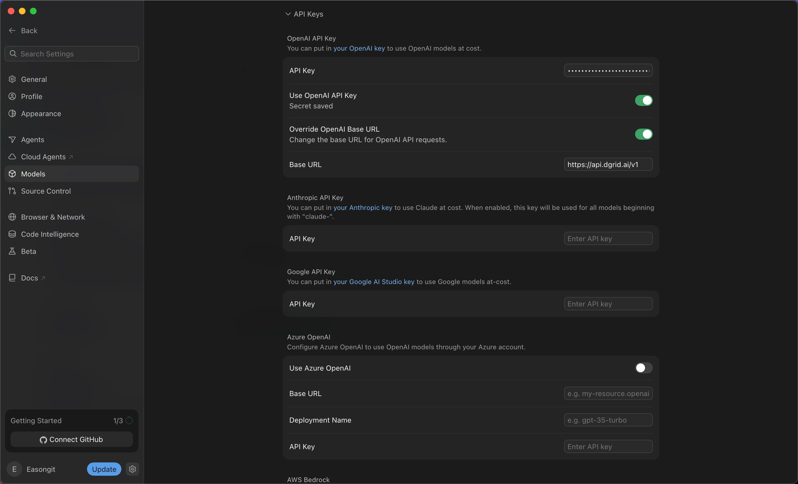
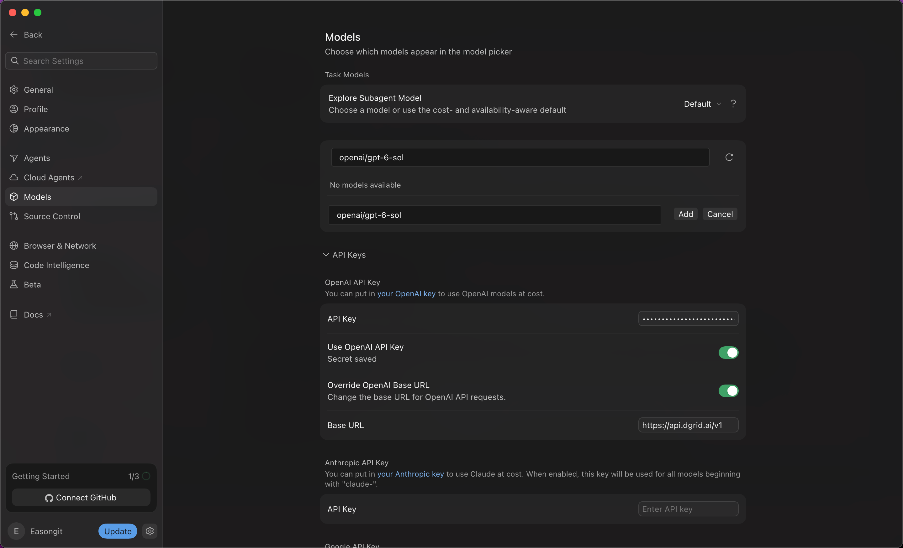
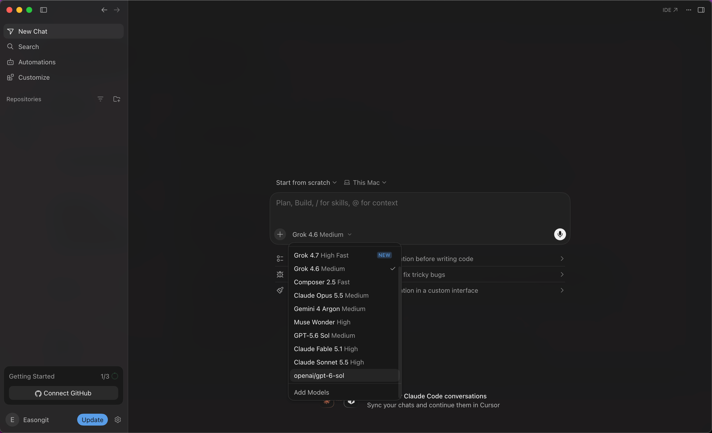
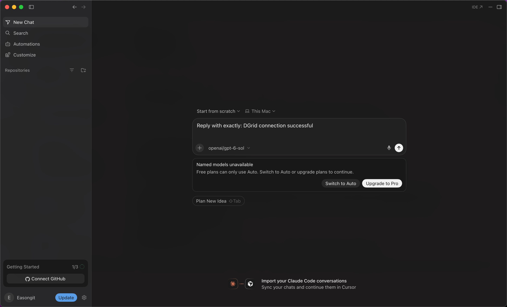

<Info>
使用 DGrid 的 Model API Key 呼叫模型；Management API Key 僅用於管理操作，無法用於本教學的模型請求。請確認金鑰具有可用餘額與目標模型的存取權限。
</Info>

在 Cursor 中填寫 DGrid API Key 和 OpenAI 相容介面地址，再使用完整的 DGrid 模型 ID 新增並選擇模型。本教學以 `openai/gpt-6-sol` 為例。

## 開始之前

- 一台可以連線上網的 macOS 或 Windows 電腦。
- 一個 Cursor 帳號。請確認目前方案支援自帶金鑰（BYOK）和所選自訂模型。本教學所示版本中的免費帳號可以儲存設定，但傳送所選模型的訊息時受到方案限制。
- 一個有可用餘額、且可以存取所選模型的 [DGrid 帳號](https://dgrid.ai/)。

Cursor 訂閱費與 DGrid 模型呼叫費分開計算。本教學截圖展示了免費方案限制；目前功能範圍以 Cursor 帳號及官方說明為準。相關背景見 [Cursor 支援說明](https://forum.cursor.com/t/youve-hit-your-usage-limit-still-after-setting-my-key/150496/3)。

下文安裝步驟同時介紹 macOS 和 Windows。後續設定操作和截圖以 macOS 版 Cursor `3.24.18` 為例，其他版本的選單名稱可能不同。

## 第 1 步 安裝並開啟 Cursor

開啟 [Cursor 官方下載頁面](https://cursor.com/download)，根據作業系統選擇桌面安裝套件。

### macOS

1. Apple Silicon 晶片選擇 <strong>Mac (ARM64)</strong>，Intel 晶片選擇 <strong>Mac (x64)</strong>，也可以選擇同時支援兩種晶片的 <strong>Mac Universal</strong>。
2. 開啟下載的 `.dmg`，將 <strong>Cursor</strong> 拖入 <strong>Applications（應用程式）</strong>。
3. 從應用程式中開啟 Cursor，完成首次設定並登入 Cursor 帳號。

### Windows

1. Intel 或 AMD 電腦選擇 <strong>Windows (x64) (User)</strong>，Windows on ARM 電腦選擇 <strong>Windows (ARM64) (User)</strong>。User 安裝套件將 Cursor 安裝到目前 Windows 使用者帳號下。
2. 執行下載的 `.exe`，按安裝精靈完成安裝。
3. 從開始選單或桌面快捷方式開啟 Cursor，完成首次設定並登入 Cursor 帳號。

接下來的設定步驟以 macOS 為例示範。

## 第 2 步 建立 DGrid API Key

1. 登入 [DGrid](https://dgrid.ai/)，開啟 [API Keys](https://dgrid.ai/api-keys) 頁面。
2. 點選 <strong>Create New Key</strong>，填寫名稱，例如 `Cursor`，然後建立金鑰。
3. 複製金鑰，供下一步使用。不要在截圖和共用檔案中展示完整金鑰。
4. 在 DGrid 模型列表中確認這枚金鑰可以使用目標模型，並複製完整模型 ID。下文範例為 `openai/gpt-6-sol`。

## 第 3 步 設定 API Key 和 Base URL

1. 點選 Cursor 左下角帳號名稱旁的<strong>齒輪圖示</strong>。
2. 在設定側欄選擇 <strong>Models</strong>。
3. 向下滾動，展開 <strong>API Keys</strong>。
4. 在 <strong>OpenAI API Key</strong> 區域，將您的 <strong>DGrid API Key</strong> 貼上到 <strong>API Key</strong> 輸入框。如果顯示 Save 按鈕，點選儲存。儲存後會顯示 <strong>Secret saved</strong>。
5. 開啟 <strong>Override OpenAI Base URL</strong>，填寫：

```text
https://api.dgrid.ai/v1
```

6. 開啟 <strong>Use OpenAI API Key</strong>。如果彈出 <strong>Enable OpenAI API Key</strong> 確認框，閱讀功能限制後，點選 <strong>Enable OpenAI API Key</strong> 繼續。

核對以下設定：

| 欄位 | 內容 |
| --- | --- |
| OpenAI API Key 區域中的 API Key | 您的 DGrid API Key |
| Use OpenAI API Key | 開啟 |
| Override OpenAI Base URL | 開啟 |
| Base URL | `https://api.dgrid.ai/v1` |

保留地址末尾的 `/v1`。截圖時保持金鑰隱藏。

<Frame caption="已儲存 DGrid 金鑰，並開啟 API Key 和 Base URL 兩個開關">
  
</Frame>

## 第 4 步 新增完整 DGrid 模型 ID

1. 在同一個 <strong>Models</strong> 設定頁面向上滾動，找到模型列表。
2. 在 <strong>Add or search model</strong> 中輸入：

```text
openai/gpt-6-sol
```

3. 如果搜尋結果顯示 <strong>No models available</strong>，點選 <strong>Add Custom Model</strong>。
4. 在新增的模型輸入框中填寫同一個完整 ID，點選 <strong>Add</strong>。

<Frame caption="將完整 DGrid 模型 ID 新增為自訂模型">
  
</Frame>

5. 確認列表中出現 <strong>openai/gpt-6-sol</strong>，且右側開關已開啟。

保留 `openai/` 前綴。如果使用其他模型，在設定和聊天中都使用該模型準確的 DGrid ID。

## 第 5 步 在新聊天中選擇模型

1. 點選左上角 <strong>Back</strong> 回傳聊天頁面；如有需要，新建聊天。
2. 點選訊息輸入框下方的模型名稱，展開模型列表。
3. 選擇剛新增的自訂 <strong><code>openai/gpt-6-sol</code></strong>。
4. 確認輸入區域顯示的目前模型為 <strong><code>openai/gpt-6-sol</code></strong>。

<Frame caption="在聊天模型列表中選擇自訂 DGrid 模型">
  
</Frame>

## 訂閱要求與第一則訊息

<Note>
下圖是方案限制範例，不是成功呼叫的驗證截圖。只有收到回覆，並在 DGrid 找到對應請求記錄後，才能確認本次請求經過 DGrid。
</Note>

如果 Cursor 提示 <strong>Named models unavailable — Free plans can only use Auto</strong>，表示目前帳號受到 Cursor 方案限制。要使用所選自訂模型，需要登入支援所選模型的帳號，或查看 Cursor 提供的訂閱選項。切換到 Auto 無法證明使用的是指定的 DGrid 模型。

<Frame caption="Cursor 免費方案攔截自訂模型訊息的提示">
  
</Frame>

具備符合要求的方案後，可以傳送一條簡短訊息，例如：

```text
Reply with exactly: DGrid connection successful
```

收到回覆後，可以在 DGrid 請求記錄中檢視對應模型、請求時間和 <strong>Success</strong> 狀態。

## 補充說明與故障排查

- <strong>功能範圍：</strong>自訂 API Key 適用於支援的聊天模型。Tab 補全仍使用 Cursor 內建模型。功能和計費詳情參閱 [Cursor API Key 官方檔案](https://cursor.com/help/models-and-usage/api-keys)。
- <strong>金鑰已儲存，但請求未使用它：</strong>確認 <strong>Use OpenAI API Key</strong> 和 <strong>Override OpenAI Base URL</strong> 都已開啟，且地址為 `https://api.dgrid.ai/v1`。
- <strong>模型列表沒有目標模型：</strong>確認已經新增完整自訂模型 ID，並開啟其開關，然後在新聊天中重新開啟模型選擇器。
- <strong>透過訂閱檢查後，請求仍然失敗：</strong>檢查 DGrid 金鑰、可用餘額、完整模型 ID 和模型存取權限。僅將模型新增到 Cursor 列表，並不代表請求一定能成功。
- <strong>切回其他供應商：</strong>使用其他 OpenAI 模型前，先檢查 Base URL 覆蓋設定，因為它會改變這些請求的傳送地址。

## 相關資源

- [整合教學總覽](/zh-Hant/ai-gateway/integrations)
- [AI Gateway 快速入門](/zh-Hant/ai-gateway/overview#快速入門)
- [Cursor 部落格教學](https://blog.dgrid.ai/posts/2026-02-18/)
