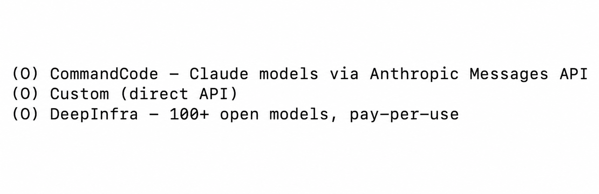
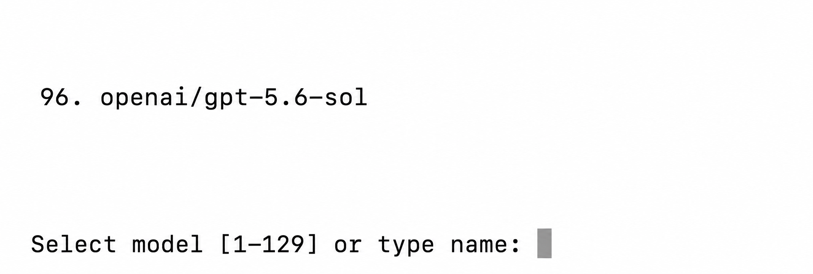
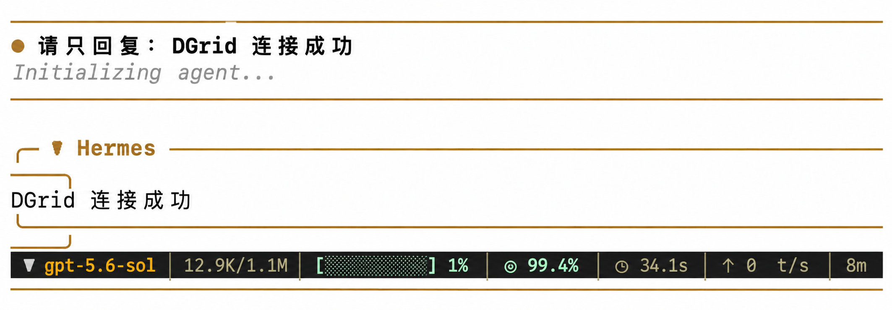
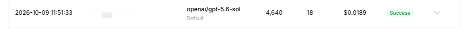

<Info>
使用 DGrid 的 Model API Key 呼叫模型；Management API Key 僅用於管理操作，無法用於本教學的模型請求。請確認金鑰具有可用餘額與目標模型的存取權限。
</Info>

在 Hermes Agent 中選擇自訂 API 供應商，填入 DGrid API Key 和介面地址，就可以使用 DGrid 上的模型。下面以 `openai/gpt-5.6-sol` 為例，按首次安裝時的介面順序完成設定。

## 準備工作

- 一個有可用額度的 [DGrid 帳號](https://dgrid.ai/)。
- 一台可使用終端機的電腦。下方分別提供 macOS、Linux、WSL2 和原生 Windows 的安裝指令。

## 第 1 步：建立 DGrid API Key

1. 登入 [DGrid 控制台](https://dgrid.ai/)，進入 <strong>Credits → Keys</strong>，或開啟 [API Keys 頁面](https://dgrid.ai/api-keys)。
2. 點選 <strong>Create New Key</strong>，填寫名稱，例如 `Hermes`，然後建立。
3. 複製 API Key。稍後在 Hermes 的 <strong>API key</strong> 輸入框中貼上；不要把它放進截圖或公開檔案。

## 第 2 步：安裝並開啟 Hermes 設定精靈

macOS、Linux 或 WSL2 在終端機執行：

```bash
curl -fsSL https://hermes-agent.nousresearch.com/install.sh | bash
```

原生 Windows 在 PowerShell 中執行：

```powershell
iex (irm https://hermes-agent.nousresearch.com/install.ps1)
```

看到 `prerequisites ok` 或 `Cloning ... hermes-agent.git` 時，安裝仍在進行，請等待設定精靈出現。

精靈詢問 <strong>How would you like to set up Hermes?</strong> 時，用方向鍵移動到 <strong>Full setup — configure every provider, tool & option yourself (bring your own keys)</strong>，按 Enter 或 Space 確認。

如果安裝完成後沒有自動出現設定精靈，在終端機執行 `hermes model`，從第 3 步繼續。

## 第 3 步：選擇自訂 API 供應商

在 <strong>Select provider</strong> 列表中找到 <strong>Custom (direct API)</strong> 並選擇。它位於列表靠近底部的位置。若您是透過 `hermes model` 進入此選單，選擇 <strong>Custom endpoint (enter URL manually)</strong>。

<Frame caption="Hermes 供應商列表中的 Custom direct API 選項">
  
</Frame>

## 第 4 步：填寫 DGrid 介面和模型

按精靈提示，依次填寫以下內容：

| 精靈提示 | 應填寫或選擇的內容 |
| --- | --- |
| <strong>API base URL</strong> | `https://api.dgrid.ai/v1` |
| <strong>API key</strong> | 第 1 步複製的 DGrid API Key |
| <strong>Select API compatibility mode</strong> | <strong>Chat Completions</strong>；目前介面中對應選項 `2` |
| <strong>Select model</strong> | 完整模型 ID `openai/gpt-5.6-sol` |
| <strong>Context length in tokens</strong> | 留空並提交，讓 Hermes 自動識別 |
| <strong>Display name</strong> | `DGrid` |

<strong>Base URL</strong> 填到 `/v1` 為止，不要追加 `/chat/completions`。<strong>API key</strong> 旁的 `[optional]` 是精靈的通用提示；本設定需要輸入 DGrid Key。

填入 Key 後，Hermes 會讀取這組 Key 可見的模型列表。在 <strong>Select model</strong> 頁面查詢 `openai/gpt-5.6-sol`：可以輸入它所在行的編號，也可以直接輸入完整 ID。截圖中的編號是 `96`，您的編號可能不同；以完整模型 ID 為準。如果列表沒有該模型，請選擇您的 DGrid Key 可用、且支援 Chat Completions 的其他模型。

<Frame caption="Hermes 模型列表中的範例模型及輸入提示">
  
</Frame>

填寫完顯示名稱後，看到模型和自訂供應商已儲存的提示，即完成設定。

## 第 5 步：啟動 Hermes 並使用 DGrid 模型

在終端機執行：

```bash
hermes
```

首次啟動若出現 <strong>Help improve Hermes?</strong>，按個人偏好選擇；選 <strong>No thanks</strong> 也可以繼續。進入聊天介面後，直接輸入問題並傳送。例如：

```text
請只回覆：DGrid 連線成功
```

收到 Hermes 的回覆後，就可以繼續正常聊天。若想核對請求是否經過 DGrid，可在 DGrid 控制台檢視相應時間的請求記錄，確認模型 ID 和 <strong>Success</strong> 狀態。下圖展示聊天回覆及對應請求記錄的樣例。

<Frame caption="Hermes 中使用 DGrid 模型聊天">
  
</Frame>

<Frame caption="DGrid 控制台中的模型請求記錄">
  
</Frame>

## 常見問題

- <strong>沒有自動進入精靈：</strong>在終端機執行 `hermes model`，選擇自訂介面並填寫第 4 步的內容。
- <strong>按 Enter 後只出現 <code>^M</code>：</strong>在目前輸入框按 <strong>Control+J</strong> 提交。
- <strong>想核對或修改目前模型：</strong>在終端機執行 `hermes status` 檢視目前 Model 和 Provider；需要重新選擇模型時執行 `hermes model`。
- <strong>聊天已回覆，但出現 <code>Auxiliary title generation failed: Request timed out</code>：</strong>這是自動生成工作階段標題時的提示，不影響已經收到的聊天回覆。

更多資訊見 [Hermes 官方安裝說明](https://hermes-agent.nousresearch.com/docs/getting-started/installation/)和[自訂供應商檔案](https://hermes-agent.nousresearch.com/docs/integrations/providers/)。

## 相關資源

- [整合教學總覽](/zh-Hant/ai-gateway/integrations)
- [AI Gateway 快速入門](/zh-Hant/ai-gateway/overview#快速入門)
