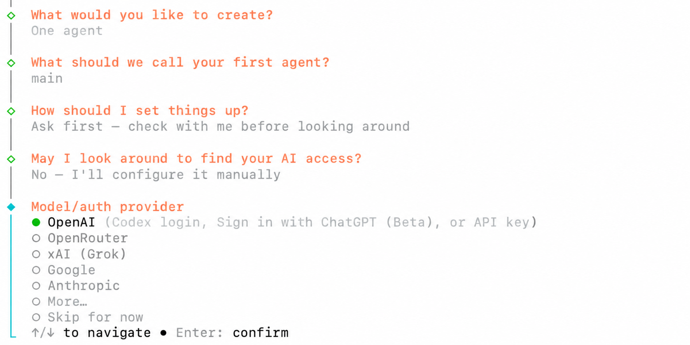
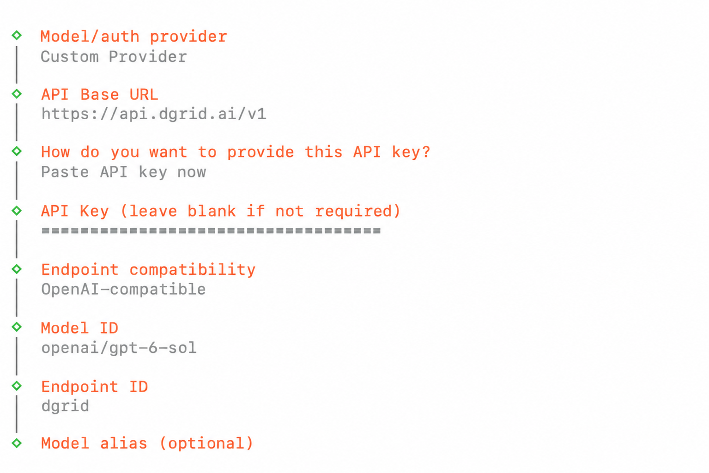
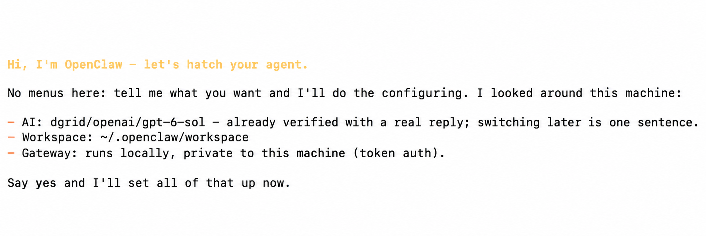
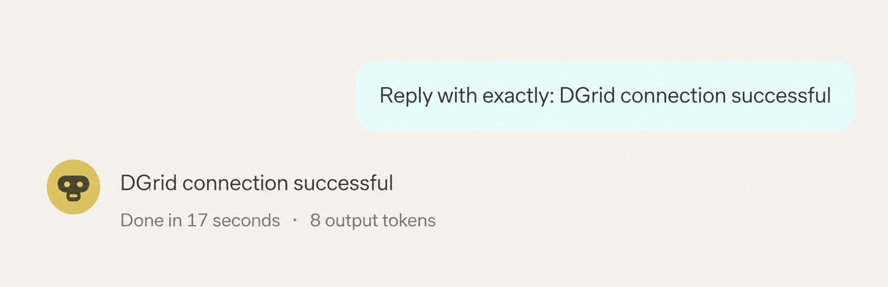
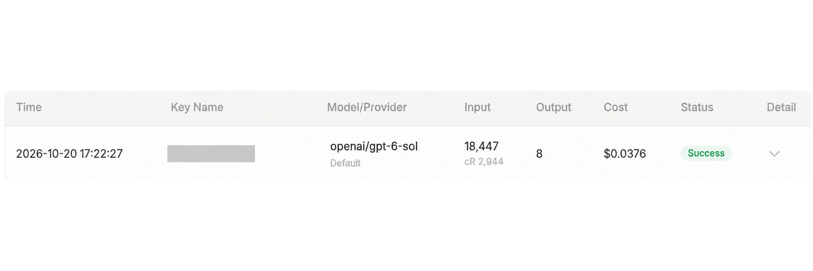

<Info>
使用 DGrid 的 Model API Key 呼叫模型；Management API Key 僅用於管理操作，無法用於本教學的模型請求。請確認金鑰具有可用餘額與目標模型的存取權限。
</Info>

<Note>
本教學中的 OpenClaw Gateway 是您電腦上的本地服務，負責連線 OpenClaw 控制台；DGrid AI Gateway 則是接收模型請求的遠端 API 服務。兩者使用的存取憑證不同。
</Note>

在 OpenClaw 中新增 Custom Provider，填寫 DGrid API Key、介面地址和模型 ID，即可使用 DGrid 提供的模型。本教學按 macOS 上的安裝和設定順序，介紹如何完成設定並在瀏覽器控制台傳送第一則訊息。範例模型為 `openai/gpt-6-sol`。

## 開始前準備

- 一台可以使用終端機並連線網際網路的 macOS 電腦。
- 一個有可用額度、且擁有目標模型存取權限的 [DGrid 帳號](https://dgrid.ai/)。

下方選單名稱和截圖對應 OpenClaw `2026.10.5`。模型可用性取決於您的 DGrid 帳號。您也可以使用其他可用且支援 Chat Completions 的模型，但需要填寫該模型完整的 DGrid 模型 ID。

## 第 1 步 建立 DGrid API Key

1. 登入 [DGrid](https://dgrid.ai/)，開啟 [API Keys 頁面](https://dgrid.ai/api-keys)。
2. 點選 <strong>Create New Key</strong>，填寫名稱，例如 `OpenClaw`，然後建立。
3. 複製 Key。第 4 步會在 OpenClaw 設定精靈中填寫它。截圖和公開檔案中不要包含完整 Key。

## 第 2 步 安裝 OpenClaw

開啟終端機，執行：

```bash
curl -fsSL https://openclaw.ai/install-cli.sh | bash
```

這個官方安裝器會把 OpenClaw 和支援的 Node.js 執行環境安裝到 `~/.openclaw` 下。等待它提示 OpenClaw 已安裝，並重新出現終端機指令提示字元。

然後單獨執行以下指令，開啟設定精靈：

```bash
"$HOME/.openclaw/bin/openclaw" onboard
```

本教學中的指令均使用完整路徑，方便您採用這種安裝方式後直接執行 OpenClaw。

## 第 3 步 選擇手動設定供應商

如果開始時出現 <strong>Quick start</strong> 和 <strong>Custom setup</strong> 選項，選擇 <strong>Custom setup</strong>。閱讀安全說明，接受後選擇 <strong>Yes</strong> 繼續。如果出現使用統計提示，按個人偏好選擇；選擇 <strong>No thanks</strong> 也可以繼續。

使用方向鍵和 Enter，依次完成以下選擇：

| 設定精靈提示 | 選擇或填寫的內容 |
| --- | --- |
| What would you like to create? | <strong>One agent</strong>，建立一個 Agent |
| What should we call your first agent? | 保留預設名稱 <strong>main</strong> |
| How should I set things up? | <strong>Ask first - check with me before looking around</strong>，查詢本機現有連線前先詢問 |
| May I look around to find your AI access? | <strong>No - I'll configure it manually</strong>，手動設定 |

進入 <strong>Model/auth provider</strong> 時，選擇 <strong>More...</strong>，開啟完整的供應商列表。

<Frame caption="選擇手動設定，然後在供應商選單中開啟 More">
  
</Frame>

在供應商搜尋框輸入 `custom`，選中 <strong>Custom Provider</strong>，按 Enter。

## 第 4 步 填寫 DGrid 連線資訊

按照下表順序填寫。每個文字輸入框填寫完成後按 Enter；選擇選單使用方向鍵和 Enter 確認。

| 設定精靈提示 | 選擇或填寫的內容 |
| --- | --- |
| API Base URL | `https://api.dgrid.ai/v1` |
| How do you want to provide this API key? | <strong>Paste API key now</strong> |
| API Key | 第 1 步複製的 DGrid API Key |
| Endpoint compatibility | <strong>OpenAI-compatible (Uses /chat/completions)</strong> |
| Model ID | `openai/gpt-6-sol` |
| Endpoint ID | 將自動生成的值替換為 `dgrid` |
| Model alias (optional) | 留空，直接按 Enter |

Base URL 填到 `/v1` 為止，不要追加 `/chat/completions`。API Key 輸入框中的“非必需時可留空”是精靈的通用提示；本設定需要填寫 DGrid Key。

Model ID 使用 `openai/gpt-6-sol`，包含 `openai/` 前綴。Endpoint ID `dgrid` 是 OpenClaw 中這個供應商的本地名稱，二者組成完整的 OpenClaw 模型引用 `dgrid/openai/gpt-6-sol`。

<Frame caption="填寫 DGrid 地址、已隱藏的 Key、模型 ID 和 Endpoint ID">
  
</Frame>

提交模型別名後，OpenClaw 會檢查模型連線，請等待它完成。如果提示連線失敗，核對介面地址、Key、可用額度和完整模型 ID，再重試。

## 第 5 步 完成設定並啟動 Gateway

設定助手會顯示所選模型、工作目錄和本地 Gateway 的摘要。出現 <strong>Say yes and I'll set all of that up now</strong> 時，在輸入框中輸入：

```text
yes
```

按 Enter，等待它應用設定。

<Frame caption="檢視設定摘要並輸入 yes 應用設定">
  
</Frame>

新開一個終端機視窗，安裝 Gateway 後台服務：

```bash
"$HOME/.openclaw/bin/openclaw" gateway install
```

檢查 Gateway 是否正在執行且可以連線：

```bash
"$HOME/.openclaw/bin/openclaw" gateway status
```

如果設定助手提示 <strong>Gateway is not reachable yet</strong>，請先完成以上 Gateway 操作，再開啟瀏覽器控制台。如果狀態仍顯示 <strong>Runtime: stopped</strong>，參照下方 Gateway 排錯說明處理。

開啟瀏覽器控制台：

```bash
"$HOME/.openclaw/bin/openclaw" dashboard
```

使用該指令開啟的連結連線本地 Gateway。

## 第 6 步 使用 DGrid 模型開始聊天

1. 在控制台開啟 <strong>Home</strong> 和 <strong>main</strong> 工作階段。
2. 確認訊息輸入框下方的模型選擇器顯示 <strong>openai/gpt-6-sol (Custom Provider)</strong>。如果您使用其他模型，請選擇相應模型。
3. 在 <strong>Message main</strong> 輸入框中輸入：

```text
Reply with exactly: DGrid connection successful
```

4. 點選向上箭頭形狀的 <strong>Send</strong> 按鈕，等待回覆。

<Frame caption="在 OpenClaw 中傳送訊息並收到回覆">
  
</Frame>

接下來即可繼續使用 DGrid 模型聊天。若要在 DGrid 中檢視這次請求，開啟請求記錄，找到對應時間和模型的記錄。成功完成的請求會顯示 <strong>Success</strong> 狀態。

<Frame caption="DGrid 中成功的模型請求記錄">
  
</Frame>

以後需要重新開啟瀏覽器控制台時，執行：

```bash
"$HOME/.openclaw/bin/openclaw" dashboard
```

## 常見問題

<strong>安裝器提示設定精靈需要互動式 TTY</strong>

安裝完成後，在終端機中直接執行設定精靈：

```bash
"$HOME/.openclaw/bin/openclaw" onboard
```

<strong>模型連線檢查失敗</strong>

核對 Base URL 是否為 `https://api.dgrid.ai/v1`、Key 是否有可用額度和模型存取權限、完整 DGrid 模型 ID 是否正確，以及這套 Chat Completions 設定的 Endpoint compatibility 是否選擇了 <strong>OpenAI-compatible</strong>。

<strong>升級後 Gateway 一直處於停止狀態</strong>

如果 Gateway 啟動日誌明確提示 <strong>Legacy device identity exists</strong>，先停止服務，再執行內建的遷移和修復指令：

```bash
"$HOME/.openclaw/bin/openclaw" gateway stop
"$HOME/.openclaw/bin/openclaw" doctor --fix
```

按提示完成修復。Doctor 可能會自動重啟並檢查 Gateway。再次執行 `"$HOME/.openclaw/bin/openclaw" gateway status`；如果修復後的服務仍處於停止狀態，執行：

```bash
"$HOME/.openclaw/bin/openclaw" gateway start
```

<strong>瀏覽器無法連線 Gateway</strong>

執行 `"$HOME/.openclaw/bin/openclaw" gateway status` 檢查服務，再使用第 5 步的指令重新開啟控制台。存取瀏覽器控制台使用的 Gateway Token 與 DGrid API Key 是不同的憑證。

更多說明見 [OpenClaw 安裝器檔案](https://docs.openclaw.ai/install/installer)、[設定精靈檔案](https://docs.openclaw.ai/start/wizard)和 [Gateway CLI 檔案](https://docs.openclaw.ai/cli/gateway)。

## 相關資源

- [整合教學總覽](/zh-Hant/ai-gateway/integrations)
- [AI Gateway 快速入門](/zh-Hant/ai-gateway/overview#快速入門)
- [OpenClaw Agent 設定教學](https://blog.dgrid.ai/posts/2026-02-02/)
- [OpenClaw 安裝與無程式碼設定](https://blog.dgrid.ai/posts/2026-02-27/)

先前的操作示範影片可供參考；介面可能與本教學版本不同。

<video controls preload="metadata" style={{ width: "100%", borderRadius: "12px", marginTop: "12px" }}>
  <source src="/images/dgrid-openclaw-demo.mp4" type="video/mp4" />
  您的瀏覽器不支援 video 標籤。
</video>
