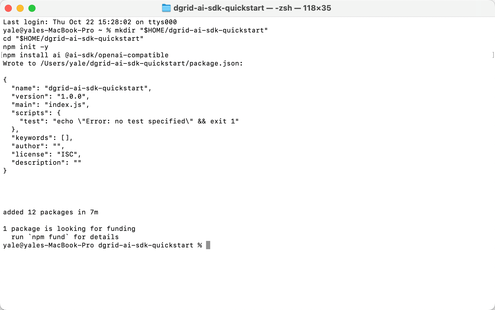
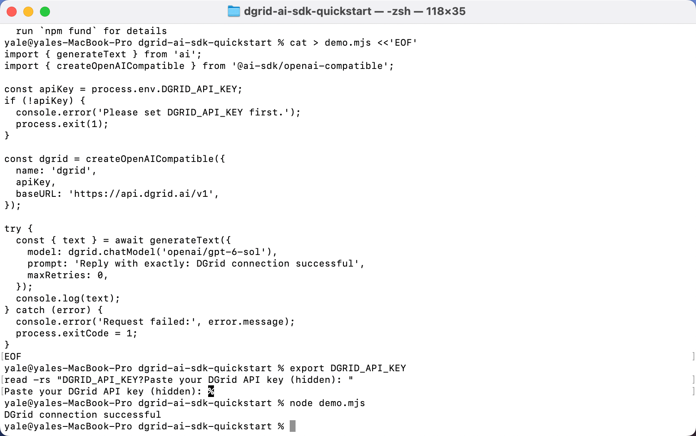

<Info>
使用 DGrid 的 Model API Key 呼叫模型；Management API Key 僅用於管理操作，無法用於本教學的模型請求。請確認金鑰具有可用餘額與目標模型的存取權限。
</Info>

Vercel 將 <strong>AI SDK Core 以 npm 套件 <code>ai</code> 的名稱發布</strong>。本教學會安裝這個套件，匯入它提供的 `generateText()` 函式，再透過 SDK 官方的 OpenAI 相容介接套件連線 DGrid。參閱 [Vercel AI SDK 官方介紹](https://ai-sdk.dev/docs/introduction)。

設定 DGrid API Key、OpenAI 相容介面地址和完整模型 ID 後，執行一個 Node.js 腳本，在終端機輸出透過 Vercel AI SDK 取得的模型回覆。

本教學使用 `openai/gpt-6-sol`。程式在本機執行，透過 AI SDK 的 OpenAI 相容介接套件向 DGrid 傳送模型請求。

## Vercel AI SDK 如何連線 DGrid

安裝指令和 JavaScript 程式碼中都會用到 SDK：

| 套件或函式 | 在本範例中的作用 |
| --- | --- |
| `ai` | Vercel AI SDK Core，透過 npm 安裝。 |
| 從 `ai` 匯入的 `generateText` | Vercel AI SDK 提供的文字生成函式，負責執行生成並回傳結果。 |
| `@ai-sdk/openai-compatible` | AI SDK 提供的介接套件，用於串接 OpenAI 相容服務。 |
| `createOpenAICompatible(...)` | 使用 DGrid 金鑰和 Base URL 建立 SDK 供應商實例。 |
| `dgrid.chatModel(...)` | 將 DGrid 模型交給 SDK 的 `generateText()` 呼叫。 |

請求流程如下：

<strong>您的腳本 → Vercel AI SDK 的 <code>generateText()</code> → OpenAI 相容介接套件 → DGrid → 模型回覆</strong>

Node.js 負責執行程式，Vercel AI SDK 提供呼叫模型的介面，DGrid 處理模型請求。[官方相容介接套件範例](https://ai-sdk.dev/providers/openai-compatible-providers#example)也採用 `generateText()` 與 `createOpenAICompatible()` 的組合。

## 開始之前

- 一台可以連線上網的 macOS 或 Windows 電腦。
- <strong>Node.js 22 或更高版本</strong>，以及 npm。
- 一個有可用餘額、且可以存取目標模型的 [DGrid 帳號](https://dgrid.ai/)。

範例環境使用 Node.js `22.14.0`、npm `10.9.2`、`ai` `7.0.148` 和 `@ai-sdk/openai-compatible` `3.0.75`。下文安裝指令選擇 AI SDK 7 和相容介接套件 3。截圖以 macOS 為例；涉及終端機指令差異時，會分別提供 Windows 說明。

## 第 1 步 安裝 Node.js 並檢查環境

如果尚未安裝 Node.js，請從 [Node.js 官方下載頁面](https://nodejs.org/en/download)下載目前 <strong>LTS</strong> 版本。

- <strong>macOS：</strong>選擇 macOS 安裝套件，執行下載的 `.pkg`，按提示完成安裝。
- <strong>Windows：</strong>根據電腦架構選擇 Windows 安裝套件，執行下載的 `.msi`，按提示完成安裝。

標準安裝套件包含 npm。安裝後，在 macOS 開啟新的<strong>終端機</strong>視窗，或在 Windows 開啟新的 <strong>PowerShell</strong> 視窗，執行：

```shell
node -v
npm -v
```

兩條指令都應顯示版本號。如果 Node.js 低於 22，請先更新再繼續。

## 第 2 步 建立 DGrid API Key

1. 登入 [DGrid](https://dgrid.ai/)，開啟 [API Keys](https://dgrid.ai/api-keys) 頁面。
2. 點選 <strong>Create New Key</strong>，填寫名稱並建立金鑰。
3. 複製金鑰，供第 5 步使用。不要在截圖和共用檔案中展示完整金鑰。
4. 在 DGrid 模型列表中確認這枚金鑰可以存取 `openai/gpt-6-sol`，或複製其他支援 Chat Completions 的模型的完整 ID。

請使用包含供應商前綴的完整模型 ID。本範例為 `openai/gpt-6-sol`。

## 第 3 步 建立專案並安裝 Vercel AI SDK

在 macOS 終端機或 Windows PowerShell 中執行：

```shell
mkdir "$HOME/dgrid-ai-sdk-quickstart"
cd "$HOME/dgrid-ai-sdk-quickstart"
npm init -y
npm install ai@7 @ai-sdk/openai-compatible@3
```

這條指令安裝的是 <strong>Vercel AI SDK Core</strong>（`ai@7`）及其 <strong>OpenAI 相容介接套件</strong>（`@ai-sdk/openai-compatible@3`）。下一步會從這兩個套件匯入程式碼，完成 DGrid 請求。

等待 npm 提示相依套件已新增，並重新顯示終端機指令提示字元。安裝時間取決於網路情況。

<Frame caption="在終端機中建立範例專案並完成 SDK 相依套件安裝">
  
</Frame>

## 第 4 步 使用 Vercel AI SDK 呼叫 DGrid

使用程式碼編輯器，在 `dgrid-ai-sdk-quickstart` 中建立 <strong><code>demo.mjs</code></strong>，與 `package.json` 放在同一層。貼上以下程式碼，儲存為純文字。確認檔名為 `demo.mjs`，沒有額外的 `.txt` 副檔名。

`.mjs` 副檔名讓 Node.js 可以使用範例中的 `import` 語法。

```javascript
// Vercel AI SDK Core: the text-generation API.
import { generateText } from 'ai';
// AI SDK provider: connects to OpenAI-compatible services such as DGrid.
import { createOpenAICompatible } from '@ai-sdk/openai-compatible';

const apiKey = process.env.DGRID_API_KEY;
if (!apiKey) {
  console.error('Please set DGRID_API_KEY first.');
  process.exit(1);
}

// Configure the AI SDK provider with the DGrid key and endpoint.
const dgrid = createOpenAICompatible({
  name: 'dgrid',
  apiKey,
  baseURL: 'https://api.dgrid.ai/v1',
});

try {
  // Run the DGrid model request through Vercel AI SDK Core.
  const { text } = await generateText({
    model: dgrid.chatModel('openai/gpt-6-sol'),
    prompt: 'Reply with exactly: DGrid connection successful',
    maxRetries: 0,
  });
  console.log(text);
} catch (error) {
  console.error('Request failed:', error.message);
  process.exitCode = 1;
}
```

主要連線設定如下：

| 程式碼 | 用途 |
| --- | --- |
| `process.env.DGRID_API_KEY` | 從終端機環境變數中讀取金鑰。 |
| `baseURL: 'https://api.dgrid.ai/v1'` | 將模型請求傳送到 DGrid，保留末尾的 `/v1`。 |
| `dgrid.chatModel('openai/gpt-6-sol')` | 透過 Chat Completions 介接套件選擇完整 DGrid 模型 ID。 |
| `generateText(...)` | Vercel AI SDK Core 透過已設定的介接套件傳送提示詞，並回傳生成的文字。 |

如果第 2 步選擇了其他模型，將 `openai/gpt-6-sol` 替換為對應的完整 ID。供應商設定中的 `name: 'dgrid'` 是 SDK 的本地標識。

## 第 5 步 輸入 DGrid API Key

根據所用終端機選擇下面一種方式。在之後執行腳本的同一個終端機中輸入金鑰。

### macOS 終端機：Zsh

執行：

```zsh
export DGRID_API_KEY
read -rs "DGRID_API_KEY?Paste your DGrid API key (hidden): "
```

出現 <strong>Paste your DGrid API key (hidden):</strong> 後，貼上 DGrid 金鑰並按 Enter。金鑰不會顯示在螢幕上。

### Windows PowerShell

先執行第一條指令，在隱藏輸入提示中填寫金鑰並按 Enter。然後執行後續指令，將其提供給 Node.js：

```powershell
$dgridSecureKey = Read-Host "Paste your DGrid API key (hidden)" -AsSecureString
$env:DGRID_API_KEY = [System.Net.NetworkCredential]::new("", $dgridSecureKey).Password
Remove-Variable dgridSecureKey
```

以上設定對目前終端機工作階段生效。開啟新終端機後，需要重新設定金鑰。不要將金鑰寫入 `demo.mjs` 或提交到版本控制。

## 第 6 步 執行範例

在專案目錄中，使用剛才輸入金鑰的同一個終端機執行：

```shell
node demo.mjs
```

等待模型回覆。使用範例提示詞時，預期輸出為：

```text
DGrid connection successful
```

<Frame caption="執行腳本並收到透過 DGrid 回傳的模型回覆">
  
</Frame>

如果要提出其他問題，修改 `demo.mjs` 中的 `prompt` 字串，儲存後再次執行 `node demo.mjs`。每次執行會發起一筆新的請求。

## 第 7 步 在 DGrid 檢視呼叫記錄

開啟 DGrid 請求記錄，根據模型和請求時間找到對應呼叫。完成的請求會顯示 <strong>Success</strong> 狀態。

<Frame caption="DGrid 請求記錄中的模型與 Success 狀態，Key Name 已模糊">
  
</Frame>

截圖中的 Key Name 已模糊處理。Token 數量、快取用量和費用隨請求變化。

## 故障排查

| 提示或現象 | 檢查方法 |
| --- | --- |
| `Please set DGRID_API_KEY first.` | 在目前終端機重新完成第 5 步，再執行腳本。 |
| `Cannot find module` 或 `ERR_MODULE_NOT_FOUND` | 確認目前目錄為 `dgrid-ai-sdk-quickstart`，且已在此目錄完成相依套件安裝。 |
| 終端機找不到 `demo.mjs` | 檢查目前目錄和檔名，注意是否多了 `.txt` 副檔名。 |
| 認證錯誤 | 重新輸入 DGrid 金鑰，並確認其有效。 |
| 模型或存取錯誤 | 核對完整模型 ID、存取權限和 DGrid 可用餘額。 |
| 網路錯誤 | 檢查電腦是否可以連線 DGrid API，然後重試。 |
| PowerShell 阻止執行 `npm.ps1` | 在初始化和安裝指令中，將 `npm` 替換為 `npm.cmd`。 |

更多內容參閱 [AI SDK Node.js 指南](https://ai-sdk.dev/docs/getting-started/nodejs)與 [OpenAI 相容介接套件檔案](https://ai-sdk.dev/providers/openai-compatible-providers)。

## 相關資源

- [整合教學總覽](/zh-Hant/ai-gateway/integrations)
- [AI Gateway 快速入門](/zh-Hant/ai-gateway/overview#快速入門)
- [Vercel AI SDK 部落格教學](https://blog.dgrid.ai/posts/2026-03-26/)
